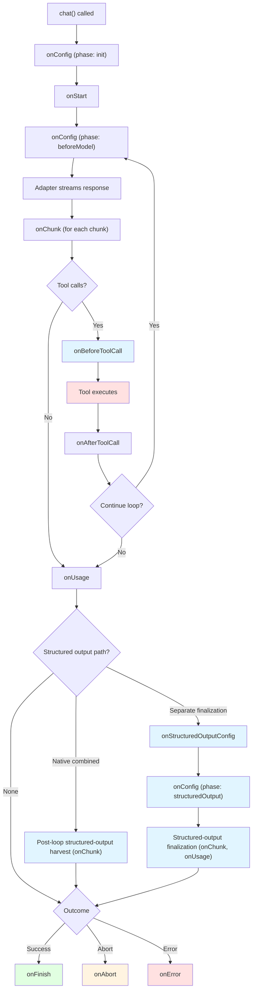

This page covers each middleware hook in detail. Set up your first middleware with [Middleware](./middleware).

## Lifecycle

Each `chat()` call goes through the same steps. The hooks fire at these steps:



### Phase transitions

The `phase` field of the context tells you where the run is:

| Phase | When | Hooks called |
| --- | --- | --- |
| `init` | Once at startup | `onConfig` |
| `beforeModel` | Before each model call (one time per iteration) | `onConfig` |
| `modelStream` | While the adapter streams chunks | `onChunk`, `onUsage` |
| `beforeTools` | Before the tools run | `onBeforeToolCall` |
| `afterTools` | After the tools run | `onAfterToolCall` |
| `structuredOutput` | During the separate structured-output call (see below) | `onStructuredOutputConfig`, `onConfig`, `onChunk`, `onUsage` |

### The two structured-output paths

When you call `chat()` with `outputSchema`, the adapter takes one of two paths.

- **Separate finalization.** `supportsCombinedToolsAndSchema()` does not return `true` for the current model and options. After the agent loop, the engine makes one more call to the adapter. The chunks from `adapter.structuredOutputStream` (or the non-streaming fallback) go through `onChunk` with the `structuredOutput` phase. `onUsage` fires for the tokens of that call.
- **Native combined.** The adapter sends tools and the schema in one streaming call. The `structuredOutput` phase does not fire. Middleware sees the run through `beforeModel` and `modelStream` as usual. These adapters do this (see issue #605):
  - Modern OpenAI Chat Completions and OpenAI Responses.
  - Claude 4.5+, Gemini 3.x, and the Grok 4.x family.
  - OpenRouter, when every routed model is in `OPENROUTER_COMBINED_TOOLS_AND_SCHEMA_MODELS`.

## Hooks reference

### onConfig

`onConfig` runs once in the `init` phase, and once per iteration in the `beforeModel` phase. Use it to change the config that the model gets.

On the separate-finalization path, `onConfig` runs one more time at the structured-output step, with `ctx.phase === 'structuredOutput'`. It gets the config after `onStructuredOutputConfig`. So a separate-finalization run with one iteration calls `onConfig` three times (`init`, `beforeModel`, `structuredOutput`). Native-combined output does not add this third call.

Return a **partial** config with only the fields you want to change. The engine merges it into the current config (a shallow merge). You do not have to spread the existing config.

```typescript
import { type ChatMiddleware } from "@tanstack/ai";

const dynamicTemperature: ChatMiddleware = {
  name: "dynamic-temperature",
  onConfig: (ctx, config) => {
    if (ctx.phase === "init") {
      // Add a system prompt at startup. Only systemPrompts changes.
      return {
        systemPrompts: [
          ...config.systemPrompts,
          "You are a helpful assistant.",
        ],
      };
    }

    if (ctx.phase === "beforeModel" && ctx.iteration > 0) {
      // Increase the temperature on later calls. Sampling params live in
      // the provider-native modelOptions object. `temperature` has the same
      // key on all providers. Spread modelOptions to keep the other options.
      const current =
        typeof config.modelOptions?.temperature === "number"
          ? config.modelOptions.temperature
          : 0.7;
      return {
        modelOptions: {
          ...config.modelOptions,
          temperature: Math.min(current + 0.1, 1.0),
        },
      };
    }
  },
};
```

> [!NOTE]
> Sampling parameters (`temperature`, `top_p` / `topP`, the `max*Tokens` keys) live in `modelOptions`, under the native name of each provider. `temperature` has the same name on all providers. A token limit does not. For example, OpenAI uses `max_output_tokens`, and Ollama uses `num_predict` inside `modelOptions.options`.

Config fields you can change:

| Field | Type | Description |
| --- | --- | --- |
| `messages` | `ModelMessage[]` | The canonical conversation history. Persistence and `ctx.messages` use this field. |
| `providerMessages` | `ModelMessage[]` | Temporary context sent to the provider. Defaults to `messages`. |
| `systemPrompts` | `SystemPrompt[]` | System prompts |
| `tools` | `Tool[]` | The tools the model can call |
| `metadata` | `Record<string, unknown>` | Request metadata |
| `modelOptions` | `Record<string, unknown>` | Provider-native options, including the sampling params |
| `reasoning` | `ReasoningRequest \| undefined` | How hard the model thinks at this call |
| `toolChoice` | `ToolChoice \| undefined` | How the model uses the tools at the next model call. See [Change the tool choice of a call](./middleware#change-the-tool-choice-of-a-call). |
| `wrapFetch` | `FetchWrapper \| undefined` | Wraps the HTTP fetch of the next model call. See [Change the HTTP requests of a call](./middleware#change-the-http-requests-of-a-call). |
| `promptCache` | `ResolvedPromptCache \| undefined` | The prompt cache of the next model call: its `retention` and `key`. See [Change the prompt cache of a call](./middleware#change-the-prompt-cache-of-a-call). |

When more than one middleware has `onConfig`, the config is **piped** through them in order. Each one gets the merged config from the one before it.

If a change must affect only the model call, return `providerMessages`. Returning `messages` also changes the provider input, unless the same result sets `providerMessages`.

### onStructuredOutputConfig

This hook runs once, at the start of the separate structured-output call. It runs only when `chat()` has `outputSchema` **and** `supportsCombinedToolsAndSchema()` does not return `true` for the current model and options.

It pipes through the middleware in order, like `onConfig`. It also gets the **JSON Schema** that goes to the provider. Use it to:

- Change the schema. For example, add `$defs`, or remove keywords that a provider does not accept.
- Change only the final call. For example, remove the system prompts from it.

> [!NOTE]
> Native-combined adapters (modern OpenAI, Claude 4.5+, Gemini 3.x, Grok 4.x, see issue #605) make no separate call, so this hook never runs. The engine sends the converted schema to `chatStream` after `onConfig`. Middleware cannot change the schema on that path.

Return a **partial** `StructuredOutputMiddlewareConfig` with the fields you want to change. The engine merges it (a shallow merge). Return nothing to pass the config through.

```typescript
import { type ChatMiddleware } from "@tanstack/ai";
import { sharedDefs } from "./defs";

const injectDefs: ChatMiddleware = {
  name: "inject-defs",
  onStructuredOutputConfig: (_ctx, config) => {
    // `config.outputSchema` is the JSON Schema that goes to the provider
    return {
      outputSchema: {
        ...config.outputSchema,
        $defs: { ...sharedDefs },
      },
    };
  },
};
```

Config fields you can change:

| Field | Type | Description |
| --- | --- | --- |
| `messages` | `ModelMessage[]` | The canonical conversation history |
| `providerMessages` | `ModelMessage[]` | Temporary context sent to the final call |
| `systemPrompts` | `SystemPrompt[]` | System prompts on the final call |
| `metadata` | `Record<string, unknown>` | Request metadata |
| `modelOptions` | `Record<string, unknown>` | Provider-native options, including the sampling params |
| `outputSchema` | `JSONSchema` | The JSON Schema that goes to the provider |

The order at the structured-output step:

1. `onStructuredOutputConfig` runs first, through each middleware in array order.
2. `onConfig` runs again with `ctx.phase === 'structuredOutput'`. It gets the config after step 1, without `outputSchema`.

Use `onConfig` for changes that apply to every adapter call. If you need the schema, use `onStructuredOutputConfig`.

### onStart

`onStart` runs once, after the first `onConfig`. Use it to start timers or write a log line.

```typescript
import { type ChatMiddleware } from "@tanstack/ai";

const timer: ChatMiddleware = {
  name: "timer",
  onStart: (ctx) => {
    console.log(`Request ${ctx.requestId} started at iteration ${ctx.iteration}`);
  },
};
```

### onIteration

`onIteration` runs at the start of each agent-loop iteration, after the engine creates the new assistant message ID. It gets `{ iteration, messageId }`. Use it to see the iteration boundaries. It does not run for the separate structured-output call.

### onChunk

`onChunk` runs for each chunk from the adapter. It can read, change, split, or drop the chunk.

```typescript ignore
import { type ChatMiddleware } from "@tanstack/ai";

const redactor: ChatMiddleware = {
  name: "redactor",
  onChunk: (ctx, chunk) => {
    if (chunk.type === "TEXT_MESSAGE_CONTENT") {
      // Redact numbers that look like an SSN
      return {
        ...chunk,
        delta: chunk.delta.replace(/\b\d{3}-\d{2}-\d{4}\b/g, "[REDACTED]"),
      };
    }
    // Return nothing to pass the chunk through
  },
};
```

Return values:

| Return | Effect |
| --- | --- |
| `void` / `undefined` | The chunk passes through unchanged |
| `StreamChunk` | Replaces the chunk |
| `StreamChunk[]` | Splits it into more chunks |
| `null` | Drops the chunk |

When more than one middleware has `onChunk`, chunks flow through them in order. If one middleware drops a chunk, the middleware after it never see it.

#### Chunk types you see

`onChunk` gets every [AG-UI event](https://docs.ag-ui.com/introduction) of the run, not only text. Narrow on `chunk.type` (a discriminated union) before you read the fields of a type. The common types:

| `chunk.type` | Meaning | Key fields |
| --- | --- | --- |
| `RUN_STARTED` / `RUN_FINISHED` / `RUN_ERROR` | Start and end of the run | `runId`, `finishReason`, `usage` (on finish), `message` (on error) |
| `TEXT_MESSAGE_START` / `TEXT_MESSAGE_CONTENT` / `TEXT_MESSAGE_END` | Assistant text | `messageId`, `delta` (content) |
| `TOOL_CALL_START` / `TOOL_CALL_ARGS` / `TOOL_CALL_END` | Tool calls | `toolCallId`, `toolCallName`, `delta` (args), result on end |
| `REASONING_START` / `REASONING_MESSAGE_CONTENT` / `REASONING_END` | Thinking or reasoning | `messageId`, `delta`. The signature comes on `REASONING_ENCRYPTED_VALUE` |
| `STATE_SNAPSHOT` / `STATE_DELTA` | Agent state sync | `snapshot`, `delta` |
| `CUSTOM` | Extension events, including structured output (see below) | `name`, `value` |

For the full list of events and their fields, see the [AG-UI protocol docs](https://docs.ag-ui.com/introduction).

#### Change structured-output chunks

Structured-output chunks go through the same `onChunk` hook as all other chunks. There is no separate chunk hook. When `chat()` has `outputSchema`, these chunks flow through `onChunk`:

- The JSON `TEXT_MESSAGE_CONTENT` deltas.
- The `structured-output.start` and `structured-output.complete` CUSTOM events.
- Any `RUN_ERROR` from the final step.

How you find them depends on the path of the adapter:

- **Separate finalization:** `ctx.phase === 'structuredOutput'` during the final call. Check the phase.
- **Native combined:** the model writes the JSON on its natural last turn, so **`ctx.phase` stays `'modelStream'`**. The `'structuredOutput'` phase never fires. Check the CUSTOM event name (`structured-output.start` / `structured-output.complete`).

```typescript ignore
import { type ChatMiddleware } from "@tanstack/ai";

const redactStructuredOutput: ChatMiddleware = {
  name: "redact-structured-output",
  onChunk: (ctx, chunk) => {
    // Separate-finalization path: the JSON streams as TEXT_MESSAGE_CONTENT
    // in the 'structuredOutput' phase. Change the delta like any other text
    // chunk. Here, redact numbers that look like an SSN.
    if (
      ctx.phase === "structuredOutput" &&
      chunk.type === "TEXT_MESSAGE_CONTENT"
    ) {
      return {
        ...chunk,
        delta: chunk.delta.replace(/\b\d{3}-\d{2}-\d{4}\b/g, "[REDACTED]"),
      };
    }

    // Both paths: the complete typed payload comes as a CUSTOM
    // `structured-output.complete` event. On the native-combined path this
    // is the only signal (ctx.phase never becomes 'structuredOutput'), so
    // check the event name, not the phase. `chunk.value` has { object, raw }.
    if (chunk.type === "CUSTOM" && chunk.name === "structured-output.complete") {
      console.log("final structured output:", chunk.value);
    }

    // Return nothing to pass all other chunks through.
  },
};
```

The config hooks are different because the config at the structured-output step has an `outputSchema` field that `ChatMiddlewareConfig` does not have (see [onStructuredOutputConfig](#onstructuredoutputconfig)). Chunks are always `StreamChunk`, in every phase. So one `onChunk` plus `ctx.phase` (or the CUSTOM event name) covers all cases.

### onShouldContinue

`onShouldContinue` runs when the engine decides if it starts another agent-loop iteration (after a tool phase, or between model turns). It gets the same `AgentLoopState` as the loop strategies (`iterationCount`, `toolCallCount`, `lastTurnToolCallCount`, and more).

- Return `false` to stop the loop.
- Return `true`, `void`, or `undefined` to let it continue.
- The results combine with AND, across all middleware and with `agentLoopStrategy`. One `false` stops the loop.

This hook does **not** abort the run. The stream finishes normally with the current messages. Use `ctx.abort()` only for a hard stop.

```typescript
import { type ChatMiddleware } from "@tanstack/ai";

const budget: ChatMiddleware = {
  name: "tool-budget",
  onShouldContinue: (_ctx, state) => {
    // Stop more turns after the model makes 20 tool calls
    if (state.toolCallCount >= 20) return false;
  },
};
```

For a full budget per turn and per run, see [Tool-call budgets](../chat/agentic-cycle#tool-call-budgets-middleware-recipe).

### onModelError

Some model calls fail for a reason that your middleware can fix. For example, the prompt is too long for the model. `onModelError` gets the `RUN_ERROR` before anyone else sees it. Fix the request and call `ctx.retry()`. While the call has retries left, the run goes on as if the call never failed.

Say your app sends retrieved documents as a second system prompt. When the call is too long, this middleware drops them and tries again:

```typescript
import { CONTEXT_OVERFLOW_CODE } from "@tanstack/ai";
import type { ChatMiddleware, ChatMiddlewareContext } from "@tanstack/ai";

// The runs that go on without the documents.
const withoutDocs = new WeakSet<ChatMiddlewareContext>();

const dropDocsWhenTooLong: ChatMiddleware = {
  name: "drop-docs-when-too-long",
  onModelError: (ctx, error) => {
    if (error.code !== CONTEXT_OVERFLOW_CODE) return;
    withoutDocs.add(ctx);
    ctx.retry();
  },
  onConfig: (ctx, config) => {
    if (ctx.phase !== "beforeModel" || !withoutDocs.has(ctx)) return;
    // Keep the main system prompt. Drop the documents after it.
    return { systemPrompts: config.systemPrompts.slice(0, 1) };
  },
};
```

What `ctx.retry()` does while the call has retries left:

- It drops the failed call. `onChunk` and the caller never see its `RUN_STARTED` or `RUN_ERROR`.
- It runs `onConfig` again (phase `beforeModel`), then calls the model again.
- It works only inside `onModelError`. In any other hook it throws.

When the hook runs:

- Only when the adapter sends a `RUN_ERROR` before any output. A call that already sent text is not retried, so no output repeats.
- Not for an exception that the adapter throws. That error goes to `onError`.
- Not for the separate structured-output call after the agent loop. The model calls of the agent loop get the hook as usual.
- Every time, also after the last retry. A model call retries at most 2 times. After that, the error goes to the caller.

`withCompaction` uses this hook to [compact and retry after a context overflow](./compaction#when-the-chat-is-still-too-long).

### onInterruptBoundary and onInterruptResolution

Use these hooks when middleware needs data from the client. Define the request with `defineInterrupt()`. Register it with `chat({ interrupts })` and `useChat({ interrupts })`. Do not send raw AG-UI events from middleware.

`onInterruptBoundary` runs at four points in an agent iteration:

- `beforeModel`, before the adapter starts.
- `afterModel`, after the model response is complete.
- `beforeTools`, before the tools start.
- `afterTools`, after the tool phase is complete.

Each middleware can return requests from one boundary. The engine puts all requests from that boundary into one AG-UI interrupt batch. The batch ends the run with one interrupt outcome.

This hook cannot change the config. It can return only `{ interrupts }` or nothing. The continuation is a new `chat()` call, so the hook runs again. If `ctx.parentRunId` is set and the pause belongs to the first request only, return nothing.

For what `ctx` has at each phase, and when to use each phase, see [Lifecycle Boundaries](../interrupts/boundaries).

Create one shared definition. The server and the client both import this value, so the definition ID and the response shape are the same on both sides.

```typescript title="review-plan.ts"
import { defineInterrupt, type ChatMiddleware } from '@tanstack/ai'
import { z } from 'zod'

export const reviewPlan = defineInterrupt({
  id: 'review-plan',
  payloadSchema: z.object({ title: z.string() }),
  responseSchema: z.object({ approved: z.boolean() }),
})

export const reviewMiddleware: ChatMiddleware<unknown, typeof reviewPlan> = {
  name: 'review-plan',
  onInterruptBoundary(ctx) {
    if (ctx.phase !== 'beforeTools') return
    if (ctx.parentRunId) return
    return {
      interrupts: [
        reviewPlan.interrupt({
          key: 'release-plan',
          reason: 'review-required',
          message: 'Approve this plan?',
          payload: { title: 'Release plan' },
        }),
      ],
    }
  },
  onInterruptResolution(_ctx, resumedInterrupts) {
    for (const result of resumedInterrupts.for(reviewPlan)) {
      if (result.status === 'resolved' && !result.response.approved) {
        return { toolResume: 'stop' }
      }
    }
  },
}
```

Register the definition on the server. Forward `parentRunId` and `resume`, so that a client answer starts the continuation with its full context.

```typescript title="route.ts"
import {
  chat,
  chatParamsFromRequestBody,
  toServerSentEventsResponse,
} from '@tanstack/ai'
import { openaiText } from '@tanstack/ai-openai'
import { reviewMiddleware, reviewPlan } from './review-plan'

export async function POST(request: Request) {
  const params = await chatParamsFromRequestBody(await request.json())
  const stream = chat({
    adapter: openaiText('gpt-6.1-sol'),
    messages: params.messages,
    threadId: params.threadId,
    runId: params.runId,
    ...(params.parentRunId ? { parentRunId: params.parentRunId } : {}),
    ...(params.resume ? { resume: params.resume } : {}),
    interrupts: [reviewPlan],
    middleware: [reviewMiddleware],
  })

  return toServerSentEventsResponse(stream)
}
```

Register the same definition on the client. Check `kind` and `definitionId`. TypeScript then treats the item as `GenericInterrupt<typeof reviewPlan>`. `resolveInterrupt` uses the response shape from `reviewPlan.responseSchema`.

```tsx title="review-plan-panel.tsx"
import { fetchServerSentEvents, useChat } from '@tanstack/ai-react'
import type { GenericInterrupt } from '@tanstack/ai-react'
import { reviewPlan } from './review-plan'

function ReviewCard({
  interrupt,
}: {
  interrupt: GenericInterrupt<typeof reviewPlan>
}) {
  return (
    <button
      onClick={() => interrupt.resolveInterrupt({ approved: true })}
    >
      Approve plan
    </button>
  )
}

export function ReviewPlanPanel() {
  const { interrupts, sendMessage } = useChat({
    connection: fetchServerSentEvents('/api/chat'),
    threadId: 'support-chat',
    interrupts: [reviewPlan],
  })

  return (
    <>
      <button onClick={() => sendMessage('Review the release plan')}>
        Start review
      </button>
      {interrupts.map((interrupt) => {
        if (interrupt.kind !== 'generic') return null
        if (!('definitionId' in interrupt)) return null
        if (interrupt.definitionId !== reviewPlan.id) return null
        return <ReviewCard key={interrupt.id} interrupt={interrupt} />
      })}
    </>
  )
}
```

`onInterruptResolution` does not run in the `chat()` call that paused. It runs once at the start of the next `chat()` call, after the client answers:

```
setup
onConfig                 (phase is init)
onInterruptResolution    (phase is still init)
onStart
then stop, or continue the agent loop
```

`useChat` sends `parentRunId` and `resume` on that second request. Each generic resume item has the original request in `metadata`. If `resume` is present and `parentRunId` is missing, the server throws.

To read the answers:

- `resumedInterrupts.for(definition)` reads one typed definition.
- `resumedInterrupts.all()` reads every registered definition.
- `resumedInterrupts.all(definitionA, definitionB)` reads a typed subset.

The hook can return `toolResume: 'continue'`, `'cancel'`, or `'stop'`. The results from all middleware combine by the most restrictive rule: `stop` wins over `cancel`, and `cancel` wins over `continue`.

This hook cannot change prompts, tools, or messages. Store the answer on a capability. Then return those fields from `onConfig` when `ctx.phase === 'beforeModel'`.

| Hook | Can change |
| --- | --- |
| `onInterruptBoundary` | Nothing. It can only pause. |
| `onInterruptResolution` | Pending-tool policy (`toolResume`) |
| `onConfig` | `messages`, `systemPrompts`, `tools`, `modelOptions`, `metadata`, `toolChoice` |

The full resume order, and an example that writes a user note into the system prompt, is in [Apply Answers](../interrupts/apply-answers).

### onBeforeToolCall

`onBeforeToolCall` runs before a server tool runs, and before a client tool goes to the client. The first middleware that returns a decision skips the other middleware for that call.

Each tool call goes through these steps:

1. The engine parses the JSON arguments from the model.
2. `onBeforeToolCall` gets the parsed input.
3. The `inputSchema` of the tool checks the final input. The engine awaits an async validator. A schema transform applies once, here.
4. The server tool runs, or the client gets the call, with the checked input.

The schema checks the input after your hook:

- `hookCtx.args` has no schema defaults or transforms yet, and it can be invalid. Check its shape before you read it.
- A `transformArgs` value or an in-place edit must fit the schema. If it does not fit, the call gets a tool error, `onAfterToolCall` runs with `ok: false`, and the tool does not run.

When the hook runs:

- For a client tool, the hook runs before the server sends the call to the client. The hook does not run when the client result comes back.
- A client tool gets `onAfterToolCall` only when the hook skips the call or the schema check fails. The result from the client does not run it. If your middleware pairs the two hooks and `hookCtx.tool?.execute` is missing, return early.
- A call that waits for approval does not run the hook. A denied call does not run it either.
- After approval, the hook gets the approved input, including any `editedArgs`. See [Tool Approval](../interrupts/tool-approval).

```typescript
import { type ChatMiddleware } from "@tanstack/ai";

function isRecord(v: unknown): v is Record<string, unknown> {
  return typeof v === "object" && v !== null;
}

const guard: ChatMiddleware = {
  name: "guard",
  onBeforeToolCall: (ctx, hookCtx) => {
    // Block dangerous tools
    if (hookCtx.toolName === "deleteDatabase") {
      return { type: "abort", reason: "Dangerous operation blocked" };
    }

    // Add a default argument
    if (hookCtx.toolName === "search" && isRecord(hookCtx.args) && !hookCtx.args.limit) {
      return {
        type: "transformArgs",
        args: { ...hookCtx.args, limit: 10 },
      };
    }
  },
};
```

Decisions:

| Decision | Effect |
| --- | --- |
| `void` / `undefined` | Go on as usual. The next middleware can decide. |
| `{ type: 'transformArgs', args }` | Replace the tool arguments before the tool runs |
| `{ type: 'skip', result }` | Do not run the tool. Use `result` instead. |
| `{ type: 'abort', reason? }` | Abort the whole chat run |

The `hookCtx` fields:

| Field | Type | Description |
| --- | --- | --- |
| `toolCall` | `ToolCall` | The raw tool call object |
| `tool` | `Tool \| undefined` | The resolved tool definition |
| `args` | `unknown` | The parsed arguments |
| `toolName` | `string` | The tool name |
| `toolCallId` | `string` | The tool call ID |

### onAfterToolCall

`onAfterToolCall` runs after each tool runs (or is skipped). Every middleware runs, in array order.

```typescript
import { type ChatMiddleware } from "@tanstack/ai";

const toolLogger: ChatMiddleware = {
  name: "tool-logger",
  onAfterToolCall: (ctx, info) => {
    if (info.ok) {
      console.log(`${info.toolName} completed in ${info.duration}ms`);
    } else {
      console.error(`${info.toolName} failed:`, info.error);
    }
  },
};
```

The `info` fields:

| Field | Type | Description |
| --- | --- | --- |
| `toolCall` | `ToolCall` | The raw tool call object |
| `tool` | `Tool \| undefined` | The resolved tool definition |
| `toolName` | `string` | The tool name |
| `toolCallId` | `string` | The tool call ID |
| `ok` | `boolean` | `true` when the tool succeeded |
| `duration` | `number` | Run time in milliseconds |
| `result` | `unknown` | The result (when `ok` is true). After a `replaceResult` from an earlier middleware, the new result. |
| `error` | `unknown` | The error (when `ok` is false) |

#### Replace a tool result

Some tools return much more than the model needs: 500 rows, a huge log, a secret you want to hide. The model reads every token of it. Return `{ type: 'replaceResult', result }`, and the model gets your version:

```typescript
import { type ChatMiddleware } from "@tanstack/ai";

const firstTwentyRows: ChatMiddleware = {
  name: "first-twenty-rows",
  onAfterToolCall: (ctx, info) => {
    if (!info.ok || !Array.isArray(info.result)) return;
    if (info.result.length <= 20) return;
    return {
      type: "replaceResult",
      result: {
        rows: info.result.slice(0, 20),
        omitted: info.result.length - 20,
      },
    };
  },
};
```

| Return | What happens |
| --- | --- |
| nothing | The result stays the same. |
| `{ type: 'replaceResult', result }` | The model gets `result`. The stream sends it in `TOOL_CALL_RESULT`, so the client shows it too. |

Good to know:

- Each middleware gets the result of the one before it as `info.result`. The last replacement wins.
- A failed call stays failed. Your replacement becomes the error that the model reads.
- A `skip` result from `onBeforeToolCall` goes through this hook too. `info.result` is the parsed skip result, the same value that the model gets.
- A call that the output limit cut goes through this hook too. It did not run, so `ok` is false, and `error` has the code `max_tokens`. See [When the output limit cuts a tool call](../chat/agentic-cycle#when-the-output-limit-cuts-a-tool-call).

### Tool hook order in one turn

When the model calls more than one server tool in one turn, the tools run at the same time:

- `onBeforeToolCall` runs for each call in call order, before any tool starts.
- `onAfterToolCall` runs for each tool when it finishes, so in finish order.
- A call that `onBeforeToolCall` skips gets its `onAfterToolCall` immediately, before the tools start.
- If the run aborts before the tools start, no tool runs. Each call gets `onAfterToolCall` with `ok: false` and the error "Operation aborted".
- If `onBeforeToolCall` aborts or throws for a call, the calls before it still run. The error is thrown after they finish.

With `toolExecution: 'sequential'`, each call finishes its `onBeforeToolCall`, its run, and its `onAfterToolCall` before the next call starts. See [Run tools one at a time](../tools/tools#run-tools-one-at-a-time).

### onToolPhaseComplete

`onToolPhaseComplete` runs once after all tool calls of an iteration are processed. Its `info` has:

- `toolCalls`: the tool calls of the assistant message.
- `results`: the completed results.
- `needsApproval`: the calls that wait for user approval.
- `needsClientExecution`: the calls that the client must run.

### onUsage

`onUsage` runs once per model call when the `RUN_FINISHED` chunk has usage data. It gets the usage object.

```typescript
import { type ChatMiddleware } from "@tanstack/ai";

const usageTracker: ChatMiddleware = {
  name: "usage-tracker",
  onUsage: (ctx, usage) => {
    console.log(
      `Iteration ${ctx.iteration}: ${usage.totalTokens} tokens`
    );
  },
};
```

The main `usage` fields:

| Field | Type | Description |
| --- | --- | --- |
| `promptTokens` | `number` | Input tokens |
| `completionTokens` | `number` | Output tokens |
| `totalTokens` | `number` | Total tokens |
| `cost` | `number \| undefined` | The cost that the provider reports, when it reports one |

The object can also have `promptTokensDetails`, `completionTokensDetails`, `costDetails`, and `providerUsageDetails`.

### Terminal hooks: onFinish, onAbort, onError

Exactly **one** terminal hook runs per `chat()` call:

| Hook | When it runs |
| --- | --- |
| `onFinish` | The run completed normally |
| `onAbort` | The run was aborted: by `ctx.abort()`, by an external `AbortSignal`, or by an `abort` decision from `onBeforeToolCall` |
| `onError` | An error was not handled |

`onFinish` also runs when the call pauses for a client tool or an approval. The run is not complete yet. To tell a pause from a completion, look in `onChunk` for a `RUN_FINISHED` chunk with `outcome.type === 'interrupt'`.

`onAbort` gets `info.cancelRequested`. It is `true` only when an explicit cancel aborted the run, never when the client only disconnected.

```typescript
import { type ChatMiddleware } from "@tanstack/ai";

const terminal: ChatMiddleware = {
  name: "terminal",
  onFinish: (ctx, info) => {
    console.log(`Finished: ${info.finishReason}, ${info.duration}ms`);
    console.log(`Content: ${info.content}`);
    if (info.usage) {
      console.log(`Tokens: ${info.usage.totalTokens}`);
    }
  },
  onAbort: (ctx, info) => {
    console.log(`Aborted: ${info.reason}, ${info.duration}ms`);
  },
  onError: (ctx, info) => {
    console.error(`Error after ${info.duration}ms:`, info.error);
  },
};
```

The `info` fields for `onFinish` (`FinishInfo`):

| Field | Type | Description |
| --- | --- | --- |
| `finishReason` | `string \| null` | The last `finishReason` of the agent loop. `null` when no agent-loop iteration sent `RUN_FINISHED` (for example, a `chat({ outputSchema })` run with no tools). |
| `duration` | `number` | The total run time in milliseconds, including any structured-output call. |
| `content` | `string` | The text of the agent loop. Includes native-combined structured JSON. Excludes separate-finalization JSON. |
| `usage` | `TokenUsage \| undefined` | **Optional.** The last `RUN_FINISHED.usage` of the agent loop. **Does not include the tokens of the separate structured-output call.** Always guard with `if (info.usage)` or `info.usage?.`. |

To count the usage of the whole run, add up the values from `onUsage`. Do not use `info.usage` for that.

#### Terminal hooks and structured output

On the **separate-finalization** path, the adapter makes one more provider call after the agent loop:

- `onStructuredOutputConfig` runs before that call. `ctx.phase` is `'structuredOutput'` for its chunks.
- `onIteration` does **not** run for that call. It runs only for agent-loop iterations.
- `onFinish` runs after that call completes. Its `info` shows the end state of the **agent loop**.
- `info.content` does not have the JSON deltas. Read the result from the `structured-output.complete` CUSTOM event in `onChunk`.
- `info.usage` is `undefined` for a structured-output run with no tools. Use `onUsage` to get the tokens of the final call. `onUsage` runs for **every** `RUN_FINISHED` with usage.

On the **native-combined** path, the JSON comes in the normal agent-loop stream:

- `onStructuredOutputConfig` does not run, and `ctx.phase` stays `'modelStream'`.
- `onIteration` runs for the iteration that writes the JSON.
- `info.content` includes the JSON.
- `onChunk` gets the `structured-output.complete` event in the same phase.

On both paths, a successful `onFinish` gets the complete canonical transcript in `ctx.messages`:

- Native-combined output keeps the structured result on its last assistant message.
- The separate-finalization path can keep the plain-text assistant message of the agent loop, then add a separate structured-output assistant message.

This transcript is separate from the fields on `info`.

## Context object

Each hook gets a `ChatMiddlewareContext` as its first argument. The fields you use most:

| Field | Type | Description |
| --- | --- | --- |
| `requestId` | `string` | A unique ID for this chat request |
| `streamId` | `string` | A unique ID for this stream |
| `runId` | `string` | The AG-UI run ID |
| `threadId` | `string` | The AG-UI thread ID: the `threadId` that you pass to `chat()`. Use it to correlate events. |
| `parentRunId` | `string \| undefined` | The paused run that this continuation belongs to |
| `provider`, `model` | `string` | The provider name and the model ID |
| `phase` | `ChatMiddlewarePhase` | The current lifecycle phase |
| `iteration` | `number` | The agent-loop iteration (starts at 0) |
| `chunkIndex` | `number` | How many chunks the run sent so far |
| `callMetadata` | `Readonly<TanStackMessageMetadata>` | The `metadata.tanstack` of the current model call (`source`, `stopReason`, `responseId`, and more). It changes as chunks arrive. Each assistant message of the call gets a copy. |
| `messages` | `ReadonlyArray<ModelMessage>` | The current messages (read-only) |
| `signal` | `AbortSignal \| undefined` | The external abort signal |
| `abort(reason?)` | `function` | Abort the run from middleware |
| `retry()` | `function` | Call the model again. Works only in [`onModelError`](#onmodelerror). |
| `emitCustomEvent(name, value, options?)` | `function` | Push a `CUSTOM` chunk onto the stream now. See [Live custom events](#live-custom-events). |
| `context` | `TContext` | The runtime context that you pass to `chat()` |
| `defer(promise)` | `function` | Register a side effect that does not block the stream |

### Typed runtime context

`ChatMiddleware` takes a context generic. Middleware that you declare outside `chat()` then reads the same typed runtime context as your tools.

```typescript
import { chat, type ChatMiddleware } from "@tanstack/ai";
import { openaiText } from "@tanstack/ai-openai";
import { session, audit } from "./server";

type AppContext = {
  userId: string;
  audit: {
    write(event: { userId: string; requestId: string }): Promise<void>;
  };
};

export const auditMiddleware: ChatMiddleware<AppContext> = {
  name: "audit",
  onStart(ctx) {
    ctx.defer(
      ctx.context.audit.write({
        userId: ctx.context.userId,
        requestId: ctx.requestId,
      })
    );
  },
};

chat({
  adapter: openaiText("gpt-6.1-sol"),
  messages: [{ role: "user", content: "Hello" }],
  threadId: "thread-1",
  middleware: [auditMiddleware],
  context: {
    userId: session.user.id,
    audit,
  },
});
```

- When typed middleware or typed tools are present, `chat()` checks that `context` has the required shape.
- Middleware typed as plain `ChatMiddleware` still works. Its `ctx.context` is `unknown`, and it does not require a `context` option.
- Runtime context is application state in the process. AG-UI `RunAgentInput.context` is a different thing: protocol metadata that `chatParamsFromRequest` parses.

See [Runtime Context](./runtime-context) for the server, the client, and how to send values from the client to the server.

### Abort from middleware

Call `ctx.abort()` to stop the run. The `onAbort` terminal hook then runs:

```typescript
import { type ChatMiddleware } from "@tanstack/ai";

const timeout: ChatMiddleware = {
  name: "timeout",
  onChunk: (ctx) => {
    if (ctx.chunkIndex > 1000) {
      ctx.abort("Too many chunks");
    }
  },
};
```

### Deferred side effects

Use `ctx.defer()` to register promises that do not block the stream. The engine awaits them after the terminal hook:

```typescript
import { type ChatMiddleware } from "@tanstack/ai";

const analytics: ChatMiddleware = {
  name: "analytics",
  onFinish: (ctx, info) => {
    ctx.defer(
      fetch("/api/analytics", {
        method: "POST",
        body: JSON.stringify({
          requestId: ctx.requestId,
          duration: info.duration,
          tokens: info.usage?.totalTokens,
        }),
      })
    );
  },
};
```

## Composing multiple middleware

Middleware runs in array order. The order matters for hooks that pipe or stop early:

```typescript
import { chat } from "@tanstack/ai";
import { openaiText } from "@tanstack/ai-openai";
import { authMiddleware, loggingMiddleware, cachingMiddleware } from "./middleware";

const stream = chat({
  adapter: openaiText("gpt-6.1-sol"),
  messages: [{ role: "user", content: "Hello" }],
  threadId: "thread-1",
  middleware: [authMiddleware, loggingMiddleware, cachingMiddleware],
});
```

### Composition rules

| Hook | Composition | Effect of the order |
| --- | --- | --- |
| `onConfig` | **Piped.** Each gets the output of the one before it. | The earlier middleware changes the config first. |
| `onStructuredOutputConfig` | **Piped.** Each gets the output of the one before it. | The earlier middleware changes the config first. |
| `onStart` | Sequential | All run in order. |
| `onChunk` | **Piped.** Chunks flow through each middleware. | If the first one drops a chunk, the later ones never see it. |
| `onBeforeToolCall` | **First wins.** The first decision wins. | The earlier middleware has priority. |
| `onShouldContinue` | **AND.** One `false` stops the loop. | The order changes only which middleware runs first. |
| `onModelError` | Sequential. If any middleware calls `ctx.retry()` and the call has retries left, the model is called again. | All run in order, so each one sees the error. |
| `onAfterToolCall` | **Piped.** Each gets the result of the previous `replaceResult`. | The last replacement wins. |
| `onUsage` | Sequential | All run in order. |
| `onFinish` / `onAbort` / `onError` | Sequential | All run in order. |

## Capabilities

Middleware often needs to **share state**. A provider middleware creates something (a database handle, a counter for the request, a sandbox). A consumer middleware reads it later in the same run.

Capabilities make this hand-off type-safe and check the order:

- The consumer declares what it needs.
- The provider declares what it gives.
- `chat()` refuses to run if no middleware provides a required capability. It checks at compile time _and_ at runtime.

### Create a capability

Create a capability with `createCapability<TValue>()('name')`. It is a **curried** call:

```typescript
import { createCapability } from "@tanstack/ai";

const counterCapability = createCapability<{ value: number }>()("counter");
const [getCounter, provideCounter] = counterCapability;
```

You give the **value type** explicitly (`<{ value: number }>`). TypeScript infers the **name literal** from the argument (`"counter"`). One call cannot do both. If you give `T` explicitly, TypeScript stops inferring the name and makes it `string`. Then the compile-time coverage check, which uses the literal name, does not work.

The returned `counterCapability` has two roles:

- It **destructures to `[get, provide]`**, the two accessors that you use in hooks.
- It **is the identity** that you list in `requires` and `provides`. There is no separate token to import.

The accessors:

| Accessor | Behavior |
| --- | --- |
| `getCounter(ctx)` | Returns the value. **Throws** if no middleware provided the capability. |
| `getCounter(ctx, { optional: true })` | Returns `TValue \| undefined`. Does not throw. |
| `provideCounter(ctx, value)` | Sets the value for this run. Call it from `setup`. |

The context has the same accessors: `ctx.get(capability)`, `ctx.getOptional(capability)`, and `ctx.provide(capability, value)`. Pass the capability handle. The handle gives the type, so `getCounter(ctx)` and `ctx.get(counterCapability)` do the same thing.

> [!WARNING]
> Use a unique capability name across your app. The compile-time check uses the name literal. The runtime check uses the handle reference. Two capabilities with the same name get mixed up in the type check.

### The `setup` hook

You provide capabilities in a `setup(ctx)` hook. `setup` **runs first**, before any `onConfig` (init), across all middleware in array order. So every capability is in place when the rest of the run starts.

- `setup` gets the stable `ChatMiddlewareContext`, not the config.
- `setup` can be async.

### `requires`, `provides`, `optionalRequires`

Three array fields declare the capability contract of a middleware. Each one is a `ReadonlyArray<CapabilityHandle>`. List the capability handles:

| Field | Meaning |
| --- | --- |
| `provides` | Capabilities that this middleware sets up. Each one **must** be provided in `setup`, or `chat()` throws after the setup phase. |
| `requires` | Capabilities that this middleware reads. `chat()` checks (at compile time and at runtime) that an earlier middleware provides each one. |
| `optionalRequires` | Capabilities that this middleware uses **if present**. They never cause a validation error. Read them with `getX(ctx, { optional: true })`. |

### Array example

Write middleware with `defineChatMiddleware`. It gives exact tuple types to `requires` and `provides`, so the coverage check and the builder can read them. Here a **provider** sets up a counter in `setup`, and a **consumer** reads it in a hook:

```typescript
import {
  chat,
  createCapability,
  defineChatMiddleware,
} from "@tanstack/ai";
import { openaiText } from "@tanstack/ai-openai";

const counterCapability = createCapability<{ value: number }>()("counter");
const [getCounter, provideCounter] = counterCapability;

// Provider: declares `provides` and sets the value in `setup`.
const withCounter = defineChatMiddleware({
  name: "with-counter",
  provides: [counterCapability],
  setup(ctx) {
    provideCounter(ctx, { value: 0 });
  },
});

// Consumer: declares `requires` and reads the value with `get` in a hook.
const countsChunks = defineChatMiddleware({
  name: "counts-chunks",
  requires: [counterCapability],
  onChunk(ctx) {
    getCounter(ctx).value++;
  },
  onFinish(ctx) {
    console.log(`Saw ${getCounter(ctx).value} chunks`);
  },
});

const stream = chat({
  adapter: openaiText("gpt-6.1-sol"),
  messages: [{ role: "user", content: "Hello" }],
  threadId: "thread-1",
  // The provider must come before the consumer.
  middleware: [withCounter, countsChunks],
});
```

If you remove `withCounter` from the array, TypeScript shows an error at the `middleware` option. The error names the missing `"counter"` capability. At runtime, `chat()` throws before it calls the adapter.

### Builder example

`createChatMiddleware()` builds the array with chained `.use()` calls. It checks the **provider-before-consumer order at compile time**. Each `.use()` requires that earlier `.use()` calls provide the `requires` of the new middleware.

```typescript
import {
  chat,
  createCapability,
  createChatMiddleware,
  defineChatMiddleware,
} from "@tanstack/ai";
import { openaiText } from "@tanstack/ai-openai";

const counterCapability = createCapability<{ value: number }>()("counter");
const [getCounter, provideCounter] = counterCapability;

const withCounter = defineChatMiddleware({
  name: "with-counter",
  provides: [counterCapability],
  setup(ctx) {
    provideCounter(ctx, { value: 0 });
  },
});

const countsChunks = defineChatMiddleware({
  name: "counts-chunks",
  requires: [counterCapability],
  onChunk(ctx) {
    getCounter(ctx).value++;
  },
});

const middleware = createChatMiddleware()
  .use(withCounter) // provides "counter"
  .use(countsChunks) // requires "counter", which the line above provides
  .build();

const stream = chat({
  adapter: openaiText("gpt-6.1-sol"),
  messages: [{ role: "user", content: "Hello" }],
  threadId: "thread-1",
  middleware,
});
```

If you swap the two `.use()` calls (`.use(countsChunks).use(withCounter)`), the builder rejects the `.use(countsChunks)` line. The consumer comes before its provider, so `"counter"` is not in the provided set yet.

### Validation guarantees

The capability system fails early, with a clear error:

- **Compile-time coverage.** A required capability that no middleware provides is a type error at the `middleware` option. Two checks do this: an **array coverage check** on `middleware: [...]`, and the **`createChatMiddleware()` builder**, which also checks the order.
- **Runtime coverage.** If the types are bypassed, `chat()` still checks coverage. It **throws before the adapter runs** when a required capability is missing.
- **Check after `setup`.** If a middleware lists a capability in `provides` but does not provide it in `setup`, `chat()` throws after the setup phase.
- **Duplicate provide.** If two middleware provide the same capability, the last write wins, and you get a development warning.
- **Unique names.** Capability names must be unique across your app. The compile-time check uses the name literal. The runtime check uses the handle reference.

### Append records to the session log

A host is a middleware that keeps a session log and provides `LogRecordsCapability`. `chat()` does not provide it, so without a host there is no log. With a host, your middleware can write its own records to that log. For example, a note that a run started. Read the writer with `getLogRecords`:

```typescript
import {
  LogRecordsCapability,
  defineChatMiddleware,
  getLogRecords,
} from "@tanstack/ai";

const noteStart = defineChatMiddleware({
  name: "note-start",
  optionalRequires: [LogRecordsCapability],
  async onStart(ctx) {
    const log = getLogRecords(ctx, { optional: true });
    await log?.append([{ type: "app.note", text: "run started" }]);
  },
});
```

- Each record needs a `type`. The other fields are yours.
- The host decides which record types it accepts. If the host refuses a record, `append` rejects.
- Without a host log, `getLogRecords(ctx, { optional: true })` returns `undefined`. If your middleware also runs without a log, use the optional read.
- If your middleware cannot work without the log, list the capability in `requires` and call `getLogRecords(ctx)`. Then `chat()` throws when no host provides the log.

If you write a host, provide the log in `setup` and list it in `provides`:

```typescript
import {
  LogRecordsCapability,
  defineChatMiddleware,
  provideLogRecords,
} from "@tanstack/ai";

const withSessionLog = defineChatMiddleware({
  name: "with-session-log",
  provides: [LogRecordsCapability],
  setup(ctx) {
    // One log per run. A real host writes to its durable store here.
    const records: Array<{ type: string }> = [];
    provideLogRecords(ctx, {
      append: async (batch) => {
        records.push(...batch);
      },
    });
  },
});
```

## Recipes

### Live custom events

A long `onConfig` hook can send progress to the client while it waits. Call `ctx.emitCustomEvent` when the work starts, then again when it finishes:

```typescript
import { type ChatMiddleware } from "@tanstack/ai";

async function prepare() {
  await new Promise<void>((resolve) => {
    setTimeout(resolve, 1);
  });
}

const progress: ChatMiddleware = {
  name: "progress",
  async onConfig(ctx) {
    if (ctx.phase !== "beforeModel") return;
    ctx.emitCustomEvent("job:started", { step: "prepare" });
    await prepare();
    ctx.emitCustomEvent("job:ended", { step: "prepare" });
  },
};
```

- The engine sends each `CUSTOM` chunk as soon as you call `emitCustomEvent`, also while the hook still runs.
- If `RUN_STARTED` is not on the wire yet, the engine sends it first.
- Durability flushes the event immediately, so the client can show a live indicator. Pass `{ batch: true }` to keep it in the durability batch.

Read these events on the client the same way as `emitCustomEvent` calls from tools. See [Custom Events](../protocol/custom-events).

### Rate limiting

Limit the number of tool calls per request:

```typescript
import { type ChatMiddleware } from "@tanstack/ai";

function rateLimitMiddleware(maxCalls: number): ChatMiddleware {
  let toolCallCount = 0;
  return {
    name: "rate-limit",
    onBeforeToolCall: (ctx, hookCtx) => {
      toolCallCount++;
      if (toolCallCount > maxCalls) {
        return {
          type: "abort",
          reason: `Rate limit: exceeded ${maxCalls} tool calls`,
        };
      }
    },
  };
}
```

The counter lives in the middleware object. Call `rateLimitMiddleware()` in the request handler, so each request gets its own counter.

### Audit trail

Log each action for compliance:

```typescript
import { type ChatMiddleware } from "@tanstack/ai";
import { db } from "./db";

const auditTrail: ChatMiddleware = {
  name: "audit-trail",
  onStart: (ctx) => {
    ctx.defer(
      db.auditLog.create({
        requestId: ctx.requestId,
        event: "chat_started",
        timestamp: Date.now(),
      })
    );
  },
  onAfterToolCall: (ctx, info) => {
    ctx.defer(
      db.auditLog.create({
        requestId: ctx.requestId,
        event: "tool_executed",
        toolName: info.toolName,
        success: info.ok,
        duration: info.duration,
        timestamp: Date.now(),
      })
    );
  },
  onFinish: (ctx, info) => {
    ctx.defer(
      db.auditLog.create({
        requestId: ctx.requestId,
        event: "chat_finished",
        duration: info.duration,
        tokens: info.usage?.totalTokens,
        timestamp: Date.now(),
      })
    );
  },
};
```

### Different tools per iteration

Give the model different tools at different steps of the agent loop:

```typescript
import { type ChatMiddleware } from "@tanstack/ai";

const toolSwapper: ChatMiddleware = {
  name: "tool-swapper",
  onConfig: (ctx, config) => {
    if (ctx.phase !== "beforeModel") return;

    if (ctx.iteration === 0) {
      // First iteration: only allow search
      return {
        tools: config.tools.filter((t) => t.name === "search"),
      };
    }
    // Later iterations: allow all tools
  },
};
```

### Content filtering

Drop or change chunks before they reach the consumer:

```typescript ignore
import { type ChatMiddleware } from "@tanstack/ai";
import { containsProfanity } from "./filters";

const contentFilter: ChatMiddleware = {
  name: "content-filter",
  onChunk: (ctx, chunk) => {
    if (chunk.type === "TEXT_MESSAGE_CONTENT") {
      if (containsProfanity(chunk.delta)) {
        // Drop the chunk
        return null;
      }
    }
  },
};
```

For a ready-made version, see [`contentGuardMiddleware`](./built-in-middleware#contentguardmiddleware).

### Alert on errors

```typescript
import { type ChatMiddleware } from "@tanstack/ai";
import { alertService } from "./services";

const errorAlerts: ChatMiddleware = {
  name: "error-alerts",
  onError: (ctx, info) => {
    ctx.defer(
      alertService.send({
        level: "error",
        message: `Chat ${ctx.requestId} failed after ${info.duration}ms`,
        error: String(info.error),
      })
    );
  },
};
```

## TypeScript types

The core middleware types come from `@tanstack/ai`:

```typescript
import type {
  ChatMiddleware,
  ChatMiddlewareContext,
  ChatMiddlewarePhase,
  ChatMiddlewareConfig,
  StructuredOutputMiddlewareConfig,
  ToolCallHookContext,
  BeforeToolCallDecision,
  AfterToolCallInfo,
  AfterToolCallDecision,
  IterationInfo,
  ToolPhaseCompleteInfo,
  UsageInfo,
  FinishInfo,
  AbortInfo,
  ErrorInfo,
} from "@tanstack/ai";
```

The option types of the [built-in middleware](./built-in-middleware) come from the `@tanstack/ai/middlewares` subpath:

```typescript
import type {
  ToolCacheMiddlewareOptions,
  ToolCacheStorage,
  ToolCacheEntry,
  ContentGuardMiddlewareOptions,
  ContentGuardRule,
  ContentFilteredInfo,
} from "@tanstack/ai/middlewares";
```
