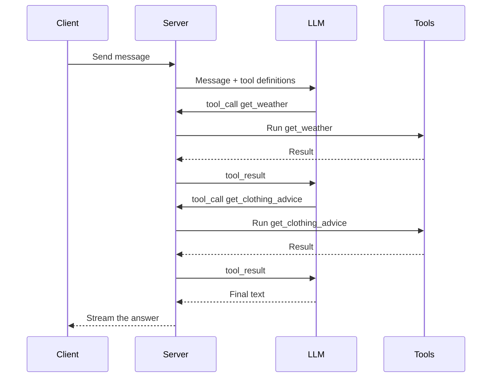

One model call cannot do a task with many steps. To answer "What should I wear in San Francisco today?", the model must get the weather first, then ask for clothing advice, then write the answer.

`chat()` runs this loop for you. The model calls a tool, `chat()` runs it and gives the result back, and the model continues until it can answer.

## Quick setup

### 1. Define the tools

```typescript
// tools.ts
import { toolDefinition } from "@tanstack/ai";
import { z } from "zod";

export const getWeather = toolDefinition({
  name: "get_weather",
  description: "Get the current weather for a city",
  inputSchema: z.object({
    city: z.string(),
  }),
}).server(async ({ city }) => {
  // Replace with a call to your weather API.
  return { city, temperature: 62, conditions: "cloudy" };
});

export const getClothingAdvice = toolDefinition({
  name: "get_clothing_advice",
  description: "Get clothing advice for the weather",
  inputSchema: z.object({
    temperature: z.number(),
    conditions: z.string(),
  }),
}).server(async ({ temperature }) => {
  if (temperature < 65) {
    return { recommendation: "Wear a light jacket" };
  }
  return { recommendation: "Light clothing is fine" };
});
```

### 2. Give the tools to `chat()`

```typescript
// api/chat.ts
import {
  chat,
  chatParamsFromRequest,
  toServerSentEventsResponse,
} from "@tanstack/ai";
import { openaiText } from "@tanstack/ai-openai";
import { getClothingAdvice, getWeather } from "./tools";

export async function POST(request: Request) {
  const { messages, threadId, runId } = await chatParamsFromRequest(request);

  const stream = chat({
    adapter: openaiText("gpt-6.1-sol"),
    messages,
    threadId,
    runId,
    tools: [getWeather, getClothingAdvice],
  });

  return toServerSentEventsResponse(stream);
}
```

### 3. Show the tool calls on the client

The tool calls arrive as `tool-call` parts in the same message as the text:

```tsx
import { useChat, fetchServerSentEvents } from "@tanstack/ai-react";

export function Chat() {
  const { messages, sendMessage } = useChat({
    connection: fetchServerSentEvents("/api/chat"),
  });

  return (
    <>
      <button
        type="button"
        onClick={() => sendMessage("What should I wear in San Francisco today?")}
      >
        Ask
      </button>
      {messages.map((message) => (
        <div key={message.id}>
          {message.parts.map((part, index) => {
            if (part.type === "tool-call") {
              return <p key={index}>Called {part.name}</p>;
            }
            return part.type === "text" ? <p key={index}>{part.content}</p> : null;
          })}
        </div>
      ))}
    </>
  );
}
```

Click "Ask". You see two tool calls, then an answer that uses both results.

## How it works

For the question above, the loop runs three model turns:

1. The model calls `get_weather({ city: "San Francisco" })`. The tool returns `{ temperature: 62, conditions: "cloudy" }`.
2. The model calls `get_clothing_advice({ temperature: 62, conditions: "cloudy" })`. The tool returns `{ recommendation: "Wear a light jacket" }`.
3. The model writes: "It is 62 degrees and cloudy in San Francisco. Wear a light jacket."



The loop continues only while both of these are true:

- The model stops with the finish reason `tool_calls`, and tool calls wait to run.
- The agent loop strategy allows one more model turn.

The loop ends when the model stops with the finish reason `stop`. The full loop is one run, so the client sees one stream.

Related pages:

- A tool can run on the client instead of the server. See [Client Tools](../tools/client-tools).
- A sensitive tool can wait for the user to say yes. See [Tool Approval](../tools/tool-approval).
- To send a turn to a named child agent, see [Subagents](./subagents).

> [!TIP]
> Code Mode can make the loop shorter. The model writes one program that calls many tools in one run. See [Code Mode](../code-mode/code-mode).

## Control the loop

By default, the loop stops after five model turns (`maxIterations(5)`), even if the model calls more tools. It also stops after an answer that [hits the output limit](#when-the-output-limit-cuts-a-tool-call). The full default is `combineStrategies([maxIterations(5), untilFinishReason(["length"])])`.

Set `agentLoopStrategy` to change it:

```typescript
// api/chat.ts
import {
  chat,
  chatParamsFromRequest,
  combineStrategies,
  maxIterations,
  toServerSentEventsResponse,
} from "@tanstack/ai";
import type { AgentLoopState } from "@tanstack/ai";
import { openaiText } from "@tanstack/ai-openai";
import { getClothingAdvice, getWeather } from "./tools";

export async function POST(request: Request) {
  const { messages, threadId, runId } = await chatParamsFromRequest(request);

  const stream = chat({
    adapter: openaiText("gpt-6.1-sol"),
    messages,
    threadId,
    runId,
    tools: [getWeather, getClothingAdvice],
    agentLoopStrategy: combineStrategies([
      maxIterations(10),
      ({ messages }: AgentLoopState) => messages.length < 100,
    ]),
  });

  return toServerSentEventsResponse(stream);
}
```

The built-in strategies:

- `maxIterations(n)`: stop after `n` model turns.
- `untilFinishReason([...])`: continue until the model returns one of the given finish reasons, for example `untilFinishReason(["stop", "length"])`.
- `combineStrategies([...])`: continue only while every strategy in the list agrees.

A strategy is a function. It gets the loop state and returns `true` to allow one more turn, or `false` to stop. The state has these fields:

- `iterationCount`: the model turns so far, from 0.
- `finishReason`: the finish reason of the last response.
- `messages`: the current messages.
- `toolCallCount`: the tool calls so far in this run.
- `lastTurnToolCallCount`: the tool calls in the last batch.

## Advanced

### When the output limit cuts a tool call

A model can run out of output tokens in the middle of a tool call, for example while it writes a long file. The provider stops with the finish reason `length`, and the input of the call is not complete.

`chat()` never runs such a call:

- It asks for no approval.
- It starts no client tool.
- Each cut call gets an error tool result.

By default, the run then ends with the finish reason `length`. To let the model send the cut call again, use a strategy that does not stop on `length`:

```typescript
// api/chat.ts
import {
  chat,
  chatParamsFromRequest,
  maxIterations,
  toServerSentEventsResponse,
} from "@tanstack/ai";
import { openaiText } from "@tanstack/ai-openai";
import { getClothingAdvice, getWeather } from "./tools";

export async function POST(request: Request) {
  const { messages, threadId, runId } = await chatParamsFromRequest(request);

  const stream = chat({
    adapter: openaiText("gpt-6.1-sol"),
    messages,
    threadId,
    runId,
    tools: [getWeather, getClothingAdvice],
    agentLoopStrategy: maxIterations(5),
  });

  return toServerSentEventsResponse(stream);
}
```

Then this happens after a cut answer:

1. The loop calls the model again. The model reads the error result and sends the call again.
2. `maxIterations` counts the cut answer as one model turn. A model that hits the limit every time stops at the iteration limit.

The client needs no change. When the loop continues, the `RUN_FINISHED` event of the cut answer has the finish reason `tool_calls`. So `useChat` keeps the stream open for the next model turn.

The default error text tells the model to send the calls again and to split a large input. To use your own text, return a new result from the `onAfterToolCall` middleware hook. The error of a cut call has the code `max_tokens`:

```typescript
import { defineChatMiddleware } from "@tanstack/ai";

export const cutToolCallText = defineChatMiddleware({
  onAfterToolCall(_ctx, info) {
    const cut =
      info.error instanceof Error &&
      "code" in info.error &&
      info.error.code === "max_tokens";
    if (!cut) return;
    return {
      type: "replaceResult",
      result: `Your call to ${info.toolName} was cut off. Write the file in parts of 200 lines or less.`,
    };
  },
});
```

Add it with `middleware: [cutToolCallText]` next to `agentLoopStrategy`.

On the server, each assistant message that `chat()` stores keeps `metadata.tanstack.finishReason`. A cut answer has `length`. If a transcript has a cut call with no result, `chat()` does not run that call.

### Tool-call budgets (middleware recipe)

`maxIterations` limits model turns, not tool calls. One model turn can emit many tool calls in parallel. A strategy runs between turns, so it cannot stop one turn that calls too many tools.

TanStack AI has no built-in `maxToolCalls` strategy. Use middleware to limit tool calls:

- `onBeforeToolCall`: skip extra calls inside one turn (`maxPerTurn`).
- `onShouldContinue`: stop more turns when the total of emitted tool calls reaches a budget (`max`). Skipped calls also count toward `toolCallCount`.

```typescript
// api/chat.ts
import {
  chat,
  chatParamsFromRequest,
  maxIterations,
  toServerSentEventsResponse,
  type ChatMiddleware,
} from "@tanstack/ai";
import { openaiText } from "@tanstack/ai-openai";
import { getClothingAdvice, getWeather } from "./tools";

// Your own policy. This is not a library export.
function toolCallBudget(options: {
  max?: number;
  maxPerTurn?: number;
}): ChatMiddleware {
  const { max, maxPerTurn } = options;
  let perTurn = 0;

  return {
    name: "tool-call-budget",
    onIteration() {
      perTurn = 0;
    },
    // A pending or resume batch has no onIteration, so reset here too.
    onToolPhaseComplete() {
      perTurn = 0;
    },
    onBeforeToolCall() {
      if (maxPerTurn == null) return undefined;
      perTurn += 1;
      if (perTurn > maxPerTurn) {
        return {
          type: "skip",
          result: {
            error: `Skipped: exceeded maxToolCallsPerTurn (${maxPerTurn})`,
          },
        };
      }
      return undefined;
    },
    onShouldContinue(_ctx, state) {
      if (max != null && state.toolCallCount >= max) return false;
      return undefined;
    },
  };
}

export async function POST(request: Request) {
  const { messages, threadId, runId } = await chatParamsFromRequest(request);

  const stream = chat({
    adapter: openaiText("gpt-6.1-sol"),
    messages,
    threadId,
    runId,
    tools: [getWeather, getClothingAdvice],
    agentLoopStrategy: maxIterations(20), // model turns
    middleware: [
      toolCallBudget({
        maxPerTurn: 10, // limit parallel calls inside one turn
        max: 20, // stop more turns after 20 emitted tool calls in total
      }),
    ],
  });

  return toServerSentEventsResponse(stream);
}
```

Put this middleware before `toolCacheMiddleware`. Then a skip for a call over the budget wins over a cache hit. See [`onShouldContinue`](../advanced/middleware-advanced#onshouldcontinue) for the hook contract.
