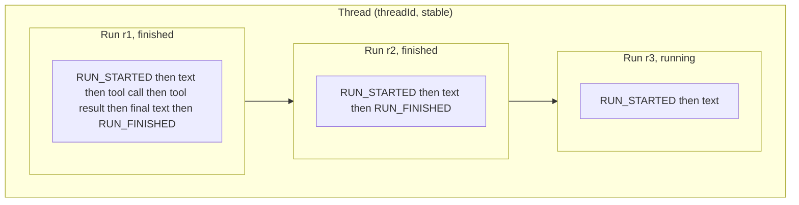

A `chat()` stream yields text deltas, tool-call chunks, and a finish chunk. This page names each chunk.

Every chunk has a `type`. Branch on it.

## Quick setup

### 1. Read the events on the server

```typescript
import { chat } from "@tanstack/ai";
import { openaiText } from "@tanstack/ai-openai";

const stream = chat({
  adapter: openaiText("gpt-6.1-sol"),
  messages: [{ role: "user", content: "Hello!" }],
  threadId: "thread-1",
});

for await (const chunk of stream) {
  if (chunk.type === "TEXT_MESSAGE_CONTENT") {
    console.log(chunk.delta);
  }
  if (chunk.type === "RUN_FINISHED") {
    console.log(chunk.usage);
    console.log(chunk.metadata?.tanstack?.finishReason);
  }
}
```

### 2. Read the events on the client

`useChat` builds `messages` from the events for you. To see each raw event, use `onChunk`:

```tsx
import { useChat, fetchServerSentEvents } from "@tanstack/ai-react";

export function Chat() {
  const { messages } = useChat({
    connection: fetchServerSentEvents("/api/chat"),
    threadId: "support-chat",
    onChunk: (chunk) => {
      if (chunk.type === "RUN_FINISHED") {
        console.log("Run done:", chunk.runId);
      }
    },
  });

  return <p>{messages.length} messages</p>;
}
```

Run it. The server prints the tokens, then the usage and the finish reason.

## Event types

`StreamChunk` follows [AG-UI](https://docs.ag-ui.com/introduction). TanStack extras live under `metadata.tanstack`.

Start with these:

| Event | Main fields |
| --- | --- |
| `RUN_STARTED` | `threadId`, `runId` |
| `TEXT_MESSAGE_START` / `CONTENT` / `END` | `messageId`, `delta` |
| `TOOL_CALL_START` / `ARGS` / `END` | `toolCallId`, `toolCallName`, args `delta` |
| `RUN_FINISHED` / `RUN_ERROR` | usage and finish reason |

A rate-limited `RUN_ERROR` also says how long to wait. See [Rate limits](#rate-limits). For the provider response id, see [Read the provider response identity](#read-the-provider-response-identity).

Later, as you need them:

- `REASONING_*` and `REASONING_ENCRYPTED_VALUE`: thinking content. See [Thinking and Reasoning](./thinking-content).
- `TEXT_MESSAGE_CHUNK`, `TOOL_CALL_CHUNK`, and `REASONING_MESSAGE_CHUNK`: other forms of START / CONTENT / END. See [Chunk events](#chunk-events).
- `STEP_STARTED` and `STEP_FINISHED`: `stepName` only.
- `CUSTOM`: `name` and `value`. See [Custom Events](../protocol/custom-events).
- `SUBAGENT_STARTED`, `SUBAGENT_FINISHED`, and `SUBAGENT_ERROR`: a child agent. See [Subagent events](#subagent-events).

## Threads and runs

Two ids frame every stream. They come from the AG-UI protocol, not from a storage layer.

- A **thread** (`threadId`) is the conversation. It stays the same across every exchange, reload, and device.
- A **run** (`runId`) is one execution inside that thread. It spans `RUN_STARTED` to `RUN_FINISHED` (or `RUN_ERROR`). Every start makes a new run id. A thread collects many runs over its life.

Tool calls and follow-up responses stream inside the same run. The full [agentic cycle](./agentic-cycle) is one run, no matter how many loops it takes.



A run id is short-lived, so anything long-lived uses the thread:

- [Resumable streams](../resumable-streams/overview) log delivery per `runId`.
- [Server persistence](../persistence/chat-persistence#threads-runs-and-turns) stores the transcript per `threadId`.

The media generation hooks take a `threadId` too. There it names a slot, not a conversation. See [Id map](../persistence/id-map).

## Tool input and output

Read tool input and output from the `tool-call` parts of `UIMessage`, not from the raw events:

- On the server, feed the chunks into `StreamProcessor`.
- On the client, read `messages` from `useChat`.

### Server

```typescript
import { chat, StreamProcessor, toolDefinition } from "@tanstack/ai";
import { openaiText } from "@tanstack/ai-openai";
import { z } from "zod";

const weatherTool = toolDefinition({
  name: "get_weather",
  description: "Get weather for a location",
  inputSchema: z.object({
    location: z.string(),
    unit: z.enum(["celsius", "fahrenheit"]).optional(),
  }),
});

const stream = chat({
  adapter: openaiText("gpt-6.1-sol"),
  messages: [{ role: "user", content: "What is the weather in Paris?" }],
  threadId: "thread-1",
  tools: [weatherTool],
});

const processor = new StreamProcessor();
for await (const chunk of stream) {
  processor.processChunk(chunk);
}
processor.finalizeStream();

for (const message of processor.getMessages()) {
  for (const part of message.parts) {
    if (part.type === "tool-call") {
      console.log(part.name, part.input, part.output);
    }
  }
}
```

### Type-safe tool call events

Pass your `.client()` tools to `useChat`. A check on `part.name` narrows `part.input` and `part.output`:

```typescript
import { useChat, fetchServerSentEvents } from "@tanstack/ai-react";
import { toolDefinition } from "@tanstack/ai";
import { z } from "zod";

const weatherTool = toolDefinition({
  name: "get_weather",
  description: "Get weather for a location",
  inputSchema: z.object({
    location: z.string(),
    unit: z.enum(["celsius", "fahrenheit"]).optional(),
  }),
}).client(async (input) => {
  return { location: input.location };
});

const { messages } = useChat({
  connection: fetchServerSentEvents("/api/chat"),
  threadId: "support-chat",
  tools: [weatherTool],
});

for (const message of messages) {
  for (const part of message.parts) {
    if (part.type === "tool-call" && part.name === "get_weather") {
      console.log(part.input?.location);
    }
  }
}
```

You now know which chunk is text, which is a tool call, and which id is the conversation and which is one run.

## Advanced

### In process and on the wire

Some fields have a different shape in process and on the SSE or HTTP wire:

| Field | In-process `chat()` | SSE and HTTP wire |
| --- | --- | --- |
| `RUN_FINISHED` usage | TanStack `TokenUsage` (`promptTokens`) | the spec `usage` array (`inputTokens`) |
| `TOOL_CALL_END` input | `input`, parsed from the argument string | no `input`. `metadata.tanstack.args` has the argument string as the provider sent it. |

Read `finishReason` from `metadata.tanstack.finishReason` in both cases. If you write a custom server, see [Event metadata](../protocol/metadata).

### Chunk events

Other AG-UI servers can send `TEXT_MESSAGE_CHUNK`, `TOOL_CALL_CHUNK`, or `REASONING_MESSAGE_CHUNK` in place of START / CONTENT / END.

- A chunk with no id continues the open stream of the same kind.
- A chunk of a different kind closes that stream.

The client builds the same message from both forms.

### Subagent events

`SUBAGENT_STARTED`, `SUBAGENT_FINISHED`, and `SUBAGENT_ERROR` frame a child agent.

- The events of the child carry `subagentRunId`.
- A child that waits for an interrupt ends with `SUBAGENT_FINISHED` and `outcome: { type: 'suspended' }`.
- In request messages, each message of the child carries `subagentRunId`.

See [Subagents](./subagents).

### Token usage

You want to know what a run cost. `RUN_FINISHED.usage.promptTokens` is the full input, cached tokens included. The cache parts are also on `promptTokensDetails`:

- `cachedTokens`: tokens read from the cache.
- `cacheWriteTokens`: tokens written to the cache.

To get the uncached part, subtract both:

```typescript
import type { TokenUsage } from "@tanstack/ai";

function uncachedTokens(usage: TokenUsage) {
  const read = usage.promptTokensDetails?.cachedTokens ?? 0;
  const written = usage.promptTokensDetails?.cacheWriteTokens ?? 0;
  return usage.promptTokens - read - written;
}
```

### Rate limits

You got a 429 and want to know how long to wait. If the provider sends a `retry-after-ms` or `retry-after` header, the `RUN_ERROR` has the wait in `metadata.tanstack.retryAfterMs`, in milliseconds.

These adapters set it:

- The Anthropic adapter.
- The adapters built on `@tanstack/openai-base`, for example OpenAI, Grok, and Groq.
- The OpenRouter adapter, for [an error in the stream](../adapters/openrouter-advanced#retry-an-error-in-the-stream). That value is the backoff wait of the adapter, not a wait from the provider.

On the server:

```typescript
import { chat } from "@tanstack/ai";
import { anthropicText } from "@tanstack/ai-anthropic";

const stream = chat({
  adapter: anthropicText("claude-sonnet-5-5"),
  messages: [{ role: "user", content: "Hello!" }],
  threadId: "thread-1",
});

for await (const chunk of stream) {
  if (chunk.type === "RUN_ERROR") {
    const waitMs = chunk.metadata?.tanstack?.retryAfterMs;
    console.log(waitMs === undefined ? "No wait sent" : `Retry in ${waitMs} ms`);
  }
}
```

The value also reaches the browser. On the client:

```typescript
import { useChat, fetchServerSentEvents } from "@tanstack/ai-react";

const { messages } = useChat({
  connection: fetchServerSentEvents("/api/chat"),
  threadId: "support-chat",
  onChunk: (chunk) => {
    if (chunk.type === "RUN_ERROR") {
      console.log(chunk.metadata?.tanstack?.retryAfterMs);
    }
  },
});
```

If there is no `retryAfterMs`, the provider sent no wait header. Pick your own backoff.

The provider SDKs also retry a 429 by themselves first. To handle every 429 yourself, set `maxRetries: 0` in the adapter config.

#### Let `chat()` retry for you

You do not have to wait and retry in your own code. Pass `retry`. Then `chat()` waits for the `retryAfterMs` time and calls the model again:

```typescript
import { chat } from "@tanstack/ai";
import { anthropicText } from "@tanstack/ai-anthropic";

const stream = chat({
  adapter: anthropicText("claude-sonnet-5-5"),
  messages: [{ role: "user", content: "Hello!" }],
  threadId: "thread-1",
  retry: { maxRetries: 3, maxWaitMs: 30_000 },
});
```

`chat()` retries only when all of these are true:

- The `RUN_ERROR` has a wait time (`metadata.tanstack.retryAfterMs`). Only the adapters named above set it.
- The wait time is at most `maxWaitMs` (default 60 000). For a longer wait time, you get the `RUN_ERROR`.
- The call streamed no output, so no text repeats.

Limits:

- `maxRetries` is the limit for each model call, not for the full run.
- The provider SDK retries a 429 first, then `chat()` retries. To count only the `chat()` retries, set `maxRetries: 0` in the adapter config.
- With `outputSchema`, `chat()` does not retry the structured-output call.
- An abort stops the wait immediately. You then get the `RUN_ERROR`.

On a serverless route, a long wait keeps the request open. If your host has a short time limit, keep `maxWaitMs` low. Then retry the longer wait times from the client.

### Read the provider response identity

You want to find a reply in the logs of the provider, or see which model really answered. Read `metadata.tanstack` on `RUN_FINISHED`:

- `responseId`: the generation id from the provider, when it sends one.
- `model`: the model that the provider says it used. It can be different from the model that you asked for.
- `source`: `{ provider, api, model }` for the call. Here `model` is the one that you asked for.

On the server:

```typescript
import { chat } from "@tanstack/ai";
import { anthropicText } from "@tanstack/ai-anthropic";

const stream = chat({
  adapter: anthropicText("claude-sonnet-5-5"),
  messages: [{ role: "user", content: "Hello!" }],
  threadId: "thread-1",
});

for await (const chunk of stream) {
  if (chunk.type === "RUN_FINISHED") {
    const tanstack = chunk.metadata?.tanstack;
    console.log(tanstack?.responseId, tanstack?.model, tanstack?.source);
  }
}
```

The same fields land on each assistant message. `StreamProcessor` merges the metadata of `RUN_FINISHED` and `RUN_ERROR` into the messages of that model call. A failed call also gets `stopReason: "error"`, and a stopped call gets `stopReason: "aborted"`.

On the client:

```typescript
import { useChat, fetchServerSentEvents } from "@tanstack/ai-react";

const { messages } = useChat({
  connection: fetchServerSentEvents("/api/chat"),
  threadId: "support-chat",
});

for (const message of messages) {
  const tanstack = message.metadata?.tanstack;
  console.log(tanstack?.responseId, tanstack?.source, tanstack?.stopReason);
}
```

If there is no `responseId`, the provider sent no generation id. The adapter never fills it with an HTTP request id.
