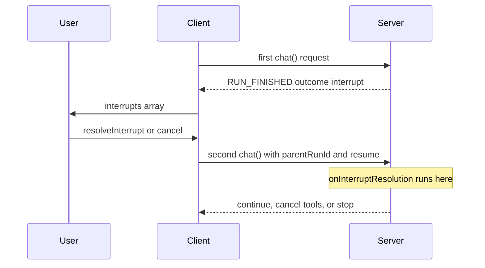

Read the user's answer in `onInterruptResolution`, then apply it in `onConfig`. A no stops the run.

Keep the answer on a middleware capability between the two hooks.

This page assumes that you have the `reviewPlan` definition from
[Generic Interrupts](./generic).

## Quick setup

### 1. Write the middleware

This middleware asks for the review, reads the answer, and adds the note to
the system prompts:

```ts
// app/review-plan.ts
import { createCapability, type ChatMiddleware } from '@tanstack/ai'
import { reviewPlan } from './interrupts'

export const reviewNote = createCapability<{ note?: string }>()('review-note')
export const [getReviewNote, provideReviewNote] = reviewNote

export const reviewMiddleware: ChatMiddleware<unknown, typeof reviewPlan> = {
  name: 'review-plan',
  provides: [reviewNote],
  setup(ctx) {
    provideReviewNote(ctx, {})
  },
  onInterruptBoundary(ctx) {
    if (ctx.phase !== 'beforeModel') return
    if (ctx.parentRunId) return
    return {
      interrupts: [
        reviewPlan.interrupt({
          key: 'initial-plan',
          reason: 'review-required',
          message: 'Review the proposed plan.',
          payload: {
            title: 'Release plan',
            changes: ['Add search'],
          },
        }),
      ],
    }
  },
  onInterruptResolution(ctx, resumed) {
    const [result] = resumed.for(reviewPlan)
    if (result?.status !== 'resolved') return
    // setup() already provided the value. Change it, do not provide it again.
    getReviewNote(ctx).note = result.response.note
    if (!result.response.approved) {
      return { toolResume: 'stop' }
    }
  },
  onConfig(ctx, config) {
    if (ctx.phase !== 'beforeModel') return
    const note = getReviewNote(ctx).note
    if (!note) return
    return {
      systemPrompts: [
        ...config.systemPrompts,
        `User review note: ${note}`,
      ],
    }
  },
}
```

### 2. Register it on the server

The continuation needs the same definitions and the same middleware as the
paused run. Forward `parentRunId` and `resume` from the request:

```ts
// app/api/chat/route.ts
import {
  chat,
  chatParamsFromRequest,
  toServerSentEventsResponse,
} from '@tanstack/ai'
import { openaiText } from '@tanstack/ai-openai'
import { reviewMiddleware } from '../../review-plan'
import { reviewPlan } from '../../interrupts'

export async function POST(request: Request) {
  const params = await chatParamsFromRequest(request)
  const stream = chat({
    adapter: openaiText('gpt-6.1-sol'),
    messages: params.messages,
    threadId: params.threadId,
    runId: params.runId,
    ...(params.parentRunId ? { parentRunId: params.parentRunId } : {}),
    ...(params.resume ? { resume: params.resume } : {}),
    interrupts: [reviewPlan],
    middleware: [reviewMiddleware],
  })
  return toServerSentEventsResponse(stream)
}
```

### 3. Try it

Use the `PlanReview` component from [Generic Interrupts](./generic). Make it
resolve with `{ approved: true, note: 'Keep it short' }`. The model reply now
follows the note. Resolve with `{ approved: false }`, and the run stops with no
model call.

## How it works

The pause spans two `chat()` calls, for one turn that the user sees:

1. **Pause.** `onInterruptBoundary` returns `{ interrupts }`. The run ends with
   `RUN_FINISHED` and `outcome: interrupt`. `onInterruptResolution` does not
   run.
2. **Resume.** After `resolveInterrupt()` or `cancel()`, the client sends a new
   request with `parentRunId` and `resume`. `onInterruptResolution` runs here.

On the continuation, the hooks run in this order:

1. `onConfig` with `phase: 'init'`. The answers are not applied yet.
2. `onInterruptResolution`. Read the answers and store them on the capability.
3. `onConfig` with `phase: 'beforeModel'`. Return the new prompts, tools, or
   messages.



## What the hook can return

Return `toolResume` to decide what happens to the **pending tools** of the
paused turn:

| Value | Effect |
| --- | --- |
| `continue` | Run the pending tools |
| `cancel` | Mark the pending tools as cancelled. Do not run them |
| `stop` | End the run after `onStart`. No tools. No model call |

When more than one middleware returns a value, the engine keeps the stricter
one. `stop` wins over `cancel`. `cancel` wins over `continue`.

After `continue`, the engine continues from the phase that paused:

| First run paused at | Next step |
| --- | --- |
| `beforeModel` | The model call |
| `afterModel` | Tools, if the model asked for them |
| `beforeTools` | Tool execution |
| `afterTools` | The next model turn (the tools already ran) |

## Read the typed answers

- `resumed.for(reviewPlan)` keeps the response type for that definition.
- `resumed.all()` returns every registered answer.
- `resumed.all(reviewPlan, otherDefinition)` narrows to those definitions.

Each item is `resolved` (with `response`) or `cancelled`.

## Advanced

### Exact place in the second call

```
setup
onConfig                 (phase is init)
onInterruptResolution    (phase is still init)
onStart
then stop, or continue the agent loop
```

- The hook runs **once**, at the start of the continuation. It does not run at
  `beforeModel`, `afterModel`, `beforeTools`, or `afterTools`.
- `ctx.phase` is `'init'` and `ctx.iteration` is `0`. No model call has
  started.
- The hook runs once per batch. Two cards in one pause give one hook call with
  both answers.
- The hook does not run on the first user message.
- The hook does not run for a tool-approval or client-tool batch that has no
  generic interrupt.
- If the continuation pauses again, the next continuation is a third `chat()`
  call. The hook runs again at the start of that call.

### What the hook cannot change

`onInterruptResolution` cannot change config, the model, or the adapter. These
fields change only from `onConfig` (or `onStructuredOutputConfig`):

- `messages`
- `systemPrompts`
- `tools`
- `modelOptions`
- `metadata`

The engine does not add the user answer to `messages`. If the model must see
the note, add it yourself, as the quick setup does.

### Why a capability

A [middleware capability](../advanced/middleware-advanced#capabilities) keeps the value
on `ctx` for this `chat()` call:

- Another middleware can declare `requires` and read the same note.
- Two `chat()` calls that run at the same time do not share the value.
- A capability in `provides` must be provided in `setup`. The answer is not
  there yet, so `setup` provides an empty object. `onInterruptResolution`
  writes the answer into that object later. A second provide logs a
  duplicate-capability warning.

A later middleware can read the same note:

```ts
import { type ChatMiddleware } from '@tanstack/ai'
import { getReviewNote, reviewNote } from './review-plan'

export const applyVoice: ChatMiddleware = {
  name: 'apply-voice',
  requires: [reviewNote],
  onConfig(ctx, config) {
    const note = getReviewNote(ctx).note
    if (!note) return
    return {
      systemPrompts: [...config.systemPrompts, `Voice note: ${note}`],
    }
  },
}
```

Other hooks can change behavior, but they do not see this resume payload:

- `onBeforeToolCall` can rewrite arguments, skip a tool, or abort.
- `onChunk` can rewrite or drop stream events.
- `onShouldContinue` can return `false` to stop the loop with a normal finish.

See [Middleware](../advanced/middleware) for those hooks.

### Client tools in the same batch

A generic interrupt can share a batch with client tools. Then the client runs
those client tools only when `toolResume` is `continue`. `cancel` and `stop`
skip them. After `continue`, the engine emits the client-tool wait again.

### The resume request

`useChat` sends these fields for you. If you POST by hand, include all three:

- a new `runId`
- `parentRunId`, set to the paused run
- `resume`, with the answers. Each generic item also has `metadata` with the
  original request (`tanstack:interruptContinuation`).

If `resume` is present and `parentRunId` is missing, the server throws.

A generic resume item that you build by hand looks like this:

```ts
import { wrapGenericInterruptContinuation } from '@tanstack/ai'

const resumeItem = {
  interruptId: 'generic-1',
  status: 'resolved' as const,
  payload: { approved: true },
  metadata: wrapGenericInterruptContinuation({
    v: 1,
    definitionId: 'review-plan',
    key: 'turn-1',
    batchIndex: 0,
    reason: 'review',
    message: 'Review the plan',
  }),
}
```

### Persistence

With [chat persistence](../persistence/chat-persistence), the hook runs at the
same moment: after init `onConfig`, before `onStart`.

Persistence rebuilds the pending requests from the store. It clears
`config.resume`, so the engine does not rebuild them from the client history.
You still read the answers from `resumed.for(definition)`.
