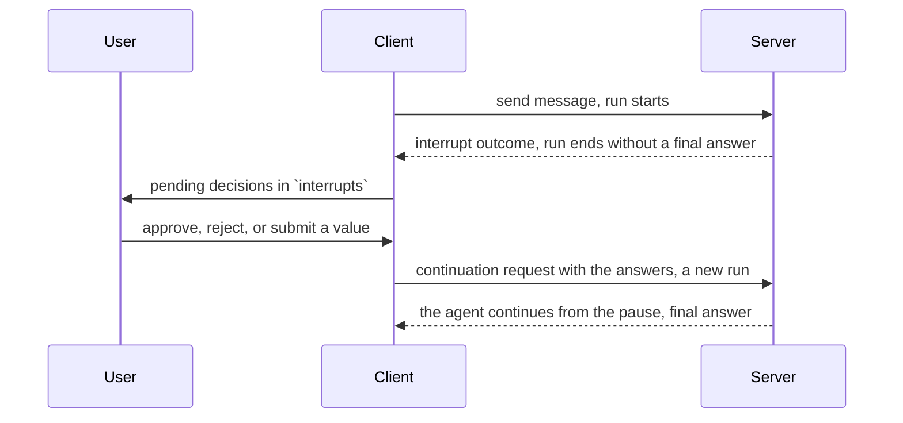

An interrupt pauses a run until a person decides. The run then continues from the same point.

## Quick setup

This setup gates one tool behind a human approval. If you already have a chat
route, it takes about 5 minutes.

### 1. Mark the tool

Add `needsApproval: true`. Put the tool in a file that the server and the
browser both import, so both sides get the same types:

```ts
// tools/transfer.ts
import { toolDefinition } from '@tanstack/ai'
import { z } from 'zod'

export const transferTool = toolDefinition({
  name: 'transfer',
  description: 'Transfer funds to a recipient',
  needsApproval: true,
  inputSchema: z.object({
    amount: z.number().positive(),
    recipient: z.string().min(1),
  }),
  outputSchema: z.object({ receiptId: z.string() }),
})
```

### 2. Serve it

Add the server implementation. Forward `parentRunId` and `resume` into
`chat()`, so the continuation can find the paused call:

```ts
// app/api/chat/route.ts
import {
  chat,
  chatParamsFromRequest,
  toServerSentEventsResponse,
} from '@tanstack/ai'
import { openaiText } from '@tanstack/ai-openai'
import { transferTool } from '../../../tools/transfer'

const transfer = transferTool.server(
  async (input: { amount: number; recipient: string }) => ({
    receiptId: `${input.recipient}-${input.amount}-${crypto.randomUUID()}`,
  }),
)

export async function POST(request: Request) {
  const params = await chatParamsFromRequest(request)
  const stream = chat({
    adapter: openaiText('gpt-6.1-sol'),
    messages: params.messages,
    threadId: params.threadId,
    runId: params.runId,
    parentRunId: params.parentRunId,
    ...(params.resume ? { resume: params.resume } : {}),
    tools: [transfer],
  })
  return toServerSentEventsResponse(stream)
}
```

### 3. Render the approval

Pass the same tool to `useChat`. Render each item in `interrupts`, and call
`interrupt.resolveInterrupt(...)` on it:

```tsx
// app/transfer-chat.tsx
import { useState } from 'react'
import { fetchServerSentEvents, useChat } from '@tanstack/ai-react'
import { transferTool } from '../tools/transfer'

export function TransferChat() {
  const { messages, sendMessage, interrupts, resuming } = useChat({
    threadId: 'account-42',
    connection: fetchServerSentEvents('/api/chat'),
    tools: [transferTool] as const,
  })
  const [input, setInput] = useState('')

  return (
    <div>
      {messages.map((message) => (
        <div key={message.id}>
          <strong>{message.role}: </strong>
          {message.parts.map((part, i) =>
            part.type === 'text' ? <span key={i}>{part.content}</span> : null,
          )}
        </div>
      ))}

      {interrupts.map((interrupt) => {
        if (
          interrupt.kind !== 'tool-approval' ||
          interrupt.toolName !== 'transfer'
        ) {
          return null
        }
        return (
          <div key={interrupt.id}>
            <p>
              Send {interrupt.originalArgs.amount} to{' '}
              {interrupt.originalArgs.recipient}?
            </p>
            <button
              disabled={!interrupt.canResolve || resuming}
              onClick={() => interrupt.resolveInterrupt(true)}
            >
              Approve
            </button>
            <button
              disabled={!interrupt.canResolve || resuming}
              onClick={() => interrupt.resolveInterrupt(false)}
            >
              Reject
            </button>
          </div>
        )
      })}

      <form
        onSubmit={(event) => {
          event.preventDefault()
          void sendMessage(input)
          setInput('')
        }}
      >
        <input value={input} onChange={(event) => setInput(event.target.value)} />
        <button type="submit">Send</button>
      </form>
    </div>
  )
}
```

### 4. Try it

Ask the model to send 20 to Ada. The chat stops on the `transfer` call and
shows Approve and Reject. Click Approve. The tool runs, and the model gives its
answer.

## How it works

1. The model calls a tool that has `needsApproval: true`. The server ends the
   run with an `interrupt` outcome, with no final answer.
2. `useChat` puts the pending decision in `interrupts`.
3. You resolve each item: approve, reject, submit a value, or cancel.
4. The client starts a new run, the continuation. It carries your answers, and
   the agent continues from the pause.



One turn that the user sees is two runs: the interrupted run and the
continuation. See [Threads and runs](../chat/stream-events#threads-and-runs).

The server needs no database. The browser sends the full message history back
on the continuation request. Then a stateless server can rebuild the paused
step and continue.

## What can pause a run

| `kind` | You get a pause when | Guide |
| --- | --- | --- |
| `tool-approval` | The model calls a tool that has `needsApproval` | [Tool Approval](./tool-approval) |
| `generic` | Middleware asks the client for typed data at a lifecycle boundary | [Generic Interrupts](./generic) |

An MCP server can also ask for input during a tool call. The run then ends with
an interrupt. See [MCP client input](../tools/mcp-input).

A tool with a `.client()` implementation runs in the browser and reports its
own result. You make no decision, so it does not show in `interrupts`. See
[Client Tools](../tools/client-tools).

A tool pauses only when you mark it `needsApproval: true`. Then it waits for a
yes or no first, on the server or in the browser:

| Tool | What you handle |
| --- | --- |
| Server tool (`.server()`) | Nothing. With `needsApproval`, you approve first, then it runs on the server. |
| Client tool (`.client()`) | Nothing. It runs in the browser. With `needsApproval`, you approve first, then it runs in the browser. |

Both kinds use the same `tool-approval` interrupt, so your approval UI does not
change.

## Where to go next

| You want to | Page |
| --- | --- |
| Add a note or a reason to an approval, or edit the arguments | [Tool Approval](./tool-approval) |
| Resolve several pending decisions at once | [Multiple Interrupts](./multiple) |
| Ask the user something that is not a tool call | [Generic Interrupts](./generic) |
| Pick `beforeModel`, `afterModel`, `beforeTools`, or `afterTools` | [Lifecycle Boundaries](./boundaries) |
| Use a generic answer in prompts, or stop the run | [Apply Answers](./apply-answers) |
| Move a 0.x approval UI to 1.0 | [Migration](./migration) |

## Advanced

### Replayed events

When the client replays saved events, it follows `parentRunId` links. Then it
does not show a resolved pause again.

- A continuation that ends without an interrupt clears the pending decisions of
  its ancestor. This is true also when the parent link arrives later.
- Intermediate `tool_calls` events do not mark the run or its ancestors as
  answered.

### Restored client tools

Persistence can restore a pending client-tool execution. The client keeps it
pending and does not run the browser code again. For recovery policies, see
[Client persistence](../persistence/client-persistence#handle-restored-client-tools).

### First-party generic interrupts

A generic interrupt that TanStack AI owns starts with `defineInterrupt()`:

- Register the definition with both `chat({ interrupts })` and
  `useChat({ interrupts })`.
- Middleware emits it from `onInterruptBoundary`.
- The client gets a typed item that it can resolve or cancel.

See [Generic Interrupts](./generic).

### Interrupts from other systems

An interrupt is a standard AG-UI object. Other producers can put one on the same stream. Examples are a workflow engine
that pauses for a durable approval, or another agent framework on the same
connection.

The client sorts each generic interrupt into one of three cases:

- **Registered first-party generic.** `kind: 'generic'`, a literal
  `definitionId`, a typed `payload`, and a typed `resolveInterrupt`.
- **External generic with a valid binding.** Also `kind: 'generic'`. Its
  response is `unknown`, but it has `resolveInterrupt`, `cancel`, and
  `clearResolution`. It joins the root batch controls.
- **No valid binding.** `kind: 'unbound'`. The binding is missing, malformed, or
  of an unsupported version. The item is visible, but it has no controls.

The binding is in the interrupt metadata under
`INTERRUPT_BINDING_METADATA_KEY`. It records the interrupted run and the
generation. The client uses it to send the answer to the matching paused step.

Show unbound items as status only. Do not show a response form for them:

```tsx
import { fetchServerSentEvents, useChat } from '@tanstack/ai-react'
import { toolDefinition } from '@tanstack/ai'
import { z } from 'zod'

const transferTool = toolDefinition({
  name: 'transfer',
  description: 'Move money between accounts',
  needsApproval: true,
  inputSchema: z.object({ recipient: z.string(), amount: z.number() }),
  outputSchema: z.object({ receiptId: z.string() }),
}).client()

export function Pauses() {
  const { interrupts } = useChat({
    threadId: 'thread-1',
    connection: fetchServerSentEvents('/api/chat'),
    tools: [transferTool] as const,
  })

  return (
    <>
      {interrupts.map((interrupt) => {
        if (interrupt.kind === 'unbound') {
          return (
            <p key={interrupt.id}>
              External pause: {interrupt.message ?? interrupt.reason}
            </p>
          )
        }
        if (interrupt.kind === 'generic') {
          return (
            <article key={interrupt.id}>
              <p>{interrupt.message ?? interrupt.reason}</p>
              <button
                onClick={() =>
                  interrupt.resolveInterrupt({ speed: 'express' })
                }
              >
                Choose express
              </button>
              <button onClick={() => interrupt.cancel()}>Cancel</button>
              <button onClick={() => interrupt.clearResolution()}>
                Clear choice
              </button>
            </article>
          )
        }
        return (
          <button
            key={interrupt.id}
            onClick={() => interrupt.resolveInterrupt(true)}
          >
            Approve {interrupt.toolName}
          </button>
        )
      })}
    </>
  )
}
```

The library does not make up a binding for an unbound item. With a made-up binding, the answer goes to a run that has nothing pending.
Then the submit fails after the user fills in the form. `unbound` tells you that the pause
belongs to a different system. Unbound items never block the items that are
yours.

For an external producer that wants the chat client to resume its pause, attach
a valid binding with `withInterruptBinding`. Do not write the metadata key
yourself. Use the exact interrupted run id and generation that own the pause:

```ts
import {
  INTERRUPT_BINDING_VERSION,
  canonicalInterruptJson,
  digestInterruptJson,
  withInterruptBinding,
} from '@tanstack/ai'

const responseSchema = {
  type: 'object',
  properties: { speed: { type: 'string' } },
  required: ['speed'],
}

const descriptor = withInterruptBinding(
  {
    id: 'shipping-1',
    reason: 'confirmation',
    message: 'Which shipping speed?',
    responseSchema,
  },
  {
    v: INTERRUPT_BINDING_VERSION,
    kind: 'generic',
    interruptId: 'shipping-1',
    interruptedRunId: 'run-42',
    generation: 0,
    // The server compares the schema it sends with the schema it validates
    // against, so the hash comes from the schema itself.
    responseSchemaHash: digestInterruptJson(
      canonicalInterruptJson(responseSchema),
    ),
  },
)
```

The client treats this item as an untyped generic interrupt. Like the `generic`
branch above, it can stage a value, cancel, or clear the draft. It can also
join `resolveInterrupts(...)` with tool approvals and first-party generic
interrupts.

`v` is the version of the binding format. The client rejects unknown versions
and bad fields. Those interrupts become `unbound`, so you never get a form that
cannot resume the owner.
