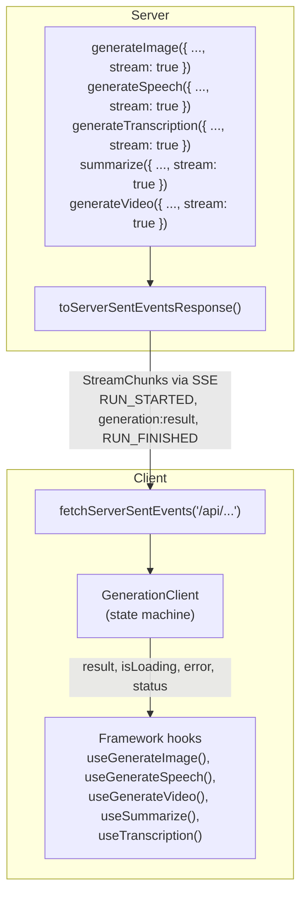

A generation is one request and one result: an image, a voice clip, a transcript, or a video. It does not keep a conversation.

Every generation uses the same three parts. When you know how to make one image, you know how to make all of them.

## Generate your first image

You need a React app with a server route, and an OpenAI API key. This takes about 5 minutes.

1. Install the packages:

<!-- ::start:tabs variant="package-manager" mode="install" -->

react: @tanstack/ai @tanstack/ai-react @tanstack/ai-openai

<!-- ::end:tabs -->

2. Put your key in `.env`:

```bash
OPENAI_API_KEY=sk-...
```

3. Add a `POST` route at `/api/generate/image`:

```typescript
import {
  generateImage,
  generationParamsFromRequest,
  toServerSentEventsResponse,
} from '@tanstack/ai'
import { openaiImage } from '@tanstack/ai-openai'

export async function POST(request: Request) {
  const { input, threadId } = await generationParamsFromRequest('image', request)
  if (typeof input.prompt !== 'string') {
    return new Response('Send a text prompt.', { status: 400 })
  }

  const stream = generateImage({
    adapter: openaiImage('gpt-image-2.5-flare'),
    prompt: input.prompt,
    threadId,
    stream: true,
  })
  return toServerSentEventsResponse(stream)
}
```

4. Call the route from a component:

```tsx
import { fetchServerSentEvents, useGenerateImage } from '@tanstack/ai-react'

export function ImageGenerator() {
  const { generate, result, isLoading, error } = useGenerateImage({
    connection: fetchServerSentEvents('/api/generate/image'),
    threadId: 'image-studio',
  })

  return (
    <div>
      <button
        onClick={() => generate({ prompt: 'A sunset over mountains' })}
        disabled={isLoading}
      >
        {isLoading ? 'Generating...' : 'Generate'}
      </button>
      {error && <p role="alert">{error.message}</p>}
      {result?.images.map((img, i) => (
        
      ))}
    </div>
  )
}
```

Click the button. The image shows up below it.

For a full React and TanStack Start walkthrough with OpenRouter, open [Generate Image](../tutorials/generate-image).

## How it works

The loop has three parts:

- **The server function.** `generateImage()` calls the provider. With `stream: true`, it returns a stream of events instead of a plain result.
- **The response helper.** `toServerSentEventsResponse()` sends those events to the browser as Server-Sent Events (SSE).
- **The hook.** `useGenerateImage()` posts the input, reads the events, and gives you `result`, `isLoading`, and `error`.

To make a different media type, swap the server function and the hook for another pair from the table. Nothing else changes.

| Activity | Server function | React hook | Guide |
| --- | --- | --- | --- |
| Image generation | `generateImage()` | `useGenerateImage()` | [Image Generation](./image-generation) |
| Audio generation | `generateAudio()` | `useGenerateAudio()` | [Audio Generation](./audio-generation) |
| Text-to-speech | `generateSpeech()` | `useGenerateSpeech()` | [Text-to-Speech](./text-to-speech) |
| Transcription | `generateTranscription()` | `useTranscription()` | [Transcription](./transcription) |
| Voice creation | `generateVoice()` | - | [Voice Creation](./voice-creation) |
| Summarization | `summarize()` | `useSummarize()` | - |
| Video generation | `generateVideo()` | `useGenerateVideo()` | [Video Generation](./video-generation) |
| Live generation | `generateLiveVideo()` | - | [Live Generation](./live-generation) |
| World generation | `generateWorld()` | - | [World Generation](./world-generation) |

Three types work a little differently:

- **Video** runs as a job. The server starts the job and polls it until the video is ready. The hook also gives you the job status. See [Video Generation](./video-generation).
- **Live** and **world** generation return a session token. The browser uses the token to connect to the provider. See [Live Generation](./live-generation) and [World Generation](./world-generation).

The hooks for Vue, Solid, Svelte, Angular, and the other frameworks are in [Generation Hooks](./generation-hooks). To keep a result after a page reload, add [Generation Persistence](../persistence/generation-persistence).

## Pick a transport

The quick setup uses a streaming route. You can also call a server function:

| Transport | Use it when | How |
| --- | --- | --- |
| **Streaming route** | You have an API route. This is the default. | `stream: true` and `toServerSentEventsResponse()` on the server. `connection:` on the hook. |
| **Direct** | You call a server function and want plain JSON back. No streaming. | Return the result from the function. `fetcher:` on the hook. |
| **Server function that streams** | You use TanStack Start server functions and want typed input and streaming. | Return `toServerSentEventsResponse(...)` from the function. `fetcher:` on the hook. |

On TanStack Start, the third transport gives you both: the input is typed and the hook still reads a stream. All three are written out in [Transports in full](#transports-in-full).

## Advanced

### Transports in full

#### Streaming route (connection)

The server passes `stream: true` to the generation function and sends the events as SSE. The hook reads them with `fetchServerSentEvents()`. This is the quick setup above.

The hook sends its input inside an AG-UI request body. `generationParamsFromRequest(kind, request)` reads that body and returns `{ input, threadId, runId }`. The `kind` is one of `'image'`, `'audio'`, `'tts'`, `'voice'`, `'video'`, `'transcription'`, `'world'`, or `'liveVideo'`.

#### Direct (fetcher)

The hook calls a server function and gets the result back as JSON. There is no stream.

Server:

```typescript ignore
import { createServerFn } from '@tanstack/react-start'
import { generateImage } from '@tanstack/ai'
import { openaiImage } from '@tanstack/ai-openai'

export const generateImageFn = createServerFn({ method: 'POST' })
  .inputValidator((data: { prompt: string; threadId: string }) => data)
  .handler(async ({ data }) => {
    return generateImage({
      adapter: openaiImage('gpt-image-2.5-flare'),
      prompt: data.prompt,
      threadId: data.threadId,
    })
  })
```

Client:

```tsx
import { useGenerateImage } from '@tanstack/ai-react'
import { generateImageFn } from '../lib/server-functions'

const threadId = 'image-studio'

export function ImageGenerator() {
  const { generate, result, isLoading } = useGenerateImage({
    fetcher: (input, { threadId }) =>
      generateImageFn({ data: { ...input, threadId } }),
    threadId,
  })
  // Render the same way as in the quick setup.
}
```

#### Server function that streams (fetcher + Response)

The server function returns an SSE `Response`. When a fetcher returns a `Response`, the hook reads it as an SSE stream. You get typed input from the fetcher and streaming from the response.

Server:

```typescript ignore
import { createServerFn } from '@tanstack/react-start'
import { generateImage, toServerSentEventsResponse } from '@tanstack/ai'
import { openaiImage } from '@tanstack/ai-openai'

export const generateImageStreamFn = createServerFn({ method: 'POST' })
  .inputValidator((data: { prompt: string; threadId: string }) => data)
  .handler(({ data }) => {
    return toServerSentEventsResponse(
      generateImage({
        adapter: openaiImage('gpt-image-2.5-flare'),
        prompt: data.prompt,
        threadId: data.threadId,
        stream: true,
      }),
    )
  })
```

Client:

```tsx
import { useGenerateImage } from '@tanstack/ai-react'
import { generateImageStreamFn } from '../lib/server-functions'

const threadId = 'image-studio'

export function ImageGenerator() {
  const { generate, result, isLoading } = useGenerateImage({
    fetcher: (input, { threadId }) =>
      generateImageStreamFn({ data: { ...input, threadId } }),
    threadId,
  })
  // Render the same way as in the quick setup.
}
```

How the client closes the response:

- If the client stops reading before the response ends, it cancels the response body.
- A `RUN_ERROR` event also closes the unfinished response.
- Custom cancellation hooks do not delay the error or loading state on the client.
- The client releases the reader lock, even if cancellation fails or stays pending.

### How streaming works

With `stream: true`, every generation function returns an async iterable of `StreamChunk` events instead of a plain result. A successful run sends these events:

```
1. RUN_STARTED          -> the hook sets status to 'generating'
2. CUSTOM               -> the hook stores the result
   name: 'generation:result'
   value: <your result>
3. RUN_FINISHED         -> the hook sets status to 'success'
```

If the function throws, the run sends `RUN_ERROR` instead:

```
1. RUN_STARTED          -> the hook sets status to 'generating'
2. RUN_ERROR            -> the hook sets error, and status to 'error'
   message: '...'
```

If [Generation Persistence](../persistence/generation-persistence) stores the generated files, a `CUSTOM` event named `generation:artifacts` comes before `generation:result`. It carries the stored file references.

Chat streaming uses the same event protocol. As a result, `toServerSentEventsResponse()` and `fetchServerSentEvents()` work for chat and for generations.

### Show errors

The hook puts a `RUN_ERROR` on `error` and sets `status` to `'error'`. Use `onError` to log it, and show `error.message` in your UI:

```tsx
import { fetchServerSentEvents, useGenerateImage } from '@tanstack/ai-react'

export function ImageGenerator() {
  const { generate, result, error, status } = useGenerateImage({
    connection: fetchServerSentEvents('/api/generate/image'),
    threadId: 'image-studio',
    onError: (err) => console.error('Generation failed:', err.message),
  })

  return (
    <div>
      <button onClick={() => generate({ prompt: 'A sunset over mountains' })}>
        Generate
      </button>
      {status === 'error' && <p role="alert">Error: {error?.message}</p>}
      {result?.images.map((img, i) => (
        
      ))}
    </div>
  )
}
```

### Hook options and return values

All generation hooks share one set of options and one return shape. The full tables, result transforms, and the framework variants are in [Generation Hooks](./generation-hooks).

### Architecture



On the server, every generation is an async function that returns a result. With `stream: true`, the same function returns a `StreamChunk` iterable. The client already knows how to read that iterable, because chat uses it too.
