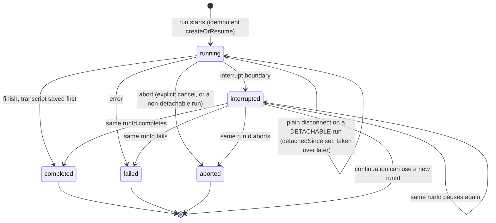
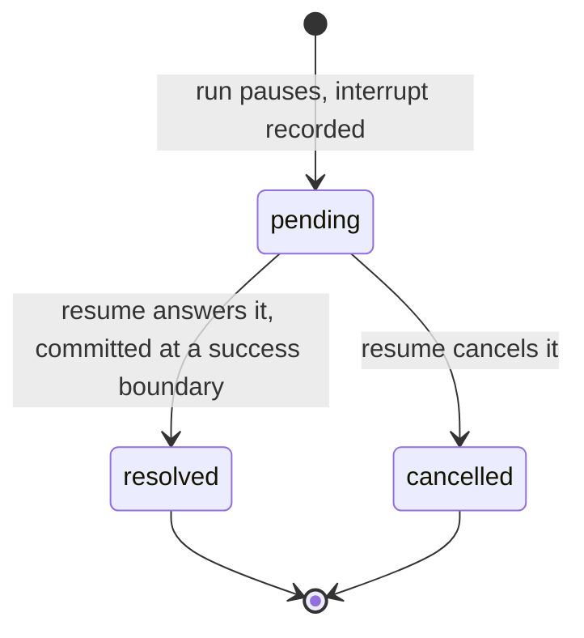

This page covers the details of `withPersistence` that you need only for special cases. Set up the basics first with [Chat persistence](./chat-persistence).

## Subagent cards on reload

When the run store keeps the link from a child run to its parent, a reload shows each subagent as a card.

Save these three fields on the child run. `createOrResume` writes them on the first insert:

- `parentRunId`: the chat run that started the child.
- `subagentRunId`: the child run id.
- `name`: the agent name.

`reconstructChat` calls `listByParentRun`. It puts one card on the parent assistant message for each child. Each card gets the full transcript of the child back: text, reasoning, tool calls, and tool results. Nested children come back as nested cards.

A child that waits for an approval comes back with `status: 'suspended'`, and its interrupt stays pending. The reloaded client can answer it, and the next run continues that child.

A tool call can start a child. Then the card sits on the message with that tool call. `reconstructChat` finds the parent run with `listByThread`, so implement that method too.

Put `withPersistence` on the parent `chat()` only. The parent stores the child runs. If a child also has `withPersistence`, it stores the same child a second time, and its interrupt records conflict with the records of the parent.

Subagent support is optional. If the store has no `listByParentRun`, a reload shows the saved text without the cards. The conformance suite skips the subagent checks, and you do not need a `skipMethods` entry.

The columns and the method are in the [store reference](./store-reference).

## AG-UI activity rows on reload

An AG-UI `ACTIVITY_SNAPSHOT` or `ACTIVITY_DELTA` event shows in the client as a `role: 'activity'` row, for example a search progress card. The `messages` store keeps only model messages, so a reload loses that row. Add an `activities` store to keep it.

1. Give the backend an `activities` store. `memoryPersistence()` already has one. For your own backend, type it with `defineActivityStore`:

   ```ts
   import {
     composePersistence,
     defineActivityStore,
   } from '@tanstack/ai-persistence'
   import type { ActivityRecord } from '@tanstack/ai-persistence'
   import { persistence as base } from './persistence'

   const rows = new Map<string, Array<ActivityRecord>>()

   export const persistence = composePersistence(base, {
     overrides: {
       activities: defineActivityStore({
         loadActivities: async (threadId) => rows.get(threadId) ?? [],
         // Full overwrite: `list` is the complete activity list for the thread.
         saveActivities: async (threadId, list) => {
           rows.set(threadId, list)
         },
       }),
     },
   })
   ```

2. Keep your `withPersistence(persistence)` route and your `reconstructChat` `GET` endpoint. They save and restore the rows when `stores.activities` is set.

3. Show the rows in the client. Each row has one part with `type: 'activity'`:

   ```tsx
   import { fetchServerSentEvents, useChat } from '@tanstack/ai-react'

   function Chat({ threadId }: { threadId: string }) {
     const { messages } = useChat({
       threadId,
       connection: fetchServerSentEvents('/api/chat'),
       persistence: true,
     })
     return (
       <div>
         {messages.map((message) =>
           message.role === 'activity' ? (
             <div key={message.id}>
               {message.parts.map((part, index) =>
                 part.type === 'activity' ? (
                   <pre key={index}>
                     {part.activityType}: {JSON.stringify(part.content)}
                   </pre>
                 ) : null,
               )}
             </div>
           ) : (
             <div key={message.id}>{message.role}</div>
           ),
         )}
       </div>
     )
   }
   ```

Some facts about activity rows:

- The model never gets activity rows as input.
- A failed activity save does not fail the run.
- Each `ActivityRecord` keeps the `metadata` of the row.

## Keep every stored message

`withPersistence` merges the incoming `messages` into the stored thread by id.

If `messages` is empty, the middleware loads the stored transcript, and the run continues from there.

If `messages` is not empty, the middleware merges by id:

- The last incoming id that is also in the stored thread is a cutoff. Stored messages after it are dropped. That is how a reload removes the old assistant message.
- If no incoming id is in the stored thread, every stored message stays. This is a new turn.
- If an id is in both lists, the incoming message wins.
- New ids and messages with no id go at the end.

`saveThread` replaces the stored thread with the merged list.

A client with `history: { pageSize }` posts only the new turn. A reload posts the last user message. A resume posts from that user message through the assistant message on screen. See [Client persistence](./client-persistence).

## Compaction keeps the transcript complete

You can add [`withCompaction`](../advanced/compaction) to the same `chat()`. The saved thread stays the true copy:

- Compaction changes only the context sent to the provider, not `ctx.messages`.
- The message store keeps the dropped content.
- Summaries do not replace old turns.
- Cleared tool output stays available for reloads.

If your adapter provides `stores.metadata`, `withPersistence` gives it to other middleware. Compaction uses it for validated checkpoints. See [Compaction and persistence](../advanced/compaction#compaction-and-persistence).

## What gets persisted, and when

`withPersistence` writes at four moments, so a reload never loses a turn:

| Moment | What is written | Best effort? |
| --- | --- | --- |
| **Start of a run** (`onStart`) | The pending turn: the user message that was just sent, plus the prior history. A reload during generation still shows the question. | Yes. A failure does not stop the run. The finish write is the one that counts. |
| **Interrupt boundary** | New interrupt records, run status `interrupted`, known usage, and a snapshot of the current messages. | No. Store errors go to the caller. |
| **Finish** (`onFinish`) | The complete transcript, run status `completed`, known usage, and the commit of the resumes that the run used. The transcript includes the completed assistant messages, the stream `messageId` of the last reply (so a reload keeps the same message id), and any completed structured-output part. | No. The transcript is saved **before** the run is marked completed. |
| **While streaming** (optional) | Partial assistant text, throttled, when `snapshotStreaming: true`. | Yes. |

Streaming snapshots are off by default, because the finish write is the true save. Turn them on to keep partial output, at the cost of more writes:

```ts
import { withPersistence } from '@tanstack/ai-persistence'
import { persistence } from './persistence'

const streamingMiddleware = [
  withPersistence(persistence, {
    snapshotStreaming: true,
    snapshotIntervalMs: 1000, // The default.
  }),
]
```

A snapshot row keeps the call metadata of a finished message, such as `source` and `responseId`, and no other chunk metadata. If the run fails or aborts after a snapshot, the snapshot stays as its assistant message. Its `metadata.tanstack.stopReason` is `'error'` or `'aborted'`.

### Structured output in the saved transcript

The chat engine completes the transcript before `onFinish` runs, and `withPersistence` saves that transcript as it is:

- Native-combined output keeps the structured result on the last assistant message.
- Separate finalization can keep a plain-text assistant message, then a structured-output assistant message.
- Harness adapters emit `structured-output.complete` during the run. A new message id stores the prose and the structured output as two assistant messages. The id of the last text message keeps both on one assistant message.

A client with `persistence: true` loads that transcript on mount. Read the structured-output part from `messages[].parts`:

```tsx
import { fetchServerSentEvents, useChat } from '@tanstack/ai-react'
import { z } from 'zod'

const PersonSchema = z.object({ name: z.string() })

function PersistentStructuredChat({ threadId }: { threadId: string }) {
  const { messages } = useChat({
    threadId,
    connection: fetchServerSentEvents('/api/chat'),
    persistence: true,
    outputSchema: PersonSchema,
  })

  return (
    <div>
      {messages.map((message) => {
        const part = message.parts.find(
          (candidate) => candidate.type === 'structured-output',
        )
        if (!part) return null
        const person = part.data ?? part.partial
        return <p key={message.id}>{person?.name}</p>
      })}
    </div>
  )
}
```

The matching server `GET` uses `reconstructChat`. See [Client persistence](./client-persistence).

### Errors and aborts

- On an **error**, the run is marked `failed`.
- On an **abort**, the run is marked `aborted` with a `finishedAt`.
- `interrupted` is written only at an interrupt boundary, and it is not terminal.
- Both terminal paths keep the usage that the provider reported before the error or abort.

Resumes that `onConfig` accepts are **not** consumed until a success boundary (an interrupt or the finish). If a run fails before the resume commit, every pending interrupt stays open for a retry. The same is true when an atomic `commitBatch()` fails: the whole batch stays pending.

The sequential fallback (a store with no `commitBatch()`) is different. A write can fail after earlier entries were committed. In that case, load the current pending interrupt records of the thread again, and send only the batch that remains. Do not send the original full batch again.

### Detached runs

One abort does **not** end the run: a plain client disconnect on a run that other middleware marks as *detachable*. In practice, that is `withSandbox` with a durable event log and a run store.

For that run:

- `onAbort` writes nothing, and the record stays `'running'`.
- The detach path records `detachedSince`, so a later request can take the run over.

The middleware never reads intent from the disconnect. A user who presses Stop and a user who closes the tab make the same connection close. A cancel arrives on a separate path: as the abort reason of the run, or as `RunRecord.cancelRequested`. Either one makes the abort terminal again. See [Takeover & Detached Runs](../sandbox/takeover#detach-vs-cancel).

### The run lifecycle

`completed`, `failed`, and `aborted` are terminal. `interrupted` is **parked**, not terminal.

The normal client flow starts a continuation with a new `runId`. A server integration can use the same `runId` again. Then `createOrResume` keeps the status `interrupted` until the next interrupt or terminal boundary. `findActiveRun` returns only `running` records, so it cannot find a same-id continuation while that continuation runs.



## How interrupts resume

Persistence is the **server-authoritative resume path**. For each request with a `resume` batch, the middleware does these steps:

1. It validates every entry of the batch against the pending interrupts before it continues.
2. It builds `ChatResumeToolState`: approvals, client-tool results, and generic requests.
3. It **clears** `config.resume`, so the chat engine skips its own short-lived rebuild. That rebuild needs client message history, and the persistence flow does not send it.
4. It commits all resolved and cancelled entries at one success boundary: the next interrupt or the finish.

An `InterruptStore` can implement `commitBatch()` to make that commit atomic. Without it, the fallback writes the entries one at a time, and the write is not atomic.

`onInterruptResolution` runs at the same moment as in a request without persistence: after the init `onConfig`, before `onStart`. See [Apply Answers](../interrupts/apply-answers).

An interrupt record starts as `pending`, and only a commit moves it. With `commitBatch()`, a failed commit leaves the full batch open for an answer again. With the sequential fallback, load the records again first, because some earlier entries can already be resolved or cancelled:



## Locks across workers

If other middleware needs a mutex across server instances, add `withLocks` next to `withPersistence`. See [Locks](../advanced/locks).
