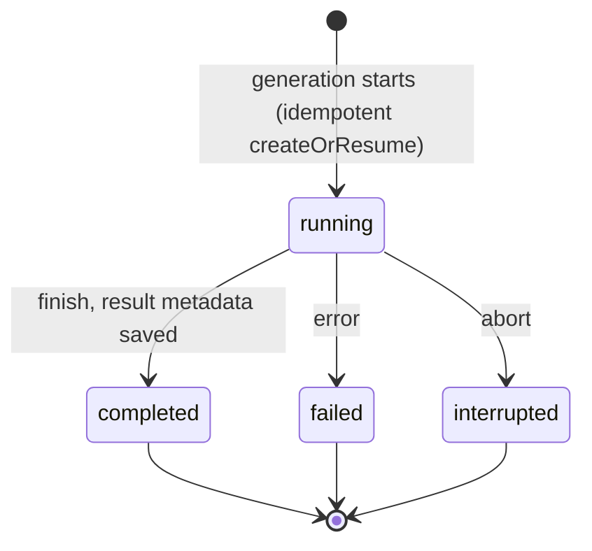
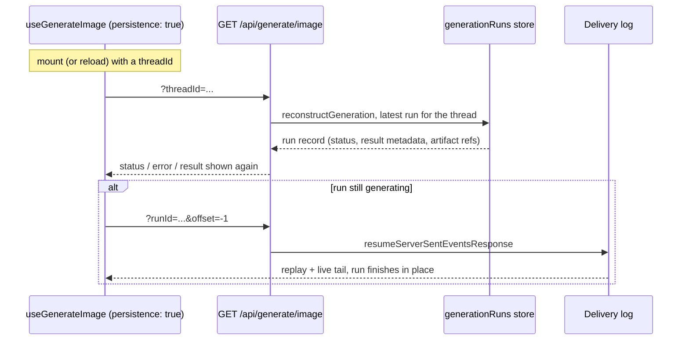

Media generation takes time, and a video can take minutes. If the user reloads the page or the connection drops during the run, the run is lost.

Generation persistence keeps a small record of each run. On reload, it puts the run back into the normal `status`, `result`, and `error` fields of the hook. So a restored run looks like a live run.

Use it when a run is long enough that a reload matters: video, batch images, long audio, or a big transcription. For a quick image that you show once, you do not need it.

## Quick setup

### 1. Install the package

<!-- ::start:tabs variant="package-manager" mode="install" -->

react: @tanstack/ai-persistence
vue: @tanstack/ai-persistence
solid: @tanstack/ai-persistence
svelte: @tanstack/ai-persistence
preact: @tanstack/ai-persistence
angular: @tanstack/ai-persistence
vanilla: @tanstack/ai-persistence
octane: @tanstack/ai-persistence

<!-- ::end:tabs -->

### 2. Add the server route

Add a `POST` that runs the generation, and a `GET` on the same route that answers the hydration on mount:

```ts group=generation-server-driven
import {
  generateImage,
  generationParamsFromRequest,
  memoryStream,
  resumeServerSentEventsResponse,
  toServerSentEventsResponse,
} from '@tanstack/ai'
import { openaiImage } from '@tanstack/ai-openai'
import {
  memoryPersistence,
  reconstructGeneration,
  withGenerationPersistence,
} from '@tanstack/ai-persistence'

const persistence = memoryPersistence()

export async function POST(request: Request) {
  const durability = memoryStream(request)
  const { input, threadId } = await generationParamsFromRequest('image', request)

  if (typeof input.prompt !== 'string') {
    throw new Error('This endpoint accepts text image prompts only.')
  }

  // Persistence files each run under its threadId. Without one, the client
  // cannot find the run again.
  if (threadId === undefined) {
    return new Response('`threadId` is required', { status: 400 })
  }

  const stream = generateImage({
    adapter: openaiImage('gpt-image-2.5-flare'),
    prompt: input.prompt,
    // The same slot the GET below finds the last run for.
    threadId,
    stream: true,
    // `artifactUrl` is optional. It makes the restored media load from your
    // own origin. See Keep generated files for the route it points at.
    middleware: [
      withGenerationPersistence(persistence, {
        artifactUrl: (ref) => `/api/generate/image/artifact?id=${ref.artifactId}`,
      }),
    ],
  })

  return toServerSentEventsResponse(stream, {
    durability: { adapter: durability },
  })
}

export function GET(request: Request): Response | Promise<Response> {
  const durability = memoryStream(request)
  // A reconnecting client sends a resume cursor. Replay the live stream.
  if (durability.resumeFrom() !== null) {
    return resumeServerSentEventsResponse({ adapter: durability })
  }
  // Otherwise this is the hydration on mount (?threadId). In a multi-user app,
  // pass the `authorize` option so a guessed threadId cannot read another
  // user's generation.
  return reconstructGeneration(persistence, request)
}
```

### 3. Turn it on in the hook

Pass a connection, a stable `threadId`, and `persistence: true`:

```tsx
import { fetchServerSentEvents, useGenerateImage } from '@tanstack/ai-react'

const connection = fetchServerSentEvents('/api/generate/image')

export function HeroImageGenerator({ threadId }: { threadId: string }) {
  const image = useGenerateImage({
    threadId,
    connection,
    persistence: true,
  })

  return (
    <section>
      <button
        type="button"
        disabled={image.isLoading}
        onClick={() =>
          void image.generate({ prompt: 'A glass cabin in a pine forest' })
        }
      >
        Generate
      </button>

      {image.status === 'success' ? (
        <p>Last run finished{image.result?.id ? ` (${image.result.id})` : ''}.</p>
      ) : null}
      {image.error ? <p>Last run failed: {image.error.message}</p> : null}
      {image.result?.images.map((img, index) =>
        img.url ?  : null,
      )}
    </section>
  )
}
```

Generate an image, then reload the page. The hook shows the last run again. Reload while the run still generates, and the hook joins the run and finishes it in place.

## The thread id is a slot

For a generation, the `threadId` is a **slot**, not a conversation. It is a stable name that you choose for the place that runs fill, for example `product-7-hero` or `video-9-start-frame`.

- Each run gets its own `runId` and its own record.
- On reload, the hook gets the newest run in the slot.
- Pass the same string to the hook and to the activity, and keep it stable across reloads. The middleware reads it from the activity.

[Id map](./id-map) explains how to choose one, and what goes wrong when it changes.

## How it works

`persistence` on the hook is a boolean:

- **`true`**: the server keeps the record. On mount, the hook loads the last run for its `threadId` and shows it again.
- **`false` or omitted**: off. The run lives in memory only, and a reload starts empty.

`withGenerationPersistence` writes the record to a `generationRuns` store. That store is keyed by the `runId` of the run, and it records the `threadId` as the slot. `memoryPersistence()` has one by default. For your own backend, see [Build a generation adapter](./build-your-own-generation-adapter).

The browser caches nothing. So the history is never copied into local storage, and a second device sees the same run.

A run can be **still generating** when the connection drops or the page reloads. Then the client joins it again and finishes it in place, like `useChat` does. Two parts make this work:

- The `durability` adapter on `toServerSentEventsResponse`.
- The resume branch of the `GET`. On mount, `reconstructGeneration` reports the live run, and the client follows it through the durability log.

In production, replace `memoryStream` with `durableStream` from `@tanstack/ai-durable-stream`, because requests then run in many processes. See [Resumable Streams](../resumable-streams/overview).

## What a reload restores

- **The hook looks the same as a live run.** After a reload, it shows `status` (`'idle'`, `'generating'`, `'success'`, or `'error'`), `error`, and `result`. There is no separate snapshot field to show.
- **`result` comes back only with byte storage.** The run record keeps result metadata, never the media bytes. Without byte storage, a reload restores `status` and `error`, and `result` stays `null`. Add byte storage and `artifactUrl` ([Keep generated files](./keep-generated-files)), and the hook rebuilds `result` with media from your own origin.

## Advanced

### The run lifecycle

The record has one status field that the middleware moves forward:



A restored `interrupted` run shows in the hook as an error. You cannot resume an aborted generation. You can only run it again.

This is the flow on mount:



### Server functions / direct

The HTTP adapters handle hydration and rejoin for you. With [TanStack Start](https://tanstack.com/start) server functions, or any direct in-process call, there is no `GET` route. So you supply two handlers yourself:

- One for the hydration on mount.
- One that replays a run that still generates.

Pass them as options next to the `fetcher`, or to `stream()` or `rpcStream()`.

Three server functions cover it:

1. `generateImageFn` runs the generation.
2. `getImageHydrationFn` answers the hydration with `getGenerationHydration`.
3. `joinImageRunFn` replays the durability log of the run with `replayRunStream`.

The two streaming functions both return an SSE `Response` from `toServerSentEventsResponse`, so the client decodes them the same way:

```ts group=generation-server-functions
// server/image.ts
import { createServerFn } from '@tanstack/react-start'
import { z } from 'zod'
import {
  generateImage,
  memoryStream,
  replayRunStream,
  toServerSentEventsResponse,
} from '@tanstack/ai'
import { openaiImage } from '@tanstack/ai-openai'
import {
  getGenerationHydration,
  memoryPersistence,
  withGenerationPersistence,
} from '@tanstack/ai-persistence'
import type { ImageGenerateInput } from '@tanstack/ai-client'

const persistence = memoryPersistence()

export const generateImageFn = createServerFn({ method: 'POST' })
  .inputValidator((data: ImageGenerateInput & { threadId: string }) => data)
  .handler(({ data: { threadId, ...input } }) => {
    if (typeof input.prompt !== 'string') {
      throw new Error('This endpoint accepts text image prompts only.')
    }
    // One run id for both the durability log and the run record, so the
    // rejoin below replays the same run that hydration reports.
    const runId = crypto.randomUUID()
    const stream = generateImage({
      adapter: openaiImage('gpt-image-2.5-flare'),
      prompt: input.prompt,
      threadId,
      runId,
      stream: true,
      // `artifactUrl` is optional. See Keep generated files.
      middleware: [
        withGenerationPersistence(persistence, {
          artifactUrl: (ref) => `/api/generate/image/artifact?id=${ref.artifactId}`,
        }),
      ],
    })
    return toServerSentEventsResponse(stream, {
      durability: { adapter: memoryStream({ runId }) },
    })
  })

/**
 * The wire shape for mount hydration, parsed with Zod so that:
 * - TanStack Start gets a JSON-serializable return type (the `result` of the
 *   run record is loosely typed, and the Start serializer rejects `unknown`)
 * - the stored record is validated before it goes over the wire
 */
const hydrationSchema = z.object({
  resumeSnapshot: z
    .object({
      schemaVersion: z.literal(1),
      resumeState: z
        .object({ threadId: z.string(), runId: z.string() })
        .nullable(),
      status: z.enum(['idle', 'running', 'complete', 'error']),
      // `z.any()` (not `z.unknown()`) so the Start serializer accepts the values.
      result: z.record(z.string(), z.any()).optional(),
      error: z
        .object({ message: z.string(), code: z.string().optional() })
        .optional(),
      activity: z.string().optional(),
    })
    .nullable(),
  activeRun: z.object({ runId: z.string() }).nullable(),
})

export const getImageHydrationFn = createServerFn({ method: 'GET' })
  .inputValidator(z.string().min(1))
  .handler(async ({ data: threadId }) => {
    // `getGenerationHydration` does no auth. Check the session here, the
    // way you pass `authorize` to `reconstructGeneration`.
    return hydrationSchema.parse(
      await getGenerationHydration(persistence, threadId),
    )
  })

export const joinImageRunFn = createServerFn({ method: 'GET' })
  .inputValidator(z.string().min(1))
  .handler(({ data: runId }) =>
    // The same SSE envelope that `generateImageFn` returns, so one client-side
    // decoder covers both.
    toServerSentEventsResponse(replayRunStream(memoryStream({ runId }))),
  )
```

On the client, pass the two handlers next to the `fetcher`. A reload then loads the last run through `getImageHydrationFn`. A run that still generates finishes through `joinImageRunFn`.

`joinRun` yields `StreamChunk`s, not a `Response`. So decode the SSE body yourself and apply the `signal` there. The server function itself takes only its `data`:

```tsx
import { useGenerateImage } from '@tanstack/ai-react'
import type { StreamChunk } from '@tanstack/ai'
import {
  generateImageFn,
  getImageHydrationFn,
  joinImageRunFn,
} from './server/image'

/** Decode an SSE `Response` from a server function into `StreamChunk`s. */
async function* chunksFromSseResponse(
  response: Response,
  signal?: AbortSignal,
): AsyncGenerator<StreamChunk> {
  if (!response.ok) throw new Error(`Join failed: ${response.status}`)
  const reader = response.body?.getReader()
  if (!reader) return
  const decoder = new TextDecoder()
  let buffer = ''
  try {
    while (!signal?.aborted) {
      const { done, value } = await reader.read()
      if (done) break
      buffer += decoder.decode(value, { stream: true })
      const lines = buffer.split('\n')
      buffer = lines.pop() ?? ''
      for (const line of lines) {
        if (!line.startsWith('data:')) continue
        const data = line.slice(5).trimStart()
        // `JSON.parse` returns the chunk that the server encoded.
        if (data) yield JSON.parse(data)
      }
    }
  } finally {
    reader.releaseLock()
  }
}

export function HeroImageGenerator({ threadId }: { threadId: string }) {
  const image = useGenerateImage({
    threadId,
    fetcher: (input) => generateImageFn({ data: { ...input, threadId } }),
    hydrateGeneration: (id) => getImageHydrationFn({ data: id }),
    joinRun: async function* (runId, signal) {
      const response = await joinImageRunFn({ data: runId })
      if (!(response instanceof Response)) {
        throw new Error('joinImageRunFn should return an SSE Response')
      }
      yield* chunksFromSseResponse(response, signal)
    },
    persistence: true,
  })
  // The render is the same as in the HTTP example above.
  return <p>{image.status}</p>
}
```

Some facts about these handlers:

- A non-streaming `fetcher` returns a plain `Promise<ImageGenerationResult>`, not an SSE `Response`. It has no live stream to rejoin, so it needs only `hydrateGeneration`. Remove `joinRun` and the decoder.
- A restored run can still be generating with **no** `joinRun` handler to follow it. Then it shows as an interrupted error, which you can run again. It does not stay on `generating` forever.
- The same handlers fit the lightweight connection adapters: `stream(factory, { hydrateGeneration, joinRun })` and `rpcStream(call, { hydrateGeneration, joinRun })`. These adapters also accept a chat `hydrate` handler for the server-driven persistence of `useChat`.

### Non-streaming video is two calls

`generateVideo({ stream: true })` runs the full create, poll, and complete lifecycle in one call. So persistence sees one run, and this section does not apply.

Without `stream: true`, it is two calls, and the video does not exist when the first call returns:

```ts
import { generateVideo, getVideoJobStatus } from '@tanstack/ai'
import {
  memoryPersistence,
  withGenerationPersistence,
} from '@tanstack/ai-persistence'
import { openaiVideo } from '@tanstack/ai-openai'

const persistence = memoryPersistence()
const adapter = openaiVideo('sora-2')
const middleware = [withGenerationPersistence(persistence)]
const threadId = 'product-7-launch-clip'

// Opens the run. Status `running`, and there is no video yet.
const { jobId } = await generateVideo({
  adapter,
  prompt: 'A cat chasing a dog in a sunny park',
  threadId,
  middleware,
})

// Completes that same run. This call writes the video and its artifacts.
const status = await getVideoJobStatus({ adapter, jobId, threadId, middleware })
```

Pass the same `threadId` and `middleware` to both calls.

- **The `jobId` links the two calls.** The run id comes from it. So the poll finds the run that the submit opened, even from a different request or process. You store nothing.
- Until a poll sees a terminal job state, the record stays `running`. That is correct: a client that loads that slot sees a generation that is still running.
- A submit that fails records a terminal `error` run. So a reload shows the failure, not an empty slot.
