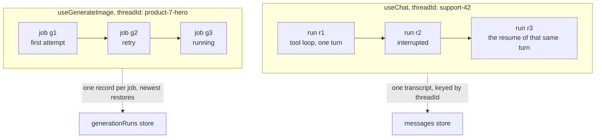

Your chat comes back empty after a reload. Or an image panel shows the image of a different panel. Almost always, the cause is the ids. TanStack AI has two ids, and persistence works only when you choose the first one yourself and keep it stable.

| Id | Names | Lifetime | Who sets it |
| --- | --- | --- | --- |
| `threadId` | The thing that runs belong to: a conversation, or a generation slot | As long as your app uses the same string | You, from your own data |
| `runId` | One execution: one streamed answer, one generation job | Starts with the execution, ends with it | The library |

## Set the ids

1. Make a `threadId` from your own data: a conversation id, a product id, a route param.
2. Pass that `threadId` to every hook that has `persistence` on.
3. Read `runId` from the hook only when you must tell your server about the work that runs now.

```tsx
import {
  fetchServerSentEvents,
  useChat,
  useGenerateImage,
} from '@tanstack/ai-react'

export function ProductPage({ productId }: { productId: string }) {
  // Chat: the thread id names a conversation.
  const support = useChat({
    threadId: `support-${productId}`,
    connection: fetchServerSentEvents('/api/chat'),
    persistence: true,
  })

  // Generation: the thread id names a slot that jobs fill.
  const hero = useGenerateImage({
    threadId: `product-${productId}-hero`,
    connection: fetchServerSentEvents('/api/generate/image'),
    persistence: true,
  })

  // Each hook also reports the id of whatever runs right now.
  return (
    <p>
      chat run {support.runId ?? 'none'}, image job {hero.runId ?? 'none'}
    </p>
  )
}
```

Reload the page. Each hook finds its record again, because the `threadId` strings are the same.

> [!WARNING]
> Do not put `crypto.randomUUID()` or `useId()` in a `threadId`. Each mount then gets a new key, and nothing restores.

`threadId` is the only identity on chat and generation clients. There is no separate `id` option.

## How it works

- Persistence writes one record per `threadId`. A reload reads the record by `threadId`.
- On `useChat`, the thread is the conversation. All runs add messages to one transcript.
- On a generation hook, the thread is a slot. Each job gets its own record, and a reload restores the newest job in the slot.
- A `runId` is made fresh for each execution. You never pick it.

Restore starts from the thread because a page that reloaded does not know the last `runId`. It does know its `threadId`, because your app made it from a product id or a route param. So the client sends the thread. The store answers with what happened in it, plus the run that still goes on, if there is one. Only then does the client read that run's delivery log.

## When restore does nothing

Look for one of these causes:

- **The thread id changed.** A random value in the id makes a new key on each mount. Log the id on the client and on the server, and compare the two strings.
- **The client and the server use different ids.** The hook files under one id and the middleware under another. They must match exactly.
- **You keyed on a run id.** A fresh page load cannot find anything by `runId` alone. Restore starts from the thread.
- **Byte storage is off.** A generation record never holds media bytes. `status` and `error` come back, but `result` stays `null`. Add [byte storage](./keep-generated-files) to get the media back too.

## Advanced

### On generation, the thread is a slot

A generation job does not add to anything. It makes one result. So each job gets its own record, linked to the thread. Restore gives back the most recent job for that thread: its status, its error, and its result metadata.

The first attempt, the retry, and the regenerate after a prompt change all land in one slot. The latest one is what the user sees. That is why a generation thread id reads like a place in your app:

| The thing on screen | A good `threadId` |
| --- | --- |
| The hero image for a product | `product-${productId}-hero` |
| The start frame of a video | `video-${videoId}-start-frame` |
| The voice-over of a chapter | `chapter-${chapterId}-narration` |
| A transcription of an upload | `upload-${uploadId}-transcript` |
| The support conversation | `chat-${conversationId}` |

Two rules follow from "one slot, latest job wins":

- **Two different things need two different ids.** If a hero-image hook and a thumbnail hook share a thread, each one restores whatever ran last, in the UI of the other.
- **The same thing keeps its id forever.** A regenerate is a new job in the same slot, not a new slot. That is why a reload lands on the newest attempt.

### On chat, a run is one turn

A run is everything between one `RUN_STARTED` and its `RUN_FINISHED`. Each hook reports the run that this client has in flight, or `null` when there is none.

On chat, the runs do not map one-to-one to what the user did:

- **A whole tool loop is one run.** The model calls a tool, gets the result, calls another tool, and writes the answer. However many loops the [agentic cycle](../chat/agentic-cycle) takes, that is one `runId`.
- **One user message can make several runs.** An [interrupt](../interrupts/overview) ends the run. The resume continues the same turn under a **new** `runId`. Approve two tools one after the other, and one message spans three runs.
- **A paused run is not in flight.** While a run waits for an approval, `runId` is `null`.

So `useChat().runId` tells you what this client runs now. It does not tell you which message is which. In a [live subscription](../chat/streaming), a run that another client started is not yours to cancel, so the hook does not report it.



### On generation, a run is the job

One call to `generate(...)` is one job with one `runId`. There is no tool loop and no interrupt, so the mapping is one-to-one. The `runId` is the handle on the provider work in progress.

Send that id to your own server when you cancel. `stop()` only stops the local stream. It does not stop a video render that still costs credits at the provider:

```tsx
import { fetchServerSentEvents, useGenerateVideo } from '@tanstack/ai-react'

export function VideoPanel({ videoId }: { videoId: string }) {
  const video = useGenerateVideo({
    threadId: `video-${videoId}-clip`,
    connection: fetchServerSentEvents('/api/generate/video'),
    persistence: true,
  })

  async function cancel() {
    // Stop the provider job on the server, then drop the local stream.
    if (video.runId) {
      await fetch(`/api/generate/video/cancel?runId=${video.runId}`, {
        method: 'POST',
      })
    }
    video.stop()
  }

  return (
    <button type="button" onClick={() => void cancel()} disabled={!video.runId}>
      Cancel
    </button>
  )
}
```

A durability log is keyed by the same id. So `runId` is also the right value for a log line when you follow one execution across your server. See [Threads and runs](../chat/stream-events#threads-and-runs) for the protocol and [Resumable streams](../resumable-streams/overview) for the log.

### The server uses the same thread id

Persistence works only when the client and the server file under the same string. On the client, that is the hook's `threadId`. On the server, it is the activity's `threadId`. For generation, the middleware reads it from the activity, so you do not repeat it on `withGenerationPersistence`:

```ts
import {
  generateImage,
  generationParamsFromRequest,
  toServerSentEventsResponse,
} from '@tanstack/ai'
import { openaiImage } from '@tanstack/ai-openai'
import {
  memoryPersistence,
  withGenerationPersistence,
} from '@tanstack/ai-persistence'

const persistence = memoryPersistence()

export async function POST(request: Request) {
  const { input, threadId } = await generationParamsFromRequest('image', request)

  // No scope means no place to file the job, so nothing can hydrate it.
  // Reject the request. Do not invent an id.
  if (threadId === undefined) {
    return new Response('`threadId` is required', { status: 400 })
  }
  if (typeof input.prompt !== 'string') {
    throw new Error('This endpoint accepts text image prompts only.')
  }

  const stream = generateImage({
    adapter: openaiImage('gpt-image-2.5-flare'),
    prompt: input.prompt,
    threadId,
    stream: true,
    middleware: [withGenerationPersistence(persistence)],
  })

  return toServerSentEventsResponse(stream)
}
```

The client sends its `threadId` on the wire for you, so the hook only needs the option. Chat works the same way: the `threadId` that you pass to `useChat` is the one that `chatParamsFromRequest` gives your route, and `withPersistence` stores under it. See [Chat persistence](./chat-persistence) and [Generation persistence](./generation-persistence) for the full setup.

### When you can skip `threadId`

Without persistence, `threadId` is optional. After the view mounts, the client makes a temporary thread id for the protocol. That id is also the DevTools row for the session. The run works, but nobody can find it again, and a reload starts a new conversation. That is fine for a one-shot image that you show and forget.

With `persistence` on, `threadId` is required on the hook and on the activity that the middleware wraps. `withGenerationPersistence` throws when neither the activity nor its own `threadId` override gives one. An app that cannot name the slot has nothing to restore into.
