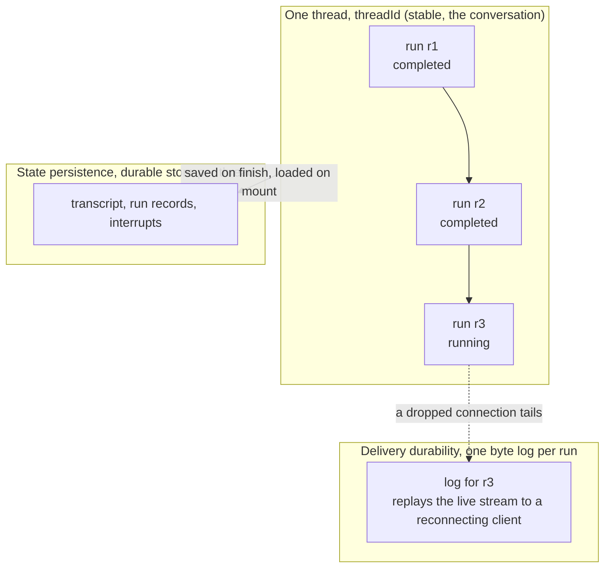
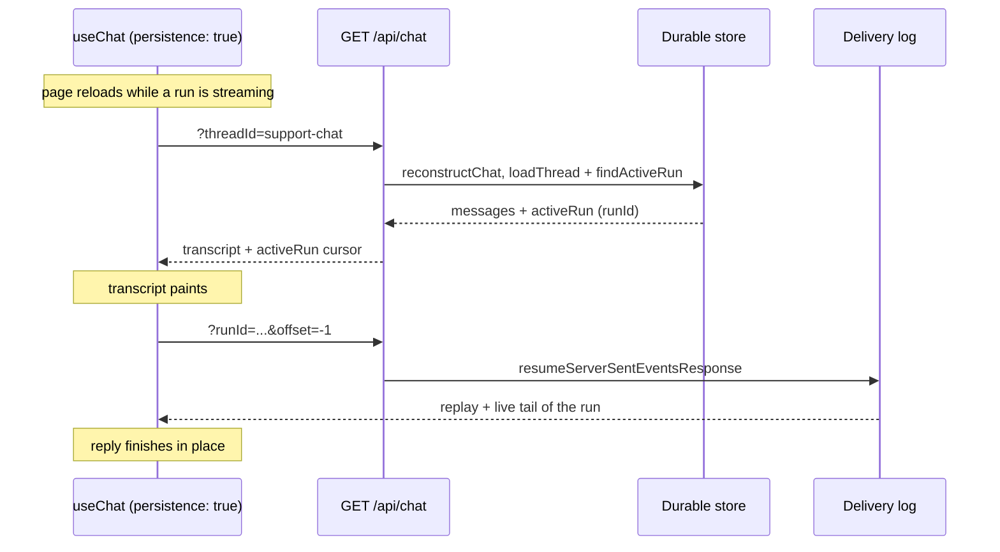

This page describes the calls a reload makes. To set persistence up, use [the overview](./overview).

## The short version

- **Two layers.** Delivery durability replays a live stream. State persistence stores the conversation. They share no code, and most apps want both.
- **Two ids.** A thread is the conversation. A run is one execution inside it. Restore starts from the thread.
- **Merge by id.** `withPersistence` merges the incoming messages into the stored thread by message id, then saves the full list.
- **Isolation is your job.** Store methods take a bare `threadId`. Authorize the user before you load or save.

## How it works

### Two layers

| Layer | Answers | Lives in | Docs |
| --- | --- | --- | --- |
| **Delivery durability** | "How do I reconnect to a stream that still runs?" | A log per run, keyed by `runId` | [Resumable Streams](../resumable-streams/overview) |
| **State persistence** | "What is the conversation, and is it still there later?" | A durable store, on the client, the server, or both | This section |

Delivery durability replays a live byte stream, so a dropped connection resumes where it stopped. State persistence stores the conversation itself, so it survives a reload and opens on another device. A replayable stream is not a saved conversation. A saved conversation is not a live stream.

### Threads and runs

A **thread** (`threadId`) is the conversation. It is stable, survives reloads, and exists on every device. A **run** (`runId`) is one execution inside the thread, made fresh for each streamed answer. A thread collects many runs. Delivery durability logs one run. State persistence stores the whole thread.



A reloading client does not always know the current run id, so it cannot reconnect by run. It reconnects from the stable `threadId`. The store answers "does this thread have a live run?" with `findActiveRun`. Only then does the client read that run's log. [Id map](./id-map) is the short version of both ids.

### Isolation is yours to enforce

Store APIs take a bare `threadId` string. That keeps adapters simple, and it makes multi-user isolation your job:

1. Derive `Scope.userId` and `Scope.tenantId` on the server, from session state.
2. Authorize before `loadThread`, `saveThread`, and `reconstructChat`. Use `reconstructChat(persistence, request, { authorize })`.
3. Never treat a thread id from the client as proof of ownership. Thread ids are easy to guess.

`Scope` is re-exported from `@tanstack/ai-persistence`, next to the store contracts.

### Who owns history when both sides persist

`withPersistence` merges the incoming `messages` into the stored thread by id:

- **Empty `messages`**: the server loads its stored transcript and continues from it.
- **Non-empty `messages`**: the last incoming id that already exists in the stored thread is a cutoff. Stored messages after it are dropped. On the same id, the incoming message wins. New ids are appended.

`saveThread` then replaces the stored thread with the merged list.

There are two postures:

- **Client-authoritative**, close to a pure single-page app. The client sends its full in-memory list. The merge keeps stored messages that the client left out, unless a shared id cuts the stored tail (a reload).
- **Server-authoritative**: the same thread opens on another device. With `history: { pageSize }`, the client posts only the new turn. A reload posts the last user message. A resume posts from that user message through the assistant message on screen. The merge keeps stored messages before the cutoff.

### What a reload restores

With a client storage adapter, `useChat` reads the client record on load. Then it does one of three things:

1. **The run had finished.** The record has the transcript and no resume pointer. The conversation paints from storage, with no network.
2. **The run had paused on an interrupt.** The resume pointer holds the pending interrupts. The transcript paints, and the approval UI comes back as it was.
3. **The run was still streaming.** The transcript paints from storage. Then the client rejoins the live run through the durability log, and the reply finishes in place. Only this case needs both layers.

If the connection drops while the page stays open, delivery durability reconnects by itself. Persistence matters when the page itself is gone.

In server-authoritative mode, the client paints from a server read, not from `localStorage`. A `GET` with `limit` returns the newest window and a `page` object. An older window uses `before`. The delivery log cannot supply that history, because it holds one run, not the thread.

Both layers expect the work to be over when the client comes back. Replaying a log and reading a transcript both read something that already exists. A long-running **sandboxed agent** is different: the run still goes on, and its producer was the host that disappeared. That needs a later request that adopts the run and keeps driving it. See [Takeover & Detached Runs](../sandbox/takeover).

### Why server-authoritative is the recommended default

- **One source of truth.** History lives on the server, so two copies cannot drift apart. The same conversation opens on any device and survives a restart.
- **A light client.** The browser never parses or stores a long transcript. There is no storage quota and no parse cost at startup, even for very long threads.
- **Reloads still work.** The mount `GET` paints the transcript again and reports any `activeRun`. The client rejoins that run and restores pending interrupts.
- **No wasted work.** That `GET` shares the route with the stream resume. `loadThread` returns ready messages, so nothing replays a stream to rebuild them.



## Advanced

### Separate boundaries

Server state persistence is one of three boundaries that share no code:

- **Server state** (this page): `AIPersistence` stores that the middleware lifecycle drives. This is the authoritative record.
- **Client hydration**: the browser restores a rendered conversation. See [Client persistence](./client-persistence).
- **Stream delivery**: replay of an in-flight SSE response. See [Resumable Streams](../resumable-streams/overview).

State middleware never changes chunks to add delivery offsets. It stores server event state, not the messages that the client rendered.

### Chat middleware lifecycle

`withPersistence(persistence)` makes a plan from the stores that are present. Then it acts at these hooks:

1. **`setup`** provides the persistence capability, a run-completion capability, and the core metadata and interrupts capabilities when those stores exist. It does not provide locks.
2. **`onConfig`** creates or resumes the run and seeds usage from the run record. It loads pending interrupts and validates the resume batch of the request against them. Then it merges stored messages into the request by id. An empty list loads the stored thread.
3. **`onStart`** saves the pending turn, so a reload during generation still shows the question. This save is best-effort.
4. **`onUsage`** adds up the usage of each provider terminal.
5. **`onChunk`** reacts only to a `RUN_FINISHED` with an interrupt outcome. It commits the accepted resumes, stores the new interrupts, marks the run interrupted, and saves the messages.
6. **`onFinish`** saves the full transcript first, then marks the run completed.

Usage at the interrupt boundary has two cases. A direct adapter terminal arrives before `onUsage`, so the handler includes its usage and ignores the next `onUsage`. A synthesized tool boundary arrives after the original terminal's `onUsage`, so the handler reuses that total.

Before `onFinish`, the chat engine adds the completed terminal assistant messages to `ctx.messages`:

- Native-combined output keeps the structured result on its terminal assistant message.
- Separate finalization and event-sourced harness output add a second structured-output message only when that event uses a different message id.

`onError` terminalizes the run record and does not replace the transcript. `onFinish`, `onError`, and a terminal `onAbort` all keep the usage known so far. One exception: on a run that another middleware has declared detachable, a plain disconnect (no cancel recorded in either band) writes nothing. The record stays `'running'` for a later takeover. See [Takeover & Detached Runs](../sandbox/takeover#detach-vs-cancel).

Accepted resumes are committed (interrupts marked resolved or cancelled) only at a successful boundary. If a provider failure or an abort happens between accepting a resume and reaching that boundary, the interrupt stays pending. A retry with the same resume then succeeds.

The AG-UI chunk stream does not change. Persistence does not create a second event stream.

### Reading the stores from your own middleware

Your own middleware often needs the stores that `withPersistence` already holds: an audit step that writes to `metadata`, or a guard that checks pending interrupts. If you pass the persistence object in twice, the two copies can drift apart. Read the stores as capabilities instead. Declare them in `requires`, then read them from the context:

```ts
import {
  chat,
  chatParamsFromRequest,
  defineChatMiddleware,
  toServerSentEventsResponse,
} from '@tanstack/ai'
import { openaiText } from '@tanstack/ai-openai'
import {
  InterruptsCapability,
  PersistenceCapability,
  getInterrupts,
  getPersistence,
  memoryPersistence,
  withPersistence,
} from '@tanstack/ai-persistence'
import type { ChatMiddlewareContext } from '@tanstack/ai'

const persistence = memoryPersistence()

const auditPending = defineChatMiddleware({
  name: 'audit-pending',
  // Fails at setup when no middleware provided the capability.
  requires: [PersistenceCapability, InterruptsCapability],
  async setup(ctx: ChatMiddlewareContext) {
    const stores = getPersistence(ctx).stores
    const interrupts = getInterrupts(ctx)
    const pending = await interrupts.listPending(ctx.threadId)
    await stores.metadata?.set(ctx.threadId, 'pending-count', {
      count: pending.length,
    })
  },
})

export async function POST(request: Request) {
  const { messages, threadId, runId } = await chatParamsFromRequest(request)
  const stream = chat({
    adapter: openaiText('gpt-6.1-sol'),
    messages,
    threadId,
    runId,
    // Order matters: the provider comes before the consumer.
    middleware: [withPersistence(persistence), auditPending],
  })
  return toServerSentEventsResponse(stream)
}
```

The capabilities that `withPersistence` publishes:

| Capability | Read with | Gives you | Published when |
| --- | --- | --- | --- |
| `PersistenceCapability` | `getPersistence(ctx)` | The whole `AIPersistence` object | Always |
| `InterruptsCapability` | `getInterrupts(ctx)` | The `interrupts` store | The backend has an `interrupts` store |
| `PersistenceCompletionCapability` | `getPersistenceCompletion(ctx)` | `waitForRunCompletion()` | Always |
| `MetadataCapability` (from `@tanstack/ai`) | `getMetadata(ctx)` | The `metadata` store | The backend has a `metadata` store |

`providePersistence` and `provideInterrupts` are the write halves. Use them in a middleware of your own that supplies the stores in place of `withPersistence`. Locks are a separate capability from [`@tanstack/ai/locks`](../advanced/locks).

### Generation middleware lifecycle

`withGenerationPersistence(persistence)` records the job at three points:

- `onStart` creates or resumes the run record.
- `onFinish`, `onError`, and `onAbort` terminalize it.
- A result transform writes the terminal result metadata (ids and URLs, never media bytes) onto the record.

When `artifacts` and `blobs` are both present, it also stores the generated media. Then it merges the durable refs onto the result and onto the run record.

Generation uses its own `generationRuns` store (`GenerationRunStore`), never the chat `runs` or `messages` stores. A generation has no conversation, so the run is keyed on its own `runId` (`ctx.runId ?? ctx.requestId`). The `threadId` is never the primary identity of the job.

The `threadId` is still **required**. It is the slot that the run is filed under, and `GenerationRunRecord.threadId` is a required field. The middleware resolves it as `opts.threadId ?? ctx.threadId`: normally the `threadId` that the caller passed to the activity, with the option as an override. When neither gives one, the middleware **throws**. It never makes one up from the request id. Nothing can find a run that is filed under an invented scope, so restore returns nothing forever.

### Composition semantics

```ts
import {
  composePersistence,
  memoryPersistence,
} from '@tanstack/ai-persistence'

const base = memoryPersistence()
const replacement = base.stores.messages

const result = composePersistence(base, {
  overrides: {
    messages: replacement,
    metadata: undefined,
    interrupts: false,
  },
})
```

- `messages` is replaced.
- `metadata` is inherited, because the override is `undefined`.
- `interrupts` is removed.
- Every store that you leave out is inherited.

Composition copies the store map. It does not change or dispose of either input. The return type works out which keys are required, optional, replaced, or removed. Unknown store keys fail at compile time and at runtime.

Each entrypoint adds its own runtime check:

| Entrypoint | Rule |
| --- | --- |
| `withPersistence` | Requires `messages`. Rejects `interrupts` without `runs`. |
| `withGenerationPersistence` | Requires `generationRuns`. Requires `artifacts` and `blobs` together. |
| `reconstructChat` | Requires `messages`. |
| `reconstructGeneration` | Requires `generationRuns`. |

The runtime checks are necessary because plain JavaScript, loaded configuration, and widened types can get past the static checks.

### Backend ownership

An adapter owns its resources: the connection lifecycle, when migrations run, and how each store record maps to rows. The middleware only calls store methods. It never opens a connection or reads a table. A backend can provide any subset of the stores (for example, no `metadata`), and the return type shows exactly the stores that it has. [Build a chat adapter](./build-your-own-chat-adapter) shows this end to end for SQLite.

`composePersistence` does not add distributed transactions. When related stores use different systems, the adapter author defines the retry, idempotency, and consistency behavior.

Two `RunStore` rules apply to durable runs:

- `update` must round-trip `driverEpoch`. A takeover increments this fencing token, and it is the only way a replaced host learns that it lost the run.
- `update` must tell an **omitted** patch key (leave the column alone) apart from a key set to `undefined` (clear the column). The takeover path clears `detachedSince` that way.

See [Build your own adapter](./build-your-own-adapter) and [Takeover & Detached Runs](../sandbox/takeover#requirements).
