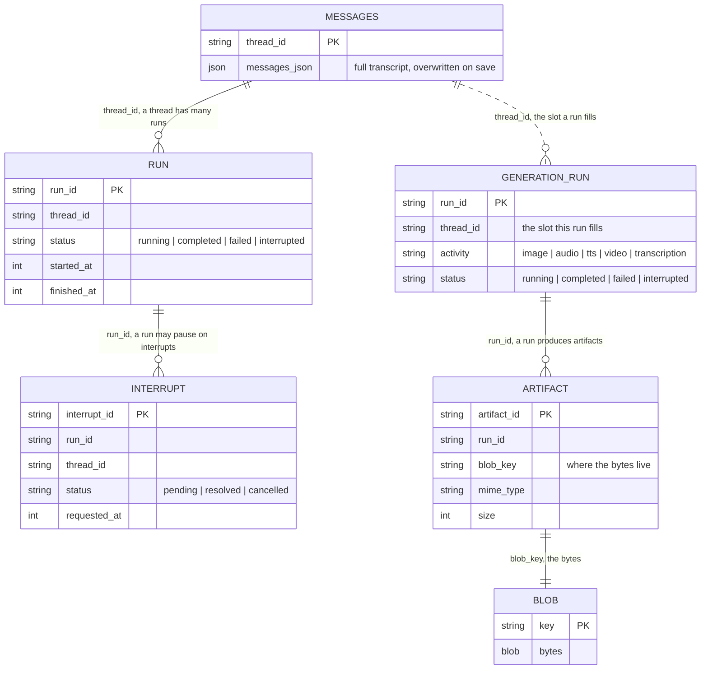

These are the public contracts from `@tanstack/ai-persistence`. Implement only the
stores you need. Middleware turns behavior on from whichever stores are present, so
there is no separate enable list.

| Store | Purpose | Used by |
| --- | --- | --- |
| `messages` | Authoritative model-message history per thread. | `withPersistence`, required |
| `runs` | Run status, timing, errors, usage. | `withPersistence` |
| `interrupts` | Pending, resolved or cancelled human waits. Needs `runs`. | `withPersistence` |
| `metadata` | App and integration key/value state. | `withPersistence` |
| `generationRuns` | Generation run status and result metadata, keyed by its own `runId`. | `withGenerationPersistence`, required |
| `artifacts` | File metadata. Needs `blobs`. | `withGenerationPersistence`, portable snapshots |
| `blobs` | File bytes. Needs `artifacts`. | `withGenerationPersistence`, portable snapshots |
| `log` | Append-only session log, with ownership, an input lane, and snapshots. | A harness host, required |
| `sessions` | One index entry per thread, for a list of sessions. | `withPersistence` (subagent children), your host code |

Named groupings of the chat stores (`ChatTranscriptStores`, `ChatPersistenceStores`,
`ChatWithInterruptsStores`) are covered in [Controls](./controls).

`runs` is typed against `RunRecord` and `RunStore` from `@tanstack/ai`, not from this
package. One definition is what lets chat persistence and a sandbox run driver key on
the same record instead of disagreeing about one run.

## MessageStore

```ts
import type { ModelMessage } from '@tanstack/ai'

type MessagePage =
  | {
      messages: Array<ModelMessage>
      truncated: false
      cursor?: never
    }
  | {
      messages: Array<ModelMessage>
      truncated: true
      cursor: string
    }

interface MessageStore {
  loadThread(
    threadId: string,
    options?: { limit?: number; before?: string },
  ): Promise<Array<ModelMessage> | MessagePage>
  saveThread(threadId: string, messages: Array<ModelMessage>): Promise<void>
}
```

- `loadThread` with only `threadId` (middleware, `onStart`, `onFinish`) returns
  the full array. Never a `MessagePage`.
- `limit` and `before` are a paging hint for hydrate. You can ignore them and
  return the full array. `reconstructChat` then slices after UI conversion.
- To page in the database, return a `MessagePage`. `truncated: true` requires a
  `cursor`. `truncated` and `cursor` use the same words as `BlobStore.list`.
- If you ignore `before` and return the newest array again, `reconstructChat`
  loads the full thread and slices.
- `saveThread` receives the full merged list. It is a replace, not an append.
  Merge by id is `withPersistence`, not this store.

`loadThread` returns `[]` (never `null`) for a thread that was never saved.

## RunStore

`RunStore` and `RunRecord` come from `@tanstack/ai`; `@tanstack/ai-persistence`
re-exports both, which is why the samples on this page import them from either
package. `RunError` is exported from `@tanstack/ai` only.

```ts
import type { TokenUsage } from '@tanstack/ai'

type TerminalRunStatus = 'completed' | 'failed' | 'aborted'
type RunStatus = 'running' | 'interrupted' | TerminalRunStatus

// Why a run failed. `message` is the provider's prose, which changes between
// model versions and cannot be branched on; `code` is the stable
// classification a consumer switches over to retry, escalate, or show a
// specific UI. Providers do not always supply one, so `code` is optional.
interface RunError {
  message: string
  code?: string
}

interface RunRecord {
  runId: string
  threadId: string
  // Present on a subagent child run. Absent on the parent chat run.
  parentRunId?: string
  subagentRunId?: string
  name?: string
  status: RunStatus
  startedAt: number // epoch ms
  finishedAt?: number // epoch ms, set once the run reaches a terminal status
  error?: RunError
  usage?: TokenUsage // reported usage accumulated for this runId
  // ---------------------------------------------------------------------------
  // DURABLE SANDBOXED RUNS ONLY. A chat app never writes these four and nothing
  // in `@tanstack/ai-persistence` reads them. Leave the columns out until you
  // wire `withSandbox(sandbox, { runs, durability })`, and see
  // [Build a Sandbox Adapter](./build-a-sandbox-adapter#the-four-run-fields)
  // for what each one does and how to prove them.
  // ---------------------------------------------------------------------------
  sandboxKey?: string // which sandbox this run is bound to
  detachedSince?: number // epoch ms since the last viewer left
  cancelRequested?: boolean // an out-of-band cancel was recorded
  driverEpoch?: number // fencing token, bumped by each host that claims the run
  // ---------------------------------------------------------------------------
  // HOST SESSIONS ONLY. A host that runs agents and activities for a long
  // session writes these. `chat()` never writes them. A store that keeps the
  // whole record keeps them too.
  // ---------------------------------------------------------------------------
  kind?: 'chat' | 'agent' | 'activity' | 'command' | 'compact'
  activity?: string // the activity of a `kind: 'activity'` run
  agent?: string // the agent name of a `kind: 'agent'` run
  result?: unknown // terminal result metadata (ids, urls, text), never bytes
  artifacts?: Array<{ artifactId: string; name?: string; mimeType?: string; url?: string }>
  principal?: { id: string } // who started the run
  leaseOwner?: string // the host that drives the run now
  leaseExpiresAt?: number // epoch ms when that claim ends
  // Crash-resume data from the last model or tool boundary.
  checkpoint?: {
    at: number
    pendingTools?: Array<{ toolCallId: string; name: string; replay: 'safe' | 'never' }>
  }
}

interface RunStore {
  // Required: insert-if-absent. An existing runId returns the stored record
  // unchanged, so resuming a run never resets its startedAt or status.
  createOrResume(input: {
    runId: string
    threadId: string
    status?: RunStatus
    startedAt: number
    // Copied on the first insert only. A later call leaves them unchanged.
    parentRunId?: string
    subagentRunId?: string
    name?: string
    kind?: RunRecord['kind']
    activity?: string
    agent?: string
    principal?: { id: string }
  }): Promise<RunRecord>
  // Required: patching an unknown runId is a no-op, not an error.
  update(
    runId: string,
    patch: Partial<
      Pick<
        RunRecord,
        | 'status'
        | 'finishedAt'
        | 'error'
        | 'usage'
        | 'sandboxKey'
        | 'detachedSince'
        | 'cancelRequested'
        | 'driverEpoch'
        | 'result'
        | 'artifacts'
        | 'leaseOwner'
        | 'leaseExpiresAt'
        | 'checkpoint'
      >
    >,
  ): Promise<void>
  // Required.
  get(runId: string): Promise<RunRecord | null>
  // Required. The most recent 'running' run for a thread (greatest
  // `startedAt` wins), or null when the thread is idle. `reconstructChat`
  // calls it to report `activeRun`, which is how a hydrating client tails a
  // run that is still generating.
  findActiveRun(threadId: string): Promise<RunRecord | null>
  // Optional. Every run for a thread, ascending by startedAt. Only needed to
  // render a thread's past agent activity.
  listByThread?(threadId: string): Promise<Array<RunRecord>>
  // Optional. Child runs for one parent, oldest startedAt first.
  // reconstructChat uses this to put subagent cards back on the parent message.
  listByParentRun?(parentRunId: string): Promise<Array<RunRecord>>
  // Optional. Runs where status is 'running' and detachedSince <= now - ttlMs
  // (inclusive). This is the query `reapDetachedRuns` (@tanstack/ai-sandbox)
  // runs to find abandoned runs; scheduling that sweep is the app's job.
  listReclaimable?(opts: {
    now: number
    ttlMs: number
  }): Promise<Array<RunRecord>>
}
```

`withPersistence` sums reported numeric usage fields across provider calls for
the same `runId`. The opaque `providerUsageDetails` field retains the latest
reported bag. Known usage is persisted when the run interrupts or reaches a
terminal status.

`createOrResume`, `update`, `get`, and `findActiveRun` are the floor: a backend
that implements those four is a valid `RunStore`. Three contracts to hold:

- `createOrResume` must be idempotent. A second call for an existing `runId`
  returns the complete stored record unchanged, including `usage`. This makes
  resuming a run safe and lets usage continue accumulating. Retries may repeat
  the same run id.
- `update` against an unknown `runId` is a no-op.
- `findActiveRun` must do real work. Stub it to `null` and `reconstructChat`
  always reports `activeRun: null`, so a client that reloads (or switches back
  to) a still-generating thread restores the transcript but never resumes the
  live reply. Nothing detects it either, because `null` is also the right answer
  for an idle thread. It was optional for exactly one release cycle and cost
  precisely that, which is why it is required now.

`listByThread`, `listByParentRun`, and `listReclaimable` are optional.
Consumers feature-detect each one. After you declare an omission of
`listByThread` or `listReclaimable` in `skipMethods`, the conformance suite
skips that method. Implement the ones
your app needs:

- Skip `listByThread` and a reload loses the cards of children that a tool call
  started. `reconstructChat` calls it to find their parent runs.
- Skip `listByParentRun` and a reload shows the saved child text. The subagent
  cards stay absent. `reconstructChat` calls this method to build the cards.
  The conformance suite skips the subagent checks when this method is absent,
  so it needs no `skipMethods` entry.
- Skip `listReclaimable` and the store cannot be reaped: `reapDetachedRuns`
  feature-detects it, logs one line, and sweeps nothing, so detached runs are
  never finalized and their sandboxes never reclaimed. `detachedSince` *is*
  populated for you by `withSandbox`'s detach path, and note that the reaper is a
  function the application schedules, so implementing this method is necessary
  but not by itself sufficient. See
  [Takeover & Detached Runs](../sandbox/takeover#configuration) for the option,
  and [Reaping & Retention](../sandbox/reaping) for the sweep itself and the
  schedules that drive it.

The four durable-run fields are a sandbox concern, so they are documented and
proven on the sandbox side:
[Build a Sandbox Adapter](./build-a-sandbox-adapter#the-four-run-fields).
`runPersistenceConformance` does not assert them, and a chat-only backend can leave
the columns out entirely. If you do wire durable sandboxed runs, run
`runDurableRunFieldsConformance` from `@tanstack/ai-sandbox/testkit` against the same
`runs` store: each field breaks one mechanism silently when dropped, which is why it
gets its own suite rather than a paragraph of warnings.

Two helpers travel with the contract, and both exist so a caller does not have
to reach for a cast:

- Deciding "can this run still emit events?" from a bare `RunStatus` string
  leaves you holding the wide union afterwards. `isTerminalRunStatus` is a type
  predicate, so inside the guard the status is a `TerminalRunStatus` and can be
  passed wherever one is required.

  ```ts
  import { isTerminalRunStatus } from '@tanstack/ai-persistence'
  import type { RunRecord, TerminalRunStatus } from '@tanstack/ai-persistence'

  function finalStatus(run: RunRecord): TerminalRunStatus | null {
    return isTerminalRunStatus(run.status) ? run.status : null
  }
  ```

- An optional method you did implement should not need a `?.` from inside your
  own code. `defineRunStore` is generic over the object you pass, so the result
  keeps that object's exact shape: `createRunStore(db).findActiveRun(threadId)`
  is a direct call on the store built in the
  [chat walkthrough](./build-your-own-chat-adapter), while a consumer holding a
  bare `RunStore` still feature-detects the same method.

Capability tiers belong at the STORE level, not the method level. A backend that
genuinely has no run lifecycle should declare `ChatTranscriptStores` and omit
`runs` entirely rather than supply a `RunStore` with a stubbed method: an absent
store is caught by the type system, an incomplete one fails silently at runtime.

`createOrResume` copies `parentRunId`, `subagentRunId`, and `name` on the first
insert. A second call for the same `runId` leaves those fields unchanged. If
the caller omits a field, omit that field on the stored record. Do not write
`''` for a field the caller did not pass.

The reference implementation, `MemoryRunStore` in
`packages/ai-persistence/src/memory.ts`, implements all seven run methods. The
`examples/ts-react-chat` SQLite adapter (`src/lib/sqlite-persistence.ts`)
implements all seven run methods.

## InterruptStore

```ts
interface InterruptRecord {
  interruptId: string
  runId: string
  threadId: string
  status: 'pending' | 'resolved' | 'cancelled'
  requestedAt: number // epoch ms
  resolvedAt?: number // epoch ms, set once resolved or cancelled
  payload: Record<string, unknown>
  response?: unknown
}

type InterruptCommitEntry =
  | { interruptId: string; status: 'resolved'; response?: unknown }
  | { interruptId: string; status: 'cancelled' }

interface InterruptStore {
  create(record: Omit<InterruptRecord, 'status' | 'resolvedAt'>): Promise<void>
  commitBatch?(entries: ReadonlyArray<InterruptCommitEntry>): Promise<void>
  resolve(interruptId: string, response?: unknown): Promise<void>
  cancel(interruptId: string): Promise<void>
  get(interruptId: string): Promise<InterruptRecord | null>
  list(threadId: string): Promise<Array<InterruptRecord>>
  listPending(threadId: string): Promise<Array<InterruptRecord>>
  listByRun(runId: string): Promise<Array<InterruptRecord>>
  listPendingByRun(runId: string): Promise<Array<InterruptRecord>>
}
```

`commitBatch` is optional. Use one database transaction for all entries when
you implement it. The legacy `resolve` and `cancel` fallback is sequential and
is not atomic.

If you implement `commitBatch`, reject the whole batch (throw, write nothing)
when any entry has a duplicate `interruptId`, names an interrupt that does not
exist, or names an interrupt that is not `'pending'`. `resolve` and `cancel`
stay no-ops for a missing `interruptId`.

`create` accepts a record without `status`/`resolvedAt` so every interrupt is
born `'pending'`; it is insert-if-absent, so a duplicate `create` never clobbers
an already-resolved interrupt. The `list*` methods return records ordered by
`requestedAt` ascending. An `interrupts` store requires a `runs` store when used
with chat persistence.

## MetadataStore

```ts
interface MetadataStore {
  get(scope: string, key: string): Promise<unknown | null>
  set(scope: string, key: string, value: unknown): Promise<void>
  delete(scope: string, key: string): Promise<void>
  // Optional: compare-and-set.
  getVersioned?(
    scope: string,
    key: string,
  ): Promise<{ value: unknown; revision: string } | null>
  setIf?(
    scope: string,
    key: string,
    value: unknown,
    expectedRevision: string | null,
  ): Promise<{ ok: true; revision: string } | { ok: false; reason: 'conflict' }>
}
```

Two writers can change the same key at the same time. Add `getVersioned` and
`setIf` so that the second write does not remove the first:

- `getVersioned` returns the value and its revision, or `null` when the key is absent.
- `setIf` writes when the stored revision equals `expectedRevision`. Pass `null` to write only when the key is absent. Success returns `{ ok: true, revision }`. A different revision returns `{ ok: false, reason: 'conflict' }` and does not write.
- Every write gives the key a new revision. A plain `set` does this too. After `delete`, the next write gets a new revision. The deleted revision is never used again.

`memoryPersistence()` has both. The conformance suite checks them when your
store has them.

Namespaces and value schemas are application-owned, and `(scope, key)` is the
composite identity. A stored `null` is indistinguishable from absence at the type
level, so wrap a value you must persist as `null` (e.g. `{ value: null }`), or
reject nullish values outright the way the SQLite store above does.

`withPersistence` also provides this store through the core
`MetadataCapability`. Middleware can use it for derived state without depending
on `@tanstack/ai-persistence`. For example, `withCompaction` stores validated
context checkpoints here. Do not place the canonical transcript in metadata;
the `messages` store owns it.

## GenerationRunStore

The generation counterpart to `RunStore`. Keyed by its own `runId`, with
`threadId` the slot `findLatestForThread` looks runs up by.
`withGenerationPersistence` requires this store, not `runs`.

Its `status` uses the same vocabulary as a chat run's `RunStatus`, so one status
column and one set of checks cover both tables.

```ts
import type { PersistedArtifactRef, TokenUsage } from '@tanstack/ai'

// The same vocabulary as a chat run's `RunStatus`.
type GenerationRunStatus =
  | 'running'
  | 'interrupted'
  | 'completed'
  | 'failed'
  | 'aborted'

interface GenerationRunRecord {
  runId: string
  threadId: string // the slot this run fills, hydrated by findLatestForThread
  activity: string // 'image' | 'audio' | 'tts' | 'video' | 'transcription'
  provider: string
  model: string
  status: GenerationRunStatus
  startedAt: number // epoch ms
  finishedAt?: number // epoch ms, set once the run reaches a terminal status
  error?: { message: string; code?: string }
  result?: unknown // terminal result metadata (ids, urls), never media bytes
  artifacts?: Array<PersistedArtifactRef> // present with an artifacts + blobs backend
  usage?: TokenUsage
}

interface GenerationRunStore {
  createOrResume(input: {
    runId: string
    activity: string
    provider: string
    model: string
    startedAt: number
    threadId: string
    status?: GenerationRunStatus
  }): Promise<GenerationRunRecord>
  update(
    runId: string,
    patch: Partial<
      Pick<
        GenerationRunRecord,
        'status' | 'finishedAt' | 'error' | 'result' | 'artifacts' | 'usage'
      >
    >,
  ): Promise<void>
  get(runId: string): Promise<GenerationRunRecord | null>
  // The most recent run filed under a thread (greatest `startedAt`), or null.
  // Required: it is the only query that hydrates a generation, so an adapter
  // without it would be indistinguishable from one whose thread has no runs:
  // `persistence: true` would silently restore nothing, forever.
  findLatestForThread(threadId: string): Promise<GenerationRunRecord | null>
}
```

Implement `createOrResume` idempotently: a second call for an existing `runId`
returns the stored record unchanged (`startedAt` / `activity` / `provider` /
`model` / `threadId` are not mutated), which is what makes resuming a run safe.
`update` against an unknown `runId` is a no-op.

## ArtifactStore

Metadata rows for persisted media. The bytes live in a `BlobStore`; this record
holds the descriptive metadata and an optional `sourceUrl` for reference-only
backends. Provide it together with a `BlobStore` to keep generated bytes.

```ts
interface ArtifactRecord {
  artifactId: string
  runId: string
  threadId: string
  blobKey?: string // where the bytes live; absent on pre-blobKey records
  name: string
  mimeType: string
  size: number
  sourceUrl?: string // where the bytes were fetched FROM (provenance)
  createdAt: number // epoch ms
}

interface ArtifactStore {
  save: (record: ArtifactRecord) => Promise<void>
  get: (artifactId: string) => Promise<ArtifactRecord | null>
  list: (runId: string) => Promise<Array<ArtifactRecord>> // [] when the run has none
  // Complete thread history, ordered by (createdAt, artifactId) ascending.
  listForThread: (threadId: string) => Promise<Array<ArtifactRecord>>
  delete: (artifactId: string) => Promise<void>
  deleteForRun: (runId: string) => Promise<void>
}
```

`list` and `listForThread` use `createdAt` first, then ordinal bytewise
`artifactId` order. Compare UTF-8 bytes from left to right. Do not use locale
collation.

## BlobStore

A durable object/blob store for the bytes. `withGenerationPersistence` writes
each generated file under the key `artifacts/<runId>/<artifactId>`.

```ts
type BlobBody =
  | ReadableStream<Uint8Array>
  | ArrayBuffer
  | ArrayBufferView
  | string
  | Blob

interface BlobRecord {
  key: string
  size?: number
  etag?: string
  contentType?: string
  customMetadata?: Record<string, string>
  createdAt?: number // epoch ms first written
  updatedAt?: number // epoch ms last overwritten
}

interface BlobObject extends BlobRecord {
  arrayBuffer(): Promise<ArrayBuffer>
  text(): Promise<string>
  body?: ReadableStream<Uint8Array>
  // The slice served, when a range was requested. Absent on a whole read.
  range?: { offset: number; length: number }
}

interface BlobListPage {
  objects: Array<BlobRecord>
  cursor?: string // present only when `truncated`
  truncated?: boolean
}

interface BlobPutOptions {
  contentType?: string
  customMetadata?: Record<string, string>
  // Exact byte length of `body`, when the producer knows it. Advisory: use it
  // to pick an upload strategy (single-shot vs multipart), never as a
  // substitute for counting the bytes you actually store.
  expectedLength?: number
}

interface BlobRange {
  offset: number // from the start of the object; must be inside it
  length?: number // defaults to "to the end"; clamped when it overshoots
}

interface BlobGetOptions {
  range?: BlobRange
}

interface BlobListOptions {
  prefix?: string
  cursor?: string
  limit?: number
}

interface BlobStore {
  put(key: string, body: BlobBody, options?: BlobPutOptions): Promise<BlobRecord>
  get(key: string, options?: BlobGetOptions): Promise<BlobObject | null>
  head(key: string): Promise<BlobRecord | null>
  delete(key: string): Promise<void>
  list(options?: BlobListOptions): Promise<BlobListPage>
}
```

Three contracts to hold for `list`:

- `prefix` matches literally and case-sensitively. Escape SQL `LIKE`
  metacharacters.
- When `limit` is given and more keys match, return `truncated: true` with a
  `cursor`. Passing that cursor back returns the strictly-following keys, so
  paging visits every key exactly once.
- `limit: 0` yields an empty, untruncated page.

And one for `put`: the body can be a `ReadableStream` with **no declared
length**. That is how a URL-fetched artifact arrives whenever the origin does
not declare one it can be held to: a chunked reply, or a compressed one whose
`content-length` describes the compressed bytes. (When the origin *does* declare
a usable length, the body reaches you exactly as `fetch` produced it, length
intact, and `expectedLength` carries the same number.) Your store must drain a
length-less stream, not require a length up front. Backends that need a declared
length for a single-shot upload (Cloudflare R2 on workerd is one) can re-attach
`expectedLength` when it is present and stream through a multipart upload when it
is not; the `ai-persistence/build-cloudflare-artifact-store` skill ships that
recipe. The conformance testkit exercises the length-less case, so a store that
only handles byte bodies fails the suite.

And one for `get`: honour `options.range` by returning **only that slice**.
`size` keeps reporting the whole object, and the returned `range` reports what
you actually served. Together they are the `206` response a media player's
seeking depends on. `resolveBlobRange(size, range)` does the clamping (a
`length` past the end is legal and clamps; an `offset` past the end throws,
because a serve route should have answered `416` from `record.size` first):

```ts ignore
import { resolveBlobRange } from '@tanstack/ai-persistence'

async get(key: string, options?: BlobGetOptions) {
  const row = await selectBlob(key)
  if (!row) return null
  if (!options?.range) return blobObject(row, row.body)
  const served = resolveBlobRange(row.size, options.range)
  // Slice at the storage layer, not after loading the whole object.
  const bytes = await selectBlobSlice(key, served.offset, served.length)
  return blobObject(row, bytes, served)
}
```

This is not optional for a store that holds bytes, and the conformance testkit
asserts it. Ignoring `range` and returning the whole file is what makes
`<video>` seeking (and Safari playback at all) fail, and it silently sends the
entire artifact for every seek. A reference-only backend that stores no bytes
skips `blobs` altogether instead.

## Session stores

A host that keeps long-lived sessions needs more than a transcript. It must remember
the inputs it accepted, the state of each thread, which host works on which thread,
and a list of sessions to show. Two stores hold that data:

- `log`: one append-only log per session tree. A harness host needs it.
- `sessions`: one index entry per thread. `withPersistence` also uses it, to index
  subagent children.

A harness host keeps the data of each tenant apart. In `log`, `metadata`, and the
media artifacts, it writes the id of the root thread as
`logIdOf({ tenantId, logId: threadId })` from `@tanstack/ai-harness`: `acme:thread-1`,
or `:thread-1` in the default tenant. Keep it as an opaque string. The session index
is the one store that keeps `tenantId` and `threadId` as two fields.

## LogStore

A host keeps the events, the transcript, the inputs, the runs, the interrupts, the
settings, the plugin state, and the tool steps of a session tree in one append-only
log. The root thread and its child threads (agent runs and subagents) share it. With the log, a turn survives a crash. When several machines
serve the sessions, the log also records which host runs each session, and it keeps
the inputs that any machine accepts. `LogStore` stores all of this.

The types, `NO_OWNER_EPOCH`, and the three errors come from `@tanstack/ai-persistence`:

```ts
const NO_OWNER_EPOCH = 0 // the epoch of a log that no host ever acquired

interface LogRecord {
  type: string
  [key: string]: unknown
}

interface LogEntry {
  seq: number // the first record of a log is at 1
  record: LogRecord
}

interface LogSnapshot {
  seq: number // the last position that `state` includes
  version: string // the version of the `state` shape, yours to name
  state: unknown // JSON
}

type OfferResult = 'offered' | 'duplicate' | 'conflict' | 'deleted'

interface OfferedInput {
  inputId: string
  record: LogRecord
  offeredAt: number // epoch ms, from the store clock
}

interface OrphanedLog {
  logId: string
  harness: string // the name of the setup that runs the log
  reason: 'expired' | 'offered' | 'wake'
}

interface LogStore {
  // Records
  append(batch: {
    logId: string
    seq: number
    epoch: number
    records: ReadonlyArray<LogRecord>
    consumes?: ReadonlyArray<string> // input ids to consume in the same write
  }): Promise<void>
  read(query: {
    logId: string
    after?: number
    limit?: number
  }): Promise<Array<LogEntry>>
  subscribe(watch: { logId: string; listener: () => void }): () => void

  // Ownership
  acquireOwnership(claim: {
    logId: string
    harness: string
    ownerId: string
    ttlMs: number
    affinity?: string
  }): Promise<{ epoch: number; expired?: boolean } | null>
  renewOwnership(claim: {
    logId: string
    ownerId: string
    epoch: number
    ttlMs: number
  }): Promise<boolean>
  releaseOwnership(claim: {
    logId: string
    ownerId: string
    epoch: number
    wakeInMs?: number
  }): Promise<void>
  pinToWorkers(pin: {
    logId: string
    epoch: number
    affinity: string | null
  }): Promise<void>
  markHostAlive(beat: { hostId: string; ttlMs: number }): Promise<void>
  listLogsWithoutOwner(query: {
    limit: number
    harnesses?: ReadonlyArray<string>
    affinity?: string
  }): Promise<Array<OrphanedLog>>

  // Input lane
  offerInput(input: {
    logId: string
    harness: string
    inputId: string
    record: LogRecord
  }): Promise<OfferResult>
  listOfferedInputs(query: { logId: string }): Promise<Array<OfferedInput>>

  // Snapshots and lifecycle
  getSnapshot(query: { logId: string }): Promise<LogSnapshot | null>
  putSnapshot(
    snapshot: { logId: string; epoch: number } & LogSnapshot,
  ): Promise<void>
  truncate(cut: {
    logId: string
    epoch: number
    beforeSeq: number
  }): Promise<void>
  deleteLog(target: { logId: string }): Promise<void>
}
```

`memoryLogStore()` is the reference store. `memoryPersistence()` includes one. To
run two store instances on one memory log, as two machines on one database, share a
`memoryLogState()`:

```ts
import { memoryLogState, memoryLogStore } from '@tanstack/ai-persistence'

const state = memoryLogState()
const first = memoryLogStore({ state })
const second = memoryLogStore({ state })
```

### Fence the writes with the epoch

Two machines can work on one log. Host A owns the log, and then it stops for a
while: a long garbage collection pause, or a lost network. Its ownership expires,
and host B acquires the log. When host A continues, it writes again. Without a
fence, the log gets the records of two owners.

The epoch is the fence. Each `acquireOwnership` that starts a new ownership adds 1 to the
epoch of the log. The owner sends that epoch with each write, and the store refuses
an old epoch. So the late write of host A rejects with `OwnershipLostError`, and the
log does not change.

`append`, `putSnapshot`, `truncate`, and `pinToWorkers` are fenced. They check the
epoch before anything else:

- On a log that a host acquired, `epoch` must be the current epoch. A released log
  refuses every epoch.
- On a log that no host acquired, `append` needs `NO_OWNER_EPOCH`. A writer that never
  calls `acquireOwnership` writes with it. `putSnapshot`, `truncate`, and `pinToWorkers` need
  an owner, so they refuse `NO_OWNER_EPOCH`.
- A deleted log refuses every epoch until the next `acquireOwnership`.
- A call with any other epoch rejects with `OwnershipLostError`, and the store writes
  nothing.

### Rules for records

`append` writes `records` at `seq`, `seq + 1`, and so on. The first record of a log
is at 1. `append` checks in this order, and the first check that fails rejects:

1. The fence.
2. `seq` is the next free position: the last position plus 1, or 1 for a new log.
   Else it rejects with `LogConflictError`.
3. Each id in `consumes` is a pending offer. Else it rejects with a `TypeError`.
4. Each record can become JSON. Else it rejects with the error of the JSON copy.

The batch is atomic. The store writes all the records and consumes all of
`consumes`, or it changes nothing. An empty batch with no `consumes` resolves. It
writes nothing and checks nothing.

`read` gives the log back in order:

- It returns the entries with `seq` more than `after` (default 0), in `seq` order, at
  most `limit`.
- `limit: 0` returns `[]`. A log with no records returns `[]`.
- If a truncate dropped the record at `after + 1`, `read` rejects with
  `LogTruncatedError`.
- The entries are copies. A change to them does not change the log.

`subscribe` wakes a host when the log changes:

- The store calls the listener after each successful `append`, each `offerInput` that
  returns `'offered'`, and each `deleteLog` of the log.
- The calls come from every store instance on the same backend. That is how one
  machine hears the writes of another.
- A store that cannot push must poll inside `subscribe`.
- If a listener throws, the store logs the error with `console.error`. The write
  still succeeds.

### Rules for ownership

Each log has one ownership record: `harness`, `ownerId`, the epoch, the expiry time,
a released flag, and an optional affinity and wake time. The epoch never goes down.
It stays after `releaseOwnership` and after `deleteLog`. The store clock decides each expiry,
so callers pass `ttlMs` and `wakeInMs`, never a timestamp. A `ttlMs` of 0 or less,
or a `wakeInMs` less than 0, rejects with `RangeError`.

`acquireOwnership` gives the log to `ownerId` for `ttlMs` milliseconds:

- It returns `null` when another owner holds a live record: not released, and not
  expired.
- It returns `null` when the log has an affinity that is not `claim.affinity`, and
  the host of that affinity is alive.
- For the owner of a live record, it extends the expiry and returns the same epoch.
- Else it adds 1 to the epoch, stores `harness`, clears the wake time, opens a
  deleted log again, and returns `{ epoch }`.
- When the record had another owner that did not release, it returns
  `{ epoch, expired: true }`. That owner stopped. The harness then sends
  `harness.ownership.changed` with `reason: taken_over`.

For the other ownership methods:

- `renewOwnership` returns `true` only for the current epoch and owner of a log that is not
  released. In that case, it sets the expiry to `ttlMs` from now. A renew after the
  expiry also succeeds if no other host acquired the log in between.
- `releaseOwnership` with the current epoch and owner marks the log released. With
  `wakeInMs`, it also sets the wake time to `wakeInMs` from now. Any other `releaseOwnership`
  does nothing.
- `pinToWorkers` pins the log to the workers with that affinity, or unpins it with
  `null`. Only the owner pins: it needs the current epoch of an acquired log.
- `markHostAlive` marks the host `hostId` alive for `ttlMs` from now. `hostId` is the
  affinity of its pins. A pin counts only while its host is alive, so the logs of a
  host that stopped go to other hosts. A host that is alive keeps its pins, also on
  the logs that it released.

`listLogsWithoutOwner` finds the logs that have work and no live owner. A worker sweep
([`createHarnessWorker`](../harness/workers) or `host.resumePending`) calls it, then
calls `acquireOwnership` for each log. A log is listed for the first reason that
applies:

1. `'expired'`: the log is not released, and its expiry is due.
2. `'offered'`: the log has pending offers, and no live owner.
3. `'wake'`: the log is released, and its wake time is due.

Then:

- With `harnesses`, the store lists only the logs with one of those harness names.
- A log with an affinity is listed only when the query has the same `affinity`, or
  when the host of the affinity is not alive.
- The log that is due first comes first, and the store lists at most `limit` logs.
  `limit: 0` returns `[]`.

### Rules for the input lane

A client can send an input to any machine, but only the owner of the log runs it.
`offerInput` keeps the input as a pending offer. The owner consumes it with
`append({ consumes })`, in the same write as the records of the input.

- If `deleteLog` deleted the log and no host acquired it since, `offerInput` returns
  `'deleted'` and stores nothing.
- If the `inputId` is new, `offerInput` stores a pending offer with `offeredAt` from the
  store clock. It calls the listeners and returns `'offered'`.
- The harness of the owner names the log for `listLogsWithoutOwner`. A log with no owner
  keeps the `harness` of its first offer. A later offer does not change it.
- If the `inputId` was offered before (pending or consumed), `offerInput` changes nothing.
  It returns `'duplicate'` when the JSON of the record is equal, else `'conflict'`.
- If the record cannot become JSON, `offerInput` rejects and stores nothing.
- Offers belong to one log. The same `inputId` on two logs gives two offers.
- `listOfferedInputs` returns the pending offers in offer order.

### Rules for snapshots, truncate, and delete

A long log is slow to read from the start. A snapshot saves the state at one
position. Then a reader loads the snapshot and reads only the records after it.
With a snapshot, the owner can also drop the old records.

- `putSnapshot` needs the owner, and it replaces the previous snapshot. If `seq` is
  after the last position, or before `firstSeq - 1`, it rejects with `RangeError`.
  `firstSeq` is the first kept position, so an earlier snapshot needs records that
  a truncate dropped.
- `getSnapshot` returns the latest snapshot, or `null` when the log has none.
- `truncate` needs the owner. It drops the records with `seq` less than `beforeSeq`.
  If the log has no snapshot with a `seq` of `beforeSeq - 1` or more, it rejects
  with `RangeError`.
- After a truncate, the positions keep counting, so the next `append` is still at the
  last position plus 1. A `read` from before the cut rejects with
  `LogTruncatedError`, and its `firstSeq` is the first kept position.
- `deleteLog` removes the records, the offers, the snapshot, the truncation point,
  the affinity, and the wake time, and calls the listeners. The epoch counter stays.
  Every fenced write fails until the next `acquireOwnership`, also with `NO_OWNER_EPOCH`. So a
  late write cannot bring a deleted transcript back. An `offerInput` returns `'deleted'`
  and stores nothing.

### In SQL

Run each method that writes in one transaction. Three tables hold the records, the
ownership, and the offers:

- `log_records`: the primary key `(log_id, seq)` refuses a taken position.
- `log_owner`: one row per log, with the epoch, the last position (`head`), and the
  first kept position. `append`, `acquireOwnership`, and `deleteLog` insert the row with
  `epoch` 0 when it is missing. Then one compare-and-set on `epoch` and `released`
  fences every log: acquired, never acquired, and deleted.
- `log_offers`: the unique key `(log_id, input_id)` finds a duplicate offer.

```sql
CREATE TABLE log_records (
  log_id TEXT NOT NULL,
  seq BIGINT NOT NULL,
  record TEXT NOT NULL,
  PRIMARY KEY (log_id, seq)
);

CREATE TABLE log_owner (
  log_id TEXT PRIMARY KEY,
  epoch BIGINT NOT NULL DEFAULT 0, -- 0 is NO_OWNER_EPOCH. It never goes down.
  head BIGINT NOT NULL DEFAULT 0, -- the last position
  first_seq BIGINT NOT NULL DEFAULT 1, -- the first kept position, after a truncate
  harness TEXT,
  owner_id TEXT,
  expires_at TIMESTAMPTZ,
  released BOOLEAN NOT NULL DEFAULT FALSE,
  deleted BOOLEAN NOT NULL DEFAULT FALSE, -- set by deleteLog, cleared by acquire
  affinity TEXT,
  wake_at TIMESTAMPTZ
);

CREATE TABLE log_hosts (
  host_id TEXT PRIMARY KEY,
  expires_at TIMESTAMPTZ NOT NULL -- the heartbeat expires
);

CREATE TABLE log_offers (
  id BIGSERIAL PRIMARY KEY, -- the offer order
  log_id TEXT NOT NULL,
  input_id TEXT NOT NULL,
  harness TEXT NOT NULL,
  record TEXT NOT NULL,
  offered_at TIMESTAMPTZ NOT NULL DEFAULT now(),
  consumed BOOLEAN NOT NULL DEFAULT FALSE,
  UNIQUE (log_id, input_id)
);
```

`append` does the fence, the position check, and the consume in the same
transaction as the insert:

```sql
BEGIN;
INSERT INTO log_owner (log_id) VALUES (:log_id) ON CONFLICT DO NOTHING;

-- The fence and the position in one compare-and-set.
UPDATE log_owner SET head = :seq + :count - 1
WHERE log_id = :log_id AND epoch = :epoch AND NOT released AND head = :seq - 1;
-- No row changed: roll back. Read the row, then reject with
-- OwnershipLostError (epoch or released) or LogConflictError (head).

-- One row for each record of the batch.
INSERT INTO log_records (log_id, seq, record) VALUES (:log_id, :seq, :record);

UPDATE log_offers SET consumed = TRUE
WHERE log_id = :log_id AND input_id = ANY(:consumes) AND NOT consumed;
-- Fewer rows changed than ids in :consumes: roll back, and reject with TypeError.
COMMIT;
```

`acquireOwnership` adds the row too, so a host can take a new log before its first record.
It reads the row first, because the result needs the old owner:

```sql
BEGIN;
INSERT INTO log_owner (log_id) VALUES (:log_id) ON CONFLICT DO NOTHING;

SELECT owner_id, released, NOT released AND expires_at > now() AS live
FROM log_owner WHERE log_id = :log_id FOR UPDATE;
-- Live, and owner_id is not :owner_id: roll back, and return null.
-- A live pin of another host (see below): roll back, and return null.
-- Live, and owner_id is :owner_id: set expires_at, and return { epoch }.

UPDATE log_owner
SET epoch = epoch + 1, owner_id = :owner_id, harness = :harness,
  expires_at = now() + :ttl_ms * interval '1 millisecond',
  released = FALSE, deleted = FALSE, wake_at = NULL
WHERE log_id = :log_id
RETURNING epoch;
-- expired: true when the row that you read had an owner_id that is not
-- :owner_id, and released was FALSE.
COMMIT;
```

`deleted = FALSE` opens a deleted log again. For the other methods:

- `pinToWorkers`, `putSnapshot`, and `truncate` need the owner. Lock the row with
  `SELECT 1 FROM log_owner WHERE log_id = :log_id AND epoch = :epoch AND epoch > 0
  AND NOT released FOR UPDATE`. No row: reject with `OwnershipLostError`.
- `offerInput` first reads `deleted` with `SELECT deleted FROM log_owner WHERE log_id =
  :log_id FOR SHARE`. `TRUE`: return `'deleted'`, and insert nothing.
- In `listLogsWithoutOwner`, the harness of a log is `log_owner.harness`. When it is `NULL`,
  use the `harness` of the first offer of the log (the lowest `id`).
- Use the database clock (`now()`) for each expiry, wake time, and `offeredAt`. The
  clocks of the hosts can disagree.
- `markHostAlive` is one upsert into `log_hosts`. In `acquireOwnership` and `listLogsWithoutOwner`, an
  affinity counts only when its row has `expires_at > now()`:

```sql
INSERT INTO log_hosts (host_id, expires_at)
VALUES (:host_id, now() + :ttl_ms * interval '1 millisecond')
ON CONFLICT (host_id) DO UPDATE SET expires_at = EXCLUDED.expires_at;

-- The pin of a log that `acquireOwnership` and `listLogsWithoutOwner` respect.
SELECT o.affinity FROM log_owner o
JOIN log_hosts h ON h.host_id = o.affinity AND h.expires_at > now()
WHERE o.log_id = :log_id;
```

- Keep the snapshot in one more table, with one row per log.
- `deleteLog` deletes the rows of the log in the other tables. It inserts the
  `log_owner` row when it is missing, and sets `head = 0`, `first_seq = 1`,
  `released = TRUE`, `deleted = TRUE`, and no `wake_at` or `affinity`. It keeps
  `epoch`. The released row refuses every write, also with `NO_OWNER_EPOCH`, and
  `deleted` refuses every offer, until the next `acquireOwnership`. That owner starts a new
  log at position 1.
- Each record is JSON. Store it as text or as a JSON column. The store does not read
  the records.

Your store is done when the
[conformance suite](#check-the-session-stores-with-the-conformance-suite) passes
with `twin`.

## SessionIndexStore

Your app shows a list of sessions: the title, the owner, the time of the last change,
and the token totals. Reading every transcript to build that list is slow.
`SessionIndexStore` keeps one small entry per tenant and thread. The index holds no
messages. The data of each thread stays in the stores that hold it.

```ts
interface SessionMember {
  userId: string
  role: 'owner' | 'member' | 'viewer' | 'operator'
}

interface SessionIndexKey {
  tenantId?: string // without it, the default tenant
  threadId: string
}

interface SessionIndexEntry {
  tenantId?: string // with `threadId`, the key of the entry
  threadId: string
  members: Array<SessionMember> // the users who can open the thread. The owner has the role `owner`. Empty for a subagent child
  harness?: string // the name of the setup that runs the thread
  title?: string
  parentThreadId?: string // the parent thread. A subagent child's own threadId is `subagent:<runId>`
  parentToolCallId?: string // the tool call in the parent thread that started it
  createdAt: number // epoch ms, the first open
  updatedAt: number // epoch ms, the last change
  pinned?: boolean
  usage?: {
    turns: number // model calls
    promptTokens: number
    completionTokens: number
    totalTokens: number
    cachedTokens: number
    cacheWriteTokens: number
    cost?: number // USD
  }
  metadata?: Record<string, unknown> // app data, for example pinned files
}

interface SessionIndexListOptions {
  tenantId?: string // one tenant per list. Without it, the default tenant
  memberId?: string // only the entries with this user in `members`
  limit?: number
  cursor?: string
  parentThreadId?: string | null
  search?: string
  harness?: string
  metadata?: Record<string, string>
}

interface SessionIndexPage {
  entries: Array<SessionIndexEntry>
  cursor?: string // only when `truncated`
  truncated?: boolean
}

interface SessionIndexStore {
  get(key: SessionIndexKey): Promise<SessionIndexEntry | undefined>
  getVersioned(
    key: SessionIndexKey,
  ): Promise<{ entry: SessionIndexEntry; revision: string } | undefined>
  upsert(entry: SessionIndexEntry): Promise<void>
  upsertIf(input: {
    entry: SessionIndexEntry
    revision: string | null
  }): Promise<{ ok: true; revision: string } | { ok: false; reason: 'conflict' }>
  list(options?: SessionIndexListOptions): Promise<SessionIndexPage>
  delete(key: SessionIndexKey): Promise<void>
}
```

The key of an entry is its `tenantId` and its `threadId` together. A key without
`tenantId` is in the default tenant. So one thread id in two tenants is two entries.
In SQL, store the default tenant as `''`, and make `(tenant_id, thread_id)` the
primary key.

Rules for `get`, `upsert`, and `delete`:

- `get` returns `undefined` for an unknown key, not `null`.
- `upsert` replaces the whole entry for the key of `entry`. A field that the new
  entry does not have is gone. Do not merge. To change one field, read the entry and
  write a changed copy with `upsertIf`.
- Keep `members` as they are written. The host decides what each role can do.
- `delete` is a hard delete. After it, `get` and `getVersioned` return `undefined`,
  and `upsertIf` with revision `null` writes a new entry. The messages, the log, and
  the other data of the thread stay. For an unknown key, `delete` does nothing.

Rules for `list`:

- Return the entries of one tenant only: the `tenantId` of the options, or the
  default tenant without it. Never return an entry of another tenant.
- Sort by `updatedAt`, the newest first. Entries with the same `updatedAt` go in
  `threadId` order. `pinned` gets no special place.
- `memberId` returns only the entries whose `members` have that user id, with any
  role. A subagent child has no members, so it never matches.
- `parentThreadId: 'x'` returns only the entries whose parent is `x`. `null` returns
  only the entries with no parent. `search` returns only the entries whose `title`
  contains the text, without case. `harness` and `metadata` match exact strings.
- All filters must match. With `limit`, when more entries match, return
  `truncated: true` and a `cursor`. The next call with that `cursor` returns the
  entries after the last entry of the page.

With `stores.sessions`, `withPersistence` writes an entry for each subagent child, in
the tenant of its `tenantId` option. The entry has the parent thread, the tool call
that started the child, and the `harness` of the parent entry. It has no members:
access to a child goes through its top-level thread.

### Keep the writes of several hosts

Two hosts can write one entry at the same time. For example, one host writes the
usage of a turn while another host writes the pinned files of the app. The host
changes an entry with `getVersioned` and `upsertIf`, so the second write never removes
the change of the first. Both methods are required: without them, `createHarnessHost`
throws.

Rules for `getVersioned` and `upsertIf`:

- `getVersioned` returns the entry and its revision, or `undefined` for an unknown
  key. The format of the revision is yours.
- A write that changes the entry gives it a new revision: `upsert` and `upsertIf`
  both. A revision can be a hash of the content (an ETag of S3 or Netlify Blobs).
  Then the same entry, written again after a `delete`, gets the same revision back.
- `upsertIf` writes only when the current revision of the key is `revision`, and
  returns `{ ok: true, revision }` with the new revision. Pass `null` to write only
  when the key has no entry.
- On any other revision, `upsertIf` writes nothing and returns
  `{ ok: false, reason: 'conflict' }`.

In SQL, keep a revision column. Then:

- For a revision, write with
  `UPDATE ... WHERE tenant_id = ? AND thread_id = ? AND revision = ?`. When no row
  changed, return a conflict.
- For `null`, write with `INSERT ... ON CONFLICT DO NOTHING`. When no row was
  added, return a conflict.

`memoryPersistence()` has every method. Its cursor is `<updatedAt>:<threadId>` of the
last entry of a page.

### Check the session stores with the conformance suite

`runPersistenceConformance` runs the cases of `log` and `sessions` when your
persistence has that store. A persistence without one
needs no `skip` entry for it. The `sessions` cases also check the tenants, the
`memberId` filter, the hard delete, and compare-and-set.

To check one session store alone, skip the stores that the suite reads by default:

```ts
import { runPersistenceConformance } from '@tanstack/ai-persistence/testkit'
import { mySessionIndex } from './session-index'

runPersistenceConformance(
  'my session index',
  () => ({ stores: { sessions: mySessionIndex() } }),
  {
    skip: [
      'messages',
      'activities',
      'runs',
      'interrupts',
      'metadata',
      'generationRuns',
      'artifacts',
      'blobs',
    ],
  },
)
```

Some `log` cases need two machines on one backend:

- A listener on one instance runs after an append on the other.
- Only one instance gets the log from `acquireOwnership`.
- An offer on one instance is a `'duplicate'` on the other.
- A listener that throws does not stop the listeners of the other instance.

Pass `twin`: a function that returns a second store set on the same backend. Its `log`
must be a new store instance, not the same object. If your persistence has `log` and
no `twin`, these cases fail.

```ts
import { runPersistenceConformance } from '@tanstack/ai-persistence/testkit'
import { db } from './db'
import { myLogStore } from './log-store'

runPersistenceConformance(
  'my log store',
  () => ({ stores: { log: myLogStore(db) } }),
  {
    skip: [
      'messages',
      'activities',
      'runs',
      'interrupts',
      'metadata',
      'generationRuns',
      'artifacts',
      'blobs',
    ],
    // A second store on the same database acts as a second machine.
    twin: (persistence) => ({
      stores: { ...persistence.stores, log: myLogStore(db) },
    }),
  },
)
```

For the memory store, share one `memoryLogState()`. Each
`memoryLogStore({ state })` call on it gives one more store instance on that
state.

## How the records relate

The thread is not a table of its own: it exists as the `thread_id` the other records
hang off. `metadata` stands apart, keyed by `(namespace, key)`. Note the asymmetry on
the generation side, where a run is keyed by its own `run_id` first and its
`thread_id` names the slot the run fills, which is what `findLatestForThread`
hydrates by.



## Typing an adapter

Each store has a `define*Store` helper (`defineMessageStore`,
`defineRunStore`, `defineInterruptStore`, `defineMetadataStore`,
`defineActivityStore`, `defineGenerationRunStore`, `defineArtifactStore`,
`defineBlobStore`, `defineLogStore`, `defineSessionIndexStore`). They compose into `defineAIPersistence`, which tracks
exact presence: the stores you passed autocomplete on `persistence.stores`, and
reading one you did not pass is a compile error.

The keys in the table at the top, plus `activities`, are the only ones `stores`
accepts. Anything else throws `Unknown AIPersistence store key` at construction.

To annotate the value instead, use a named shape:

- `ChatPersistence`: all four chat stores.
- `ChatTranscriptPersistence`: the `messages` floor.
- `AIPersistence`: the all-optional bag. `withPersistence` rejects it, because
  `stores.messages` is possibly `undefined`.

## Where to go next

- [Build a chat adapter](./build-your-own-chat-adapter): these contracts implemented against SQLite.
- [Build a generation adapter](./build-your-own-generation-adapter): the generation half.
- [Build your own adapter](./build-your-own-adapter#prove-it-with-the-conformance-suite): check an implementation against the conformance suite.
