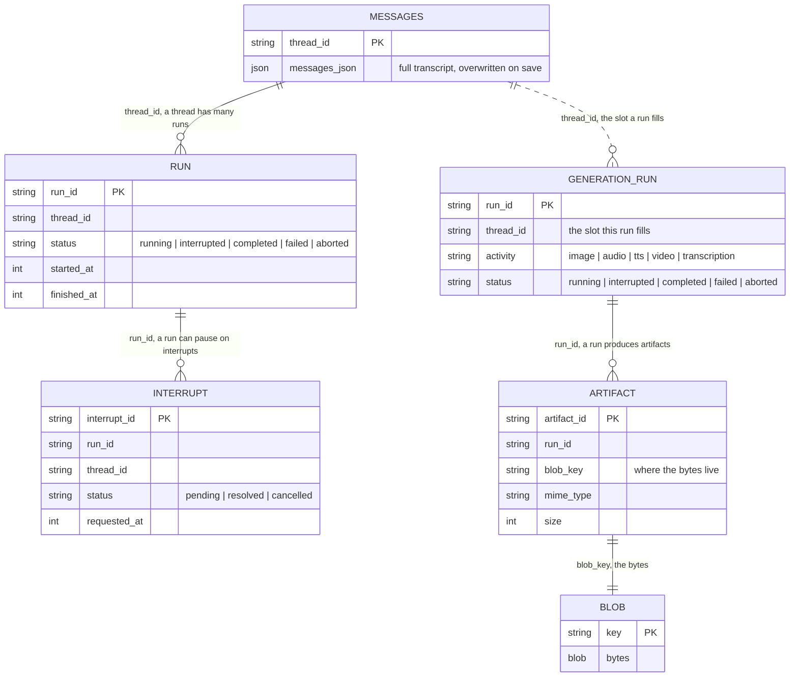

The store contracts of `@tanstack/ai-persistence`. Implement only the stores you need: the middleware turns each feature on from the stores that are present.

| Store | Holds | Used by | Guide |
| --- | --- | --- | --- |
| `messages` | The model-message history of each thread | `withPersistence` (required), `reconstructChat` (required) | [Chat persistence](./chat-persistence) |
| `activities` | AG-UI activity rows of each thread | `withPersistence`, `reconstructChat` | [AG-UI activity rows](./chat-persistence-advanced#ag-ui-activity-rows-on-reload) |
| `runs` | Run status, timing, errors, usage | `withPersistence`, `reconstructChat` | [Chat persistence](./chat-persistence) |
| `interrupts` | Pending, resolved, or cancelled human waits. Needs `runs`. | `withPersistence` | [Chat persistence](./chat-persistence) |
| `metadata` | App and integration key/value state | `withPersistence`, `withCompaction` | [Compaction](../advanced/compaction#compaction-and-persistence) |
| `generationRuns` | Generation run status and result metadata | `withGenerationPersistence` (required), `reconstructGeneration` (required) | [Generation persistence](./generation-persistence) |
| `artifacts` | File metadata. Needs `blobs`. | `withGenerationPersistence`, portable snapshots | [Keep generated files](./keep-generated-files) |
| `blobs` | File bytes. Needs `artifacts`. | `withGenerationPersistence`, portable snapshots | [Keep generated files](./keep-generated-files) |

The named groups of chat stores (`ChatTranscriptStores`, `ChatPersistenceStores`, `ChatWithInterruptsStores`) are in [Controls](./controls). To build the stores, see [Build a chat adapter](./build-your-own-chat-adapter) and [Build a generation adapter](./build-your-own-generation-adapter). To test them, see [the conformance suite](./build-your-own-adapter#verify-with-the-conformance-suite).

## MessageStore

```ts
import type { ModelMessage } from '@tanstack/ai'

type MessagePage =
  | {
      messages: Array<ModelMessage>
      truncated: false
      cursor?: never
    }
  | {
      messages: Array<ModelMessage>
      truncated: true
      cursor: string
    }

interface MessageStore {
  loadThread(
    threadId: string,
    options?: { limit?: number; before?: string },
  ): Promise<Array<ModelMessage> | MessagePage>
  saveThread(threadId: string, messages: Array<ModelMessage>): Promise<void>
}
```

Rules:

- `loadThread` with only `threadId` (the middleware calls it this way) returns the full array, never a `MessagePage`.
- `loadThread` returns `[]`, never `null`, for a thread that was never saved.
- `limit` and `before` are a paging hint for hydrate. You can ignore them and return the full array. `reconstructChat` then slices after the UI conversion.
- To page in the database, return a `MessagePage`. `truncated: true` requires a `cursor`. The words `truncated` and `cursor` mean the same as in `BlobStore.list`.
- If you ignore `before` and return the newest array again, `reconstructChat` loads the full thread and slices it.
- `saveThread` gets the full merged list. It replaces the stored thread. It never appends. The merge by id happens in `withPersistence`, not in this store.

## ActivityStore

```ts
import type { ActivityRecord } from '@tanstack/ai-persistence'

interface ActivityStore {
  loadActivities(threadId: string): Promise<Array<ActivityRecord>>
  saveActivities(
    threadId: string,
    activities: Array<ActivityRecord>,
  ): Promise<void>
}
```

Rules:

- `loadActivities` returns `[]`, never `null`, for a thread that was never saved.
- `saveActivities` gets the complete activity list for the thread. It replaces the stored list.
- Activity rows are never model messages. Do not store them in `messages`.

The store is optional. Without it, activity rows are not durable on the server. Type an implementation with `defineActivityStore`. See [AG-UI activity rows on reload](./chat-persistence-advanced#ag-ui-activity-rows-on-reload).

## RunStore

`RunStore` and `RunRecord` come from `@tanstack/ai`. `@tanstack/ai-persistence` re-exports both. `RunError` is exported from `@tanstack/ai` only. One shared definition lets chat persistence and a sandbox run driver use the same record for one run.

```ts
import type { TokenUsage } from '@tanstack/ai'

type TerminalRunStatus = 'completed' | 'failed' | 'aborted'
type RunStatus = 'running' | 'interrupted' | TerminalRunStatus

// Why a run failed. `message` is the provider's text, which changes between
// model versions. `code` is the stable value to switch on (retry, escalate,
// show a specific UI). Providers do not always supply one.
interface RunError {
  message: string
  code?: string
}

interface RunRecord {
  runId: string
  threadId: string
  // Present on a subagent child run. Absent on the parent chat run.
  parentRunId?: string
  subagentRunId?: string
  name?: string
  status: RunStatus
  startedAt: number // epoch ms
  finishedAt?: number // epoch ms, set at a terminal status
  error?: RunError
  usage?: TokenUsage // reported usage added up for this runId
  // ---------------------------------------------------------------------------
  // DURABLE SANDBOXED RUNS ONLY. A chat app never writes these four, and
  // nothing in `@tanstack/ai-persistence` reads them. Leave the columns out
  // until you use `withSandbox(sandbox, { runs, durability })`. See
  // Build a Sandbox Adapter, "The four run fields".
  // ---------------------------------------------------------------------------
  sandboxKey?: string // the sandbox this run is bound to
  detachedSince?: number // epoch ms since the last viewer left
  cancelRequested?: boolean // an out-of-band cancel was recorded
  driverEpoch?: number // fencing token, incremented by each host that claims the run
  // ---------------------------------------------------------------------------
  // HOST SESSIONS ONLY. A host that runs agents and activities for a long
  // session writes these. `chat()` never writes them. A store that keeps the
  // whole record keeps them too.
  // ---------------------------------------------------------------------------
  kind?: 'chat' | 'agent' | 'activity' | 'command' | 'compact'
  activity?: string // the activity of a `kind: 'activity'` run
  agent?: string // the agent name of a `kind: 'agent'` run
  result?: unknown // terminal result metadata (ids, urls, text), never bytes
  artifacts?: Array<{ artifactId: string; name?: string; mimeType?: string; url?: string }>
  principal?: { id: string } // who started the run
  leaseOwner?: string // the host that drives the run now
  leaseExpiresAt?: number // epoch ms when that claim ends
  // Crash-resume data from the last model or tool boundary.
  checkpoint?: {
    at: number
    pendingTools?: Array<{ toolCallId: string; name: string; replay: 'safe' | 'never' }>
  }
}

interface RunStore {
  // Required. Insert-if-absent: an existing runId returns the stored record
  // unchanged, so a resume never resets its startedAt or status.
  createOrResume(input: {
    runId: string
    threadId: string
    status?: RunStatus
    startedAt: number
    // Copied on the first insert only. A later call leaves them unchanged.
    parentRunId?: string
    subagentRunId?: string
    name?: string
    kind?: RunRecord['kind']
    activity?: string
    agent?: string
    principal?: { id: string }
  }): Promise<RunRecord>
  // Required. A patch for an unknown runId does nothing. It does not throw.
  update(
    runId: string,
    patch: Partial<
      Pick<
        RunRecord,
        | 'status'
        | 'finishedAt'
        | 'error'
        | 'usage'
        | 'sandboxKey'
        | 'detachedSince'
        | 'cancelRequested'
        | 'driverEpoch'
        | 'result'
        | 'artifacts'
        | 'leaseOwner'
        | 'leaseExpiresAt'
        | 'checkpoint'
      >
    >,
  ): Promise<void>
  // Required.
  get(runId: string): Promise<RunRecord | null>
  // Required. The most recent 'running' run of a thread (greatest startedAt),
  // or null when the thread is idle. reconstructChat uses it to report
  // activeRun, which lets a hydrating client tail a run that still generates.
  findActiveRun(threadId: string): Promise<RunRecord | null>
  // Optional. Every run of a thread, startedAt ascending.
  listByThread?(threadId: string): Promise<Array<RunRecord>>
  // Optional. The child runs of one parent, oldest startedAt first.
  listByParentRun?(parentRunId: string): Promise<Array<RunRecord>>
  // Optional. Runs with status 'running' and detachedSince <= now - ttlMs.
  listReclaimable?(opts: {
    now: number
    ttlMs: number
  }): Promise<Array<RunRecord>>
}
```

Required methods and their rules:

| Method | Rule |
| --- | --- |
| `createOrResume` | Idempotent. A second call for an existing `runId` returns the complete stored record unchanged, `usage` included. Retries can repeat the same run id. |
| `createOrResume` | Copies `parentRunId`, `subagentRunId`, and `name` on the first insert only. If the caller leaves a field out, leave it out of the record. Do not write `''`. |
| `update` | A patch for an unknown `runId` does nothing. |
| `get` | Returns `null` for an unknown `runId`. |
| `findActiveRun` | Must do a real query. A stub that returns `null` makes `reconstructChat` always report `activeRun: null`. A reloaded client then restores the transcript but never resumes the live reply, and nothing reports the fault, because `null` is also correct for an idle thread. |

Optional methods. Consumers feature-detect each one:

| Method | Used by | If you leave it out |
| --- | --- | --- |
| `listByThread` | `reconstructChat` (finds the parent run of a child that a tool call started), `includeRuns` timings | A reload loses those subagent cards. Declare the omission in `skipMethods` for the conformance suite. |
| `listByParentRun` | `reconstructChat` (builds the subagent cards) | A reload shows the saved child text, without cards. The conformance suite skips the subagent checks. No `skipMethods` entry is necessary. |
| `listReclaimable` | `reapDetachedRuns` from `@tanstack/ai-sandbox` | The reaper logs one line and sweeps nothing. Detached runs never finish and their sandboxes are never reclaimed. Declare the omission in `skipMethods`. |

The reaper is a function that your app schedules, so `listReclaimable` alone is not enough. `withSandbox`'s detach path fills in `detachedSince` for you. See [Takeover & Detached Runs](../sandbox/takeover#configuration) and [Reaping & Retention](../sandbox/reaping).

Usage: `withPersistence` adds up the numeric usage fields across the provider calls of one `runId`. The opaque `providerUsageDetails` field keeps the latest reported value. Known usage is saved when the run interrupts or reaches a terminal status.

The four durable-run fields are a sandbox concern. `runPersistenceConformance` does not test them, and a chat-only backend can leave the columns out. If you use durable sandboxed runs, run `runDurableRunFieldsConformance` from `@tanstack/ai-sandbox/testkit` against the same `runs` store. Each field breaks one mechanism without an error when it is dropped. See [Build a Sandbox Adapter](./build-a-sandbox-adapter#the-four-run-fields).

Capability tiers belong at the store level, not the method level. A backend with no run lifecycle declares `ChatTranscriptStores` and leaves out `runs`. It does not supply a `RunStore` with a stubbed method. The type system catches a missing store. An incomplete store fails at runtime with no error.

Two helpers come with the contract:

- `isTerminalRunStatus` is a type predicate. Inside the guard, the status is a `TerminalRunStatus`:

  ```ts
  import { isTerminalRunStatus } from '@tanstack/ai-persistence'
  import type { RunRecord, TerminalRunStatus } from '@tanstack/ai-persistence'

  function finalStatus(run: RunRecord): TerminalRunStatus | null {
    return isTerminalRunStatus(run.status) ? run.status : null
  }
  ```

- `defineRunStore` is generic over the object you pass, so the result keeps that object's exact shape. An optional method that you implemented needs no `?.` in your own code. For example, `createRunStore(db).findActiveRun(threadId)` is a direct call on the store from the [chat walkthrough](./build-your-own-chat-adapter). A consumer that holds a plain `RunStore` still feature-detects the same method.

Reference implementations: `MemoryRunStore` in `packages/ai-persistence/src/memory.ts` and the SQLite adapter in `examples/ts-react-chat` (`src/lib/sqlite-persistence.ts`). Both implement all seven run methods.

## InterruptStore

```ts
interface InterruptRecord {
  interruptId: string
  runId: string
  threadId: string
  status: 'pending' | 'resolved' | 'cancelled'
  requestedAt: number // epoch ms
  resolvedAt?: number // epoch ms, set when resolved or cancelled
  payload: Record<string, unknown>
  response?: unknown
}

type InterruptCommitEntry =
  | { interruptId: string; status: 'resolved'; response?: unknown }
  | { interruptId: string; status: 'cancelled' }

interface InterruptStore {
  create(record: Omit<InterruptRecord, 'status' | 'resolvedAt'>): Promise<void>
  commitBatch?(entries: ReadonlyArray<InterruptCommitEntry>): Promise<void>
  resolve(interruptId: string, response?: unknown): Promise<void>
  cancel(interruptId: string): Promise<void>
  get(interruptId: string): Promise<InterruptRecord | null>
  list(threadId: string): Promise<Array<InterruptRecord>>
  listPending(threadId: string): Promise<Array<InterruptRecord>>
  listByRun(runId: string): Promise<Array<InterruptRecord>>
  listPendingByRun(runId: string): Promise<Array<InterruptRecord>>
}
```

Rules:

- `create` takes a record without `status` and `resolvedAt`, so every interrupt starts as `'pending'`.
- `create` is insert-if-absent. A duplicate `create` never changes an interrupt that is already resolved.
- `resolve` and `cancel` do nothing for an unknown `interruptId`.
- The `list*` methods return records in `requestedAt` ascending order.
- With chat persistence, an `interrupts` store requires a `runs` store.

`commitBatch` is optional. If you implement it, write all entries in one database transaction. Reject the whole batch (throw and write nothing) when any entry:

- repeats an `interruptId`,
- names an interrupt that does not exist, or
- names an interrupt that is not `'pending'`.

Without `commitBatch`, the middleware calls `resolve` and `cancel` one entry at a time. That fallback is not atomic.

## MetadataStore

`MetadataStore` comes from `@tanstack/ai` and is re-exported here.

```ts
interface MetadataStore {
  get(namespace: string, key: string): Promise<unknown | null>
  set(namespace: string, key: string, value: unknown): Promise<void>
  delete(namespace: string, key: string): Promise<void>
  // Optional: compare-and-set.
  getVersioned?(
    namespace: string,
    key: string,
  ): Promise<{ value: unknown; revision: string } | null>
  setIf?(
    namespace: string,
    key: string,
    value: unknown,
    expectedRevision: string | null,
  ): Promise<{ ok: true; revision: string } | { ok: false; reason: 'conflict' }>
}
```

Rules:

- `(namespace, key)` is the identity. Your app owns the namespaces and the value schemas.
- A stored `null` looks the same as an absent key. To store `null`, wrap it (for example, `{ value: null }`), or reject nullish values.
- Do not put the transcript in metadata. The `messages` store owns it.

Add `getVersioned` and `setIf` when two writers can change the same key at the same time. Then the second write cannot erase the first:

- `getVersioned` returns the value and its revision, or `null` when the key is absent.
- `setIf` writes only when the stored revision equals `expectedRevision`. Pass `null` to write only when the key is absent.
- `setIf` returns `{ ok: true, revision }` on success. On a different revision, it returns `{ ok: false, reason: 'conflict' }` and does not write.
- Every write gives the key a new revision, a plain `set` too. After `delete`, the next write gets a new revision. A deleted revision is never used again.

`memoryPersistence()` has both methods. The conformance suite tests them when your store has them.

`withPersistence` also provides this store through the core `MetadataCapability`. Other middleware can then use it without a dependency on `@tanstack/ai-persistence`. For example, `withCompaction` stores validated context checkpoints here.

## GenerationRunStore

The generation counterpart to `RunStore`. A record is keyed by its own `runId`. Its `threadId` is the slot that `findLatestForThread` looks it up by. `withGenerationPersistence` requires this store, not `runs`.

```ts
import type { PersistedArtifactRef, TokenUsage } from '@tanstack/ai'

// The same values as a chat run's `RunStatus`, so one status column and one
// set of checks cover both tables.
type GenerationRunStatus =
  | 'running'
  | 'interrupted'
  | 'completed'
  | 'failed'
  | 'aborted'

interface GenerationRunRecord {
  runId: string
  threadId: string // the slot this run fills, hydrated by findLatestForThread
  activity: string // 'image' | 'audio' | 'tts' | 'video' | 'transcription'
  provider: string
  model: string
  status: GenerationRunStatus
  startedAt: number // epoch ms
  finishedAt?: number // epoch ms, set at a terminal status
  error?: { message: string; code?: string }
  result?: unknown // terminal result metadata (ids, urls), never media bytes
  artifacts?: Array<PersistedArtifactRef> // present with an artifacts + blobs backend
  usage?: TokenUsage
}

interface GenerationRunStore {
  createOrResume(input: {
    runId: string
    activity: string
    provider: string
    model: string
    startedAt: number
    threadId: string
    status?: GenerationRunStatus
  }): Promise<GenerationRunRecord>
  update(
    runId: string,
    patch: Partial<
      Pick<
        GenerationRunRecord,
        'status' | 'finishedAt' | 'error' | 'result' | 'artifacts' | 'usage'
      >
    >,
  ): Promise<void>
  get(runId: string): Promise<GenerationRunRecord | null>
  // The most recent run filed under a thread (greatest startedAt), or null.
  findLatestForThread(threadId: string): Promise<GenerationRunRecord | null>
}
```

Rules:

- `createOrResume` is idempotent. A second call for an existing `runId` returns the stored record unchanged. It does not change `startedAt`, `activity`, `provider`, `model`, or `threadId`. `status` defaults to `'running'` on the first insert.
- `update` for an unknown `runId` does nothing. It does not throw and does not create a record.
- `findLatestForThread` is required. It is the only query that hydrates a generation. Without it, `persistence: true` restores nothing, and nothing reports the fault.

## ArtifactStore

Metadata rows for stored media. The bytes live in a `BlobStore`. Provide both stores together to keep generated bytes.

```ts
interface ArtifactRecord {
  artifactId: string
  runId: string
  threadId: string
  blobKey: string // where the bytes live
  name: string
  mimeType: string
  size: number
  sourceUrl?: string // where the bytes were fetched FROM (provenance)
  createdAt: number // epoch ms
}

interface ArtifactStore {
  save: (record: ArtifactRecord) => Promise<void>
  get: (artifactId: string) => Promise<ArtifactRecord | null>
  list: (runId: string) => Promise<Array<ArtifactRecord>> // [] when the run has none
  // Complete thread history, ordered by (createdAt, artifactId) ascending.
  listForThread: (threadId: string) => Promise<Array<ArtifactRecord>>
  delete: (artifactId: string) => Promise<void>
  deleteForRun: (runId: string) => Promise<void>
}
```

Rules:

- `save` inserts or overwrites the record.
- `list` and `listForThread` sort by `createdAt` first, then by `artifactId` in bytewise order. Compare the UTF-8 bytes from left to right. Do not use locale collation.
- `delete` and `deleteForRun` do nothing when there is nothing to delete.
- Every record must have `blobKey`. With a custom `storageKey`, the path cannot be computed again from the record. See [Keep generated files](./keep-generated-files).

## BlobStore

A durable object store for the bytes. By default, `withGenerationPersistence` writes each generated file under the key `artifacts/<runId>/<artifactId>`.

```ts
type BlobBody =
  | ReadableStream<Uint8Array>
  | ArrayBuffer
  | ArrayBufferView
  | string
  | Blob

interface BlobRecord {
  key: string
  size?: number
  etag?: string
  contentType?: string
  customMetadata?: Record<string, string>
  createdAt?: number // epoch ms first written
  updatedAt?: number // epoch ms last overwritten
}

interface BlobObject extends BlobRecord {
  arrayBuffer(): Promise<ArrayBuffer>
  text(): Promise<string>
  body?: ReadableStream<Uint8Array>
  // The slice served, when a range was requested. Absent on a whole read.
  range?: { offset: number; length: number }
}

interface BlobListPage {
  objects: Array<BlobRecord>
  cursor?: string // present only when `truncated`
  truncated?: boolean
}

interface BlobPutOptions {
  contentType?: string
  customMetadata?: Record<string, string>
  // Exact byte length of `body`, when the producer knows it. Advisory: use it
  // to pick an upload strategy (single-shot or multipart). Do not use it in
  // place of counting the bytes you store.
  expectedLength?: number
}

interface BlobRange {
  offset: number // from the start of the object, must be inside it
  length?: number // defaults to "to the end", clamped when it overshoots
}

interface BlobGetOptions {
  range?: BlobRange
}

interface BlobListOptions {
  prefix?: string
  cursor?: string
  limit?: number
}

interface BlobStore {
  put(key: string, body: BlobBody, options?: BlobPutOptions): Promise<BlobRecord>
  get(key: string, options?: BlobGetOptions): Promise<BlobObject | null>
  head(key: string): Promise<BlobRecord | null>
  delete(key: string): Promise<void>
  list(options?: BlobListOptions): Promise<BlobListPage>
}
```

Rules for `list`:

- `prefix` matches literally and is case-sensitive. Escape SQL `LIKE` metacharacters.
- When `limit` is set and more keys match, return `truncated: true` with a `cursor`. That cursor returns the keys strictly after it, so paging visits every key once.
- `limit: 0` returns an empty page that is not truncated.

Rules for `put`:

- The body can be a `ReadableStream` with **no declared length**. Your store must read a stream of unknown length to the end. Do not require a length first.
- A URL-fetched artifact arrives without a length when the origin does not declare one that can be enforced: a chunked reply, or a compressed reply whose `content-length` counts the compressed bytes.
- When the origin declares a usable length, the body arrives as `fetch` made it, and `expectedLength` has the same number.
- A backend that needs a declared length for a single-shot upload (Cloudflare R2 on workerd is one) can attach `expectedLength` when it is present. When it is absent, stream through a multipart upload. The `ai-persistence/build-cloudflare-artifact-store` skill has that recipe.

The conformance testkit tests the length-less case, so a store that handles only byte bodies fails the suite.

Rules for `get`:

- With `options.range`, return **only that slice**. `size` still reports the whole object, and the returned `range` reports what you served. A media player needs these values for a `206` response when it seeks.
- Use `resolveBlobRange(size, range)` to clamp. A `length` past the end is legal and clamps. An `offset` past the end throws, because a serve route answers `416` from the record's `size` before it calls the store.

```ts ignore
import { resolveBlobRange } from '@tanstack/ai-persistence'

async get(key: string, options?: BlobGetOptions) {
  const row = await selectBlob(key)
  if (!row) return null
  if (!options?.range) return blobObject(row, row.body)
  const served = resolveBlobRange(row.size, options.range)
  // Slice at the storage layer, not after loading the whole object.
  const bytes = await selectBlobSlice(key, served.offset, served.length)
  return blobObject(row, bytes, served)
}
```

Range support is required for a store that holds bytes, and the conformance testkit tests it. A store that ignores `range` sends the whole file on every seek. Then `<video>` seeking fails, and Safari does not play the video at all. A reference-only backend that stores no bytes leaves out `blobs` completely. See [Keep generated files](./keep-generated-files) for the serve route.

## How the records relate

The thread is not a table. It exists as the `thread_id` that the other records refer to. `metadata` is separate, keyed by `(namespace, key)`. On the generation side, a run is keyed by its own `run_id` first. Its `thread_id` names the slot that the run fills, and `findLatestForThread` hydrates by it.



## Typing an adapter

Each store has a `define*Store` helper:

| Helper | Store |
| --- | --- |
| `defineMessageStore` | `messages` |
| `defineActivityStore` | `activities` |
| `defineRunStore` | `runs` |
| `defineInterruptStore` | `interrupts` |
| `defineMetadataStore` | `metadata` |
| `defineGenerationRunStore` | `generationRuns` |
| `defineArtifactStore` | `artifacts` |
| `defineBlobStore` | `blobs` |

The helpers compose into `defineAIPersistence`, which tracks exactly which stores exist. The stores you passed autocomplete on `persistence.stores`. A read of a store you did not pass is a compile error.

Those eight keys are the only ones that `stores` accepts. Any other key throws `Unknown AIPersistence store key` at construction.

To annotate the value, use a named shape:

| Shape | Stores |
| --- | --- |
| `ChatPersistence` | All four chat state stores: `messages`, `runs`, `interrupts`, `metadata` |
| `ChatTranscriptPersistence` | The `messages` floor |
| `AIPersistence` | All stores optional. `withPersistence` rejects it, because `stores.messages` can be `undefined`. |
