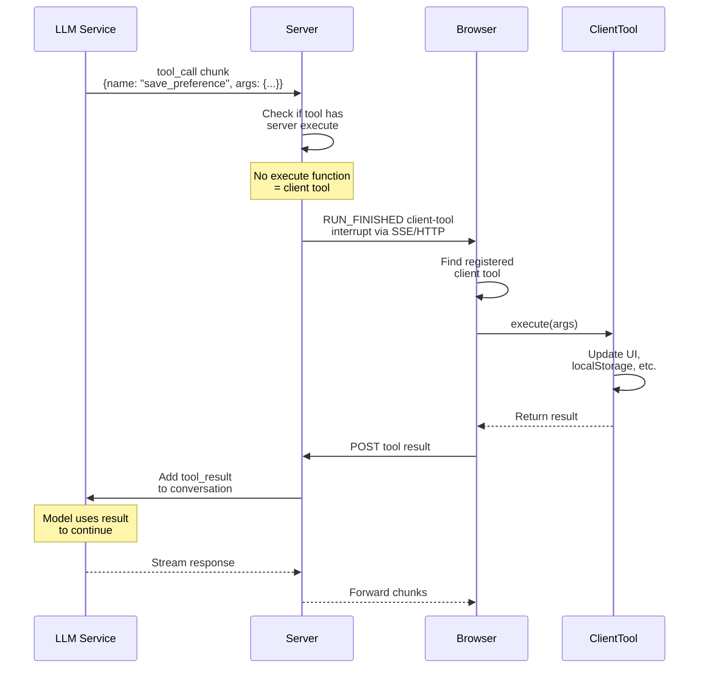

Some actions only work in the browser. The model wants to show a notification, save a setting in `localStorage`, read the clipboard, or open another page. Your server cannot do these things.

A client tool fixes this. The server tells the model that the tool exists. When the model calls it, the browser runs your `.client()` function and sends the result back. Then the model continues.

Good jobs for a client tool:

- **UI changes**: show a notification, fill a form, open a panel.
- **Local data**: save preferences, cache values in `localStorage`.
- **Browser APIs**: geolocation, camera, clipboard.
- **Navigation**: change the route, scroll to a section.
- **App state**: update React, Vue, or Solid state, or send an analytics event.

## Add a client tool

### 1. Define the tool in a shared file

The server and the browser both import this file. It has no implementation yet:

```typescript
// tools/definitions.ts
import { toolDefinition } from "@tanstack/ai";
import { z } from "zod";

export const savePreferenceDef = toolDefinition({
  name: "save_preference",
  description: "Save a user preference in the browser, such as the color theme",
  inputSchema: z.object({
    key: z.string().meta({ description: "Preference name, for example theme" }),
    value: z.string().meta({ description: "Preference value, for example dark" }),
  }),
  outputSchema: z.object({
    saved: z.boolean(),
  }),
});
```

### 2. Pass the definition to `chat()`

On the server, pass the definition, not an implementation:

```typescript
// api/chat.ts
import {
  chat,
  chatParamsFromRequest,
  toServerSentEventsResponse,
} from "@tanstack/ai";
import { openaiText } from "@tanstack/ai-openai";
import { savePreferenceDef } from "../tools/definitions";

export async function POST(request: Request) {
  const params = await chatParamsFromRequest(request);

  const stream = chat({
    adapter: openaiText("gpt-6.1-sol"),
    messages: params.messages,
    threadId: params.threadId,
    runId: params.runId,
    parentRunId: params.parentRunId,
    ...(params.resume ? { resume: params.resume } : {}),
    tools: [savePreferenceDef],
  });

  return toServerSentEventsResponse(stream);
}
```

The browser sends the tool result in a second request. `parentRunId` and `resume` let `chat()` find the paused call and continue it.

### 3. Add the `.client()` function and pass it to your chat hook

Create the implementation at module scope. Then add it to `tools`:

```tsx
// app/chat.tsx
import { useState } from "react";
import { useChat, fetchServerSentEvents } from "@tanstack/ai-react";
import { toolDefinition } from "@tanstack/ai";
import { z } from "zod";

// The same definition as tools/definitions.ts. In your app, import it from that file.
const savePreferenceDef = toolDefinition({
  name: "save_preference",
  description: "Save a user preference in the browser, such as the color theme",
  inputSchema: z.object({
    key: z.string().meta({ description: "Preference name, for example theme" }),
    value: z.string().meta({ description: "Preference value, for example dark" }),
  }),
  outputSchema: z.object({
    saved: z.boolean(),
  }),
});

const savePreference = savePreferenceDef.client((input) => {
  localStorage.setItem(input.key, input.value);
  return { saved: true };
});

export function Chat() {
  const [input, setInput] = useState("");
  const { messages, sendMessage } = useChat({
    connection: fetchServerSentEvents("/api/chat"),
    tools: [savePreference],
  });

  return (
    <>
      {messages.map((message) => (
        <div key={message.id}>
          {message.parts.map((part, index) =>
            part.type === "text" ? <p key={index}>{part.content}</p> : null,
          )}
        </div>
      ))}
      <form
        onSubmit={(event) => {
          event.preventDefault();
          sendMessage(input);
          setInput("");
        }}
      >
        <input value={input} onChange={(event) => setInput(event.target.value)} />
        <button type="submit">Send</button>
      </form>
    </>
  );
}
```

Every framework takes the same `tools` option:

- `useChat` in Vue, Solid, Preact, and Octane.
- `createChat` in Svelte and Remix.
- `injectChat` in Angular.

### 4. Try it

Ask your chat "Use the dark theme from now on." The model calls `save_preference`. Your browser saves `theme` as `dark` in `localStorage`, and the model confirms. Open the dev tools of your browser to see the saved value.

## How it works



1. The model calls the tool.
2. The server sees that the tool has no server function. It pauses the run and sends the call to the browser.
3. The browser finds the `.client()` function with the same tool name and runs it with the parsed input.
4. The browser sends the result back to the server and starts the next run.
5. The server checks the result against `outputSchema`. If the function throws or the check fails, the model gets a tool error.
6. The model reads the result and continues.

You do not write code for steps 2 to 5. `useChat` does them for you.

## Show the tool call in your UI

Each tool call is a `tool-call` part in the assistant message. When you pass the tools to the hook, a check on `part.name` gives you typed `part.input` and `part.output`:

```tsx
import { useChat, fetchServerSentEvents } from "@tanstack/ai-react";
import { createChatClientOptions, type InferChatMessages } from "@tanstack/ai-client";
import { toolDefinition } from "@tanstack/ai";
import { z } from "zod";

// The same definition as tools/definitions.ts. In your app, import it from that file.
const savePreferenceDef = toolDefinition({
  name: "save_preference",
  description: "Save a user preference in the browser, such as the color theme",
  inputSchema: z.object({
    key: z.string().meta({ description: "Preference name, for example theme" }),
    value: z.string().meta({ description: "Preference value, for example dark" }),
  }),
  outputSchema: z.object({
    saved: z.boolean(),
  }),
});

const savePreference = savePreferenceDef.client((input) => {
  localStorage.setItem(input.key, input.value);
  return { saved: true };
});

const chatOptions = createChatClientOptions({
  connection: fetchServerSentEvents("/api/chat"),
  tools: [savePreference],
});

type ChatMessages = InferChatMessages<typeof chatOptions>;

function Message({ message }: { message: ChatMessages[number] }) {
  return (
    <div>
      {message.parts.map((part, index) => {
        if (part.type === "text") {
          return <p key={index}>{part.content}</p>;
        }
        if (part.type === "tool-call" && part.name === "save_preference") {
          // part.input is { key: string; value: string }
          // part.output is { saved: boolean } | undefined
          return (
            <p key={part.id}>
              Saving {part.input?.key}
              {part.output?.saved ? " (done)" : "..."}
            </p>
          );
        }
        return null;
      })}
    </div>
  );
}

export function Chat() {
  const { messages } = useChat(chatOptions);
  return (
    <>
      {messages.map((message) => (
        <Message key={message.id} message={message} />
      ))}
    </>
  );
}
```

A plain array in `tools` is enough for this type inference. You do not need `as const` or a wrapper. For every state that a tool call goes through, see [Tool Architecture](./tool-architecture#call-states). For typed tool events, see [Type-safe tool call events](../chat/stream-events#type-safe-tool-call-events).

## Advanced

### Ask the user before a client tool runs

Add `needsApproval: true` to the definition. The tool first pauses on a `tool-approval` interrupt. You resolve only that decision. After the user approves, the client runs the `.client()` function and sends its result:

```ts ignore
const approval = interrupts.find(
  (interrupt) =>
    interrupt.kind === 'tool-approval' &&
    interrupt.toolName === 'delete_local_data',
)

if (
  approval?.kind === 'tool-approval' &&
  approval.toolName === 'delete_local_data'
) {
  approval.resolveInterrupt(true)
}
```

You never resolve the run of the tool by hand. The `.client()` function does that. If you register a tool with no `.client()` function and want to give the result yourself, call `addToolResult`. It checks the result against the output schema of the tool.

For approval forms, see [Tool Approval Flow](./tool-approval). For the approval lifecycle, see [Interrupts](../interrupts/overview).

### The client-tool pause

- The server pauses the run with an internal `client-tool-execution` item on the interrupt wire. It is not a public item in `interrupts`.
- This pause uses the same atomic interrupt batch as approvals, so it can hold back a submit of several items. The client resolves it for you. You do not call `resolveInterrupt` for it.
- After hydration, a pending client-tool call comes back, but it does not run again. For recovery policies, see [Client persistence](../persistence/client-persistence#handle-restored-client-tools).

For the ephemeral lifecycle and batches, see [Interrupts](../interrupts/overview).

### Pass local values to a client tool

A client tool gets typed runtime context as its second argument. This context belongs to the `ChatClient` or the hook instance. It is not sent to the server.

```typescript
import { createChatClientOptions } from "@tanstack/ai-client";
import { useChat, fetchServerSentEvents } from "@tanstack/ai-react";
import { toolDefinition } from "@tanstack/ai";
import { toast } from "./toast";

const activeProjectId = "";

type ClientContext = {
  activeProjectId: string;
  toast(message: string): void;
};

const showToast = toolDefinition({
  name: "show_toast",
  description: "Show a browser notification",
}).client<ClientContext>((_input, ctx) => {
  ctx.context.toast(`Project ${ctx.context.activeProjectId} updated`);
  return { ok: true };
});

const chatOptions = createChatClientOptions({
  connection: fetchServerSentEvents("/api/chat"),
  tools: [showToast],
  context: {
    activeProjectId,
    toast: (message) => toast(message),
  },
});

const chat = useChat(chatOptions);
```

Does the server also need a value from the client? Send it with `forwardedProps`, check it in your route, and put it in the server `chat({ context })`. See [Runtime Context](../advanced/runtime-context).

### One definition, two implementations

A definition can have a `.server()` and a `.client()` implementation. The tool that you pass to `chat()` decides where it runs:

```typescript
import { toolDefinition, chat } from "@tanstack/ai";
import { openaiText } from "@tanstack/ai-openai";
import { z } from "zod";
import { db } from "./db";

const addToCartDef = toolDefinition({
  name: "add_to_cart",
  description: "Add item to shopping cart",
  inputSchema: z.object({
    itemId: z.string(),
    quantity: z.number(),
  }),
  outputSchema: z.object({
    success: z.boolean(),
    cartId: z.string(),
  }),
});

// Server implementation: store the cart in the database
const addToCartServer = addToCartDef.server(async (input) => {
  const cart = await db.carts.create({
    data: { itemId: input.itemId, quantity: input.quantity },
  });
  return { success: true, cartId: cart.id };
});

// Client implementation: update a local wishlist
const addToCartClient = addToCartDef.client((input) => {
  const wishlist = JSON.parse(localStorage.getItem("wishlist") || "[]");
  wishlist.push(input.itemId);
  localStorage.setItem("wishlist", JSON.stringify(wishlist));
  return { success: true, cartId: "local" };
});

// Pass the definition: the client runs the tool
chat({ adapter: openaiText("gpt-6.1-sol"), messages: [], tools: [addToCartDef] });

// Or pass the server implementation: the server runs the tool
chat({ adapter: openaiText("gpt-6.1-sol"), messages: [], tools: [addToCartServer] });
```

Pass only one of the two to a `chat()` call. Both have the same name, and the tool names in one `tools` array must be unique.

### Let the client declare its tools

Pass the definitions on the server, as in the quick setup. Then the server alone decides which tools the model sees, and a client cannot add tools that you did not allow.

To let the client declare its tools for each request through AG-UI `RunAgentInput.tools`, use [`mergeAgentTools`](../migration/ag-ui-compliance#tier-3-let-the-client-advertise-its-tools). Read its security note first, because the client controls `params.tools`.

### Client tools with other AG-UI servers

Your agent runs on another AG-UI server, such as Pydantic AI. It calls a frontend tool, then ends the run. `useChat` runs the tool and starts the next run with the result.

Register the client tools as in [step 3](#3-add-the-client-function-and-pass-it-to-your-chat-hook). Point the connection at the endpoint of that server, for example `fetchServerSentEvents("/agent")`.

The AG-UI spec ends such a run with `RUN_FINISHED` and a success outcome. The tool call gets no `TOOL_CALL_RESULT`. When that run ends:

- The client runs each tool call that the run started and did not answer.
- If the server names the calls in `outcome.pendingToolCallIds`, the client runs only those of them that this run started.
- The next request carries each result as a `role: "tool"` message.

These calls do not run:

- A call with a name that no client tool has.
- A call with arguments that are not complete JSON.
- A call to a client tool with `needsApproval: true`, because the server did not ask for approval.

### Expose client tools through WebMCP

WebMCP lets browser agents call your client tools. This path is separate from a TanStack chat run:

- WebMCP calls the client function and returns the result to WebMCP.
- It does not call `addToolResult`, and it does not continue a chat run.

Register the same client tools with a framework wrapper or `registerWebMCPTools`. See [WebMCP Tools](./webmcp) for setup and security rules.

### The `clientTools()` helper

A plain array, `tools: [toolA, toolB]`, already gives you typed tool names, inputs, and outputs. `clientTools()` does the same capture by name. Use it only to build a shared tool list outside the hook or the options call:

```ts
import { clientTools } from "@tanstack/ai-client";
import { toolDefinition } from "@tanstack/ai";

const notify = toolDefinition({
  name: "notify",
  description: "Show a notification",
}).client(() => ({ ok: true }));

// Same as `const tools = [notify]`
const tools = clientTools(notify);
```

### Tips for good client tools

- **Keep them small.** They run in the browser, so heavy work and large dependencies make your bundle bigger.
- **Return errors as data.** Put an error field in the output schema and give a clear message.
- **Keep secrets out.** Do not put API keys or personal data in `localStorage` or in a client tool.
- **Show progress.** Use the tool-call states to show a spinner, a result, or an error.
