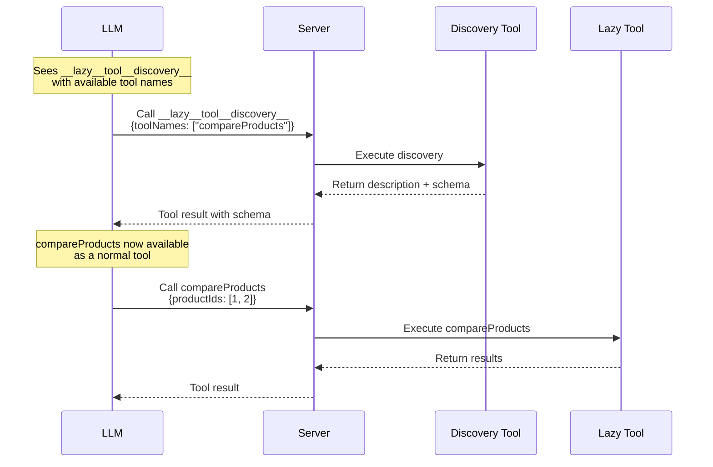

Your app has many tools. Each request sends every tool definition to the model, even the ones that it almost never uses. That costs tokens, and a long tool list can make the answers worse.

Mark the rarely used tools with `lazy: true`. The model then sees only their names. When a task needs one, the model asks for it, gets its full definition, and calls it.

## Make a tool lazy

### 1. Add `lazy: true` to the tool

```typescript
// tools.ts
import { toolDefinition } from "@tanstack/ai";
import { z } from "zod";

const products = [
  { id: 1, name: "Trail shoe", price: 120 },
  { id: 2, name: "Road shoe", price: 140 },
];

// Eager tool: the model always sees it
export const getProducts = toolDefinition({
  name: "getProducts",
  description: "Get all products from the catalog",
  inputSchema: z.object({}),
}).server(async () => products);

// Lazy tool: the model sees only its name until it asks for it
export const compareProducts = toolDefinition({
  name: "compareProducts",
  description: "Compare two or more products side by side",
  inputSchema: z.object({
    productIds: z.array(z.number()).min(2),
  }),
  lazy: true,
}).server(async ({ productIds }) => ({
  products: products.filter((product) => productIds.includes(product.id)),
}));

// Lazy tool
export const calculateFinancing = toolDefinition({
  name: "calculateFinancing",
  description: "Calculate monthly payment plans for a product",
  inputSchema: z.object({
    productId: z.number(),
    months: z.number(),
  }),
  lazy: true,
}).server(async ({ productId, months }) => {
  const product = products.find((item) => item.id === productId);
  if (!product) {
    return { error: "Product not found" };
  }
  return { monthlyPayment: product.price / months, totalPrice: product.price, months };
});
```

### 2. Pass all tools to `chat()`

Eager and lazy tools go in the same `tools` array:

```typescript
// api/chat.ts
import {
  chat,
  chatParamsFromRequest,
  maxIterations,
  toServerSentEventsResponse,
} from "@tanstack/ai";
import { openaiText } from "@tanstack/ai-openai";
import { getProducts, compareProducts, calculateFinancing } from "./tools";

export async function POST(request: Request) {
  const { messages, threadId, runId } = await chatParamsFromRequest(request);

  const stream = chat({
    adapter: openaiText("gpt-6.1-sol"),
    messages,
    threadId,
    runId,
    tools: [getProducts, compareProducts, calculateFinancing],
    // Each discovery is one more step of the loop.
    agentLoopStrategy: maxIterations(20),
  });

  return toServerSentEventsResponse(stream);
}
```

### 3. Try it

Ask your chat "Compare products 1 and 2."

- The model sees `getProducts` and a discovery tool that lists `compareProducts` and `calculateFinancing` by name.
- It asks for `compareProducts`, gets the full definition, and then calls it.
- The full definition of `calculateFinancing` never goes to the model in this chat, so you pay no tokens for it.

## How it works



1. `chat()` does not send lazy tools to the model. It adds a tool named `__lazy__tool__discovery__`. The description of that tool lists the names of the lazy tools.
2. When a task needs a lazy tool, the model calls the discovery tool with the names it wants.
3. The discovery tool returns the full description and the JSON Schema of each tool.
4. On the next step, those tools are normal tools. The model calls them directly.

The model can ask for one tool or for many in one call:

```
__lazy__tool__discovery__({ toolNames: ["compareProducts", "calculateFinancing"] })
```

## When to make a tool lazy

Make a tool lazy when:

- **You have many tools**, and you want fewer tokens in each request.
- **The tool is rarely needed**, such as comparison, financing, or advanced search.
- **The tool has a long description**, and you want a short first prompt.

Keep a tool eager (the default) when most chats call it.

## Advanced

### Control the discovery catalog

By default, the description of the discovery tool lists only the names of the lazy tools. Set `lazyToolsConfig` on `chat()` to show more of each description before discovery:

```typescript
import { chat, toServerSentEventsResponse } from "@tanstack/ai";
import { openaiText } from "@tanstack/ai-openai";
import { getProducts, compareProducts, calculateFinancing } from "./tools";

async function handleRequest(request: Request) {
  const { messages } = await request.json();
  const stream = chat({
    adapter: openaiText("gpt-6.1-sol"),
    messages,
    tools: [getProducts, compareProducts, calculateFinancing],
    lazyToolsConfig: {
      // 'none' (default) | 'first-sentence' | 'full'
      includeDescription: "first-sentence",
    },
  });

  return toServerSentEventsResponse(stream);
}
```

| `includeDescription` | The catalog entry for `compareProducts` has |
| -------------------- | ------------------------------------------- |
| `'none'` (default)   | The name only |
| `'first-sentence'`   | The name and the first sentence of the description |
| `'full'`             | The name and the full description |

- This setting changes only the catalog before discovery. The discovery result always has the full description and the argument schema of each tool.
- The default `'none'` keeps the catalog as short as possible.
- Code Mode `createCodeMode()` takes the same option. See [Code Mode Lazy Tools](../code-mode/lazy-tools).

### Several turns

A tool that the model found in one turn stays available in the next turns of the same conversation. The model does not need to find it again. On each `chat()` call, TanStack AI reads the earlier discovery results in the message history.

### Calls to a tool that the model did not find yet

If the model calls a lazy tool before it asks for it, the model gets this error:

```
Error: Tool 'compareProducts' must be discovered first. Call __lazy__tool__discovery__ with toolNames: ['compareProducts'] to discover it.
```

The model then calls the discovery tool first, and then calls the tool again.

### No cost when you do not use it

- If no tool has `lazy: true`, `chat()` adds no discovery tool. Nothing changes, and there is no extra token cost.
- When the model has found all lazy tools, `chat()` removes the discovery tool from the active tool list.

For how the loop runs each step, see [Agentic Cycle](../chat/agentic-cycle).
