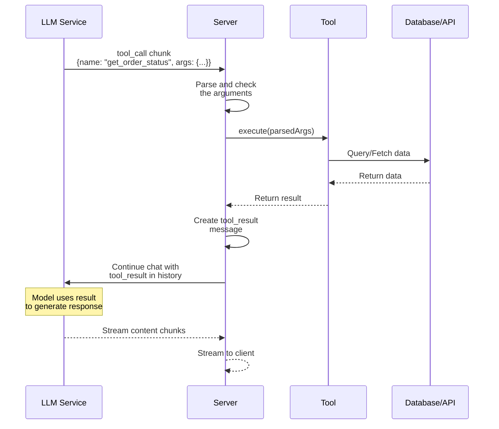

A server tool runs on your server. Use it for a database row, a secret, or an environment variable. That code never runs in the browser.

Write the function with `.server()`, and `chat()` runs it each time the model calls it.

## Add a server tool

### 1. Define the tool

This tool looks up an order. The `Map` stands in for your database:

```typescript
// tools.ts
import { toolDefinition } from "@tanstack/ai";
import { z } from "zod";

const orders = new Map([
  ["1001", { status: "shipped", eta: "2026-10-24" }],
  ["1002", { status: "processing", eta: "2026-10-28" }],
]);

export const getOrderStatus = toolDefinition({
  name: "get_order_status",
  description: "Get the shipping status of an order by its order number",
  inputSchema: z.object({
    orderId: z.string().meta({ description: "The order number, for example 1001" }),
  }),
  outputSchema: z.object({
    found: z.boolean(),
    status: z.string().optional(),
    eta: z.string().optional(),
  }),
}).server(async ({ orderId }) => {
  // This runs on your server. Query your database here.
  const order = orders.get(orderId);
  if (!order) {
    return { found: false };
  }
  return { found: true, ...order };
});
```

### 2. Pass the tool to `chat()`

```typescript
// api/chat.ts
import {
  chat,
  chatParamsFromRequest,
  toServerSentEventsResponse,
} from "@tanstack/ai";
import { openaiText } from "@tanstack/ai-openai";
import { getOrderStatus } from "./tools";

export async function POST(request: Request) {
  const { messages, threadId, runId } = await chatParamsFromRequest(request);

  const stream = chat({
    adapter: openaiText("gpt-6.1-sol"),
    messages,
    threadId,
    runId,
    tools: [getOrderStatus],
  });

  return toServerSentEventsResponse(stream);
}
```

### 3. Try it

Ask your chat "Where is order 1001?" The model calls `get_order_status` and answers that the order shipped and arrives on 2026-10-24.

You did not change the client. Server tools need no client code.

## How it works



1. The model sends a tool call. The arguments are a JSON string.
2. `chat()` parses the arguments and checks them against `inputSchema`.
3. `chat()` runs your `.server()` function with the parsed input.
4. If you set an `outputSchema`, `chat()` checks the result against it. Then it adds the result to the conversation.
5. The model reads the result and continues.

If the tool has `needsApproval: true`, the run pauses before step 3 until the user says yes. See [Tool Approval Flow](./tool-approval).

## Use the signed-in user

A tool often needs data from the request, such as the user ID or a database client. Pass it as `context` on `chat()`. The tool gets it as the second argument:

```typescript
import { chat, toolDefinition, toServerSentEventsResponse } from "@tanstack/ai";
import { openaiText } from "@tanstack/ai-openai";
import { z } from "zod";
import { getSession, getDb } from "./auth";

type AppContext = {
  userId: string;
  db: {
    users: {
      findUnique(args: { where: { id: string } }): Promise<{ name: string } | null>;
    };
  };
};

const getCurrentUser = toolDefinition({
  name: "get_current_user",
  description: "Get the current authenticated user",
  inputSchema: z.object({}),
  outputSchema: z.object({
    name: z.string().nullable(),
  }),
}).server<AppContext>(async (_input, ctx) => {
  const user = await ctx.context.db.users.findUnique({
    where: { id: ctx.context.userId },
  });

  return { name: user?.name ?? null };
});

export async function POST(request: Request) {
  const { messages, threadId } = await request.json();
  // `getSession` and `getDb` are your own app code, not part of TanStack AI.
  const session = await getSession(request);
  const db = getDb();

  const stream = chat({
    adapter: openaiText("gpt-6.1-sol"),
    messages,
    threadId,
    tools: [getCurrentUser],
    context: {
      userId: session.user.id,
      db,
    },
  });

  return toServerSentEventsResponse(stream);
}
```

- If a tool sets a context type, such as `.server<AppContext>()`, `chat()` requires a `context` that matches it.
- A tool with no context type gets `unknown` context.

For middleware and values that come from the client, see [Runtime Context](../advanced/runtime-context).

## Return an error the model can use

If a lookup fails, return the error as data. The model can then tell the user or try again:

```typescript
import { toolDefinition } from "@tanstack/ai";
import { z } from "zod";
import { db } from "./db";

const getUserData = toolDefinition({
  name: "get_user_data",
  description: "Get user information",
  inputSchema: z.object({
    userId: z.string(),
  }),
  outputSchema: z.object({
    name: z.string().optional(),
    email: z.string().optional(),
    error: z.string().optional(),
  }),
}).server(async ({ userId }) => {
  try {
    const user = await db.users.findUnique({ where: { id: userId } });
    if (!user) {
      return { error: "User not found" };
    }
    return { name: user.name, email: user.email };
  } catch {
    return { error: "Failed to fetch user data" };
  }
});
```

- **Return `{ error }`**: you write the message that the model sees. Put the `error` field in `outputSchema`, because `chat()` checks the result against it.
- **Throw**: `chat()` catches the error and sends a tool error to the model. You do not control the message.

## Advanced

For input checks and repair, JSON Schema tools, progress events, long-running hosts, and file layout, see [Server Tools: Advanced](./server-tools-advanced).
