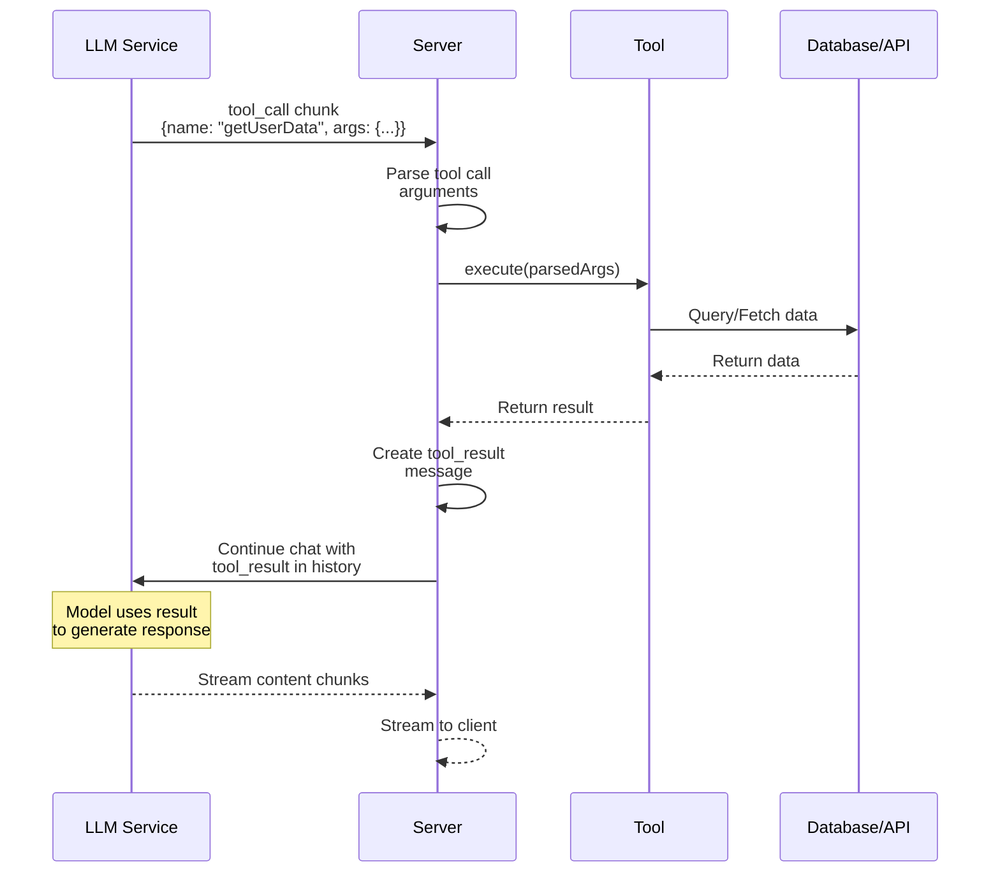

Server tools execute automatically when called by the LLM. They have full access to server resources like databases, APIs, and environment variables.



## How It Works

1. **Tool Call Received**: Server receives a `tool_call` chunk from the LLM
2. **Argument Parsing**: The tool arguments (JSON string) are parsed and validated against the input schema
3. **Execution**: The tool's `execute` function is called with the parsed arguments
4. **Result Processing**: The result is:
   - Validated against the output schema (if defined)
   - Converted to a tool result message
   - Added to the conversation history
5. **Continuation**: The chat continues with the tool result, allowing the LLM to generate a response based on the result
  
## Automatic Execution and Approval Pauses

**Automatic (Default):**
- Server tools with an `execute` function run automatically
- Results are added to the conversation immediately
- No client-side handling required

**Approval-gated:**
- Tools marked `needsApproval: true` still execute automatically — but only *after* the user approves
- The run pauses at the `approval-requested` state and resumes (executing the tool, or skipping it on denial) once the client sends an approval response
- See [Tool Approval Flow](./tool-approval) for the full pattern

## Server Tool Definition

```typescript
import { toolDefinition } from "@tanstack/ai";
import { z } from "zod";
import { db } from "./db";

const getUserDataDef = toolDefinition({
  name: "get_user_data",
  description: "Get user information from the database",
  inputSchema: z.object({
    userId: z.string().meta({ description: "The user ID to look up" }),
  }),
  outputSchema: z.object({
    name: z.string(),
    email: z.string().email(),
    createdAt: z.string(),
  }),
});

const getUserData = getUserDataDef.server(async ({ userId }) => {
  // This runs on the server - secure access to database
  const user = await db.users.findUnique({ where: { id: userId } });
  return {
    name: user.name,
    email: user.email,
    createdAt: user.createdAt.toISOString(),
  };
});
```

## Defining Server Tools

Server tools use the isomorphic `toolDefinition()` API with the `.server()` method:

```typescript
import { toolDefinition } from "@tanstack/ai";
import { z } from "zod";
import { db } from "./db";

// Step 1: Define the tool schema
const getUserDataDef = toolDefinition({
  name: "get_user_data",
  description: "Get user information from the database",
  inputSchema: z.object({
    userId: z.string().meta({ description: "The user ID to look up" }),
  }),
  outputSchema: z.object({
    name: z.string(),
    email: z.string().email(),
    createdAt: z.string(),
  }),
});

// Step 2: Create server implementation
const getUserData = getUserDataDef.server(async ({ userId }) => {
  // This runs on the server - can access database, APIs, etc.
  const user = await db.users.findUnique({ where: { id: userId } });
  return {
    name: user.name,
    email: user.email,
    createdAt: user.createdAt.toISOString(),
  };
});

// Example: API call tool
const searchProductsDef = toolDefinition({
  name: "search_products",
  description: "Search for products in the catalog",
  inputSchema: z.object({
    query: z.string().meta({ description: "Search query" }),
    limit: z.number().optional().meta({ description: "Maximum number of results" }),
  }),
});

const searchProducts = searchProductsDef.server(async ({ query, limit = 10 }) => {
  const response = await fetch(
    `https://api.example.com/products?q=${query}&limit=${limit}`,
    {
      headers: {
        Authorization: `Bearer ${process.env.API_KEY}`, // Server-only access
      },
    }
  );
  return await response.json();
});
```

## Using Server Tools

Pass tools to the `chat` function:

```typescript
import { chat, toServerSentEventsResponse } from "@tanstack/ai";
import { openaiText } from "@tanstack/ai-openai";
import { getUserData, searchProducts } from "./tools";

export async function POST(request: Request) {
  const { messages } = await request.json();

  const stream = chat({
    adapter: openaiText("gpt-5.5"),
    messages,
    tools: [getUserData, searchProducts],
  });

  return toServerSentEventsResponse(stream);
}
```

## Runtime Context

Server tools can receive typed runtime context as their second argument. Use this for request-scoped dependencies like authenticated users, database clients, tenant IDs, or audit loggers.

```typescript
import { chat, toolDefinition, toServerSentEventsResponse } from "@tanstack/ai";
import { openaiText } from "@tanstack/ai-openai";
import { z } from "zod";
import { getSession, getDb } from "./auth";

type AppContext = {
  userId: string;
  db: {
    users: {
      findUnique(args: { where: { id: string } }): Promise<{ name: string } | null>;
    };
  };
};

const getCurrentUser = toolDefinition({
  name: "get_current_user",
  description: "Get the current authenticated user",
  inputSchema: z.object({}),
  outputSchema: z.object({
    name: z.string().nullable(),
  }),
}).server<AppContext>(async (_input, ctx) => {
  const user = await ctx.context.db.users.findUnique({
    where: { id: ctx.context.userId },
  });

  return { name: user?.name ?? null };
});

export async function POST(request: Request) {
  const { messages } = await request.json();
  // `session` and `db` come from your own app setup (auth middleware,
  // a DB client, etc.) — they are not provided by TanStack AI.
  const session = await getSession(request);
  const db = getDb();

  const stream = chat({
    adapter: openaiText("gpt-5.5"),
    messages,
    tools: [getCurrentUser],
    context: {
      userId: session.user.id,
      db,
    },
  });

  return toServerSentEventsResponse(stream);
}
```

If a server tool declares a context generic, `chat()` requires a compatible `context` value. Untyped tools keep working and receive `unknown` context.

For middleware and client-to-server handoff patterns, see [Runtime Context](../advanced/runtime-context).

## Support a host that runs long sessions

Some hosts run `chat()` for a long session. Such a host can restart a run after a crash, or move a slow tool call to the background. Two fields let your tool work with that host. `chat()` alone does not use them.

- `replay` tells the host if it can run the tool again after a crash. `'safe'` means the host can run it again. Use it for a read or another call that you can repeat. When a second run is not safe, omit the field or set `'never'`. The host then writes a note for the model. `chat()` does not read `replay`.
- The host sets `detach` when it can move this call to the background. Pass the work to `detach`. Race that promise with the work. When the host moves the call, `detach` resolves to a short string. The work keeps running. When the work ends, the host tells the model the result. An object `outputSchema` rejects that string. `chat()` does not set `detach`.

```typescript
import { toolDefinition } from "@tanstack/ai";
import { z } from "zod";

declare function runBuild(target: string): Promise<string>;

const build = toolDefinition({
  name: "build",
  description: "Build a target",
  inputSchema: z.object({ target: z.string() }),
  replay: "safe",
}).server(async ({ target }, ctx) => {
  const work = runBuild(target);
  return ctx?.detach ? Promise.race([work, ctx.detach(work)]) : work;
});
```

## Tool Organization Pattern

For better organization, define tool schemas and implementations separately:

```typescript ignore
// tools/definitions.ts
import { toolDefinition } from "@tanstack/ai";
import { z } from "zod";

export const getUserDataDef = toolDefinition({
  name: "get_user_data",
  description: "Get user information",
  inputSchema: z.object({
    userId: z.string(),
  }),
  outputSchema: z.object({
    name: z.string(),
    email: z.string(),
  }),
});

export const searchProductsDef = toolDefinition({
  name: "search_products",
  description: "Search products",
  inputSchema: z.object({
    query: z.string(),
  }),
});

// tools/server.ts
import { getUserDataDef, searchProductsDef } from "./definitions";
import { db } from "@/lib/db";

export const getUserData = getUserDataDef.server(async ({ userId }) => {
  const user = await db.users.findUnique({ where: { id: userId } });
  return { name: user.name, email: user.email };
});

export const searchProducts = searchProductsDef.server(async ({ query }) => {
  const products = await db.products.search(query);
  return products;
});

// api/chat/route.ts
import { chat } from "@tanstack/ai";
import { openaiText } from "@tanstack/ai-openai";
import { getUserData, searchProducts } from "@/tools/server";

const stream = chat({
  adapter: openaiText("gpt-5.5"),
  messages,
  tools: [getUserData, searchProducts],
});
```

## Automatic Execution

Server tools are automatically executed when the model calls them. The SDK:

1. Receives the tool call from the model
2. Executes the tool's `execute` function
3. Adds the result to the conversation
4. Continues the chat with the tool result

You don't need to manually handle tool execution - it's automatic!

## Error Handling

Tools should handle errors gracefully:

```typescript
import { toolDefinition } from "@tanstack/ai";
import { z } from "zod";
import { db } from "./db";

const getUserDataDef = toolDefinition({
  name: "get_user_data",
  description: "Get user information",
  inputSchema: z.object({
    userId: z.string(),
  }),
  outputSchema: z.object({
    name: z.string().optional(),
    email: z.string().optional(),
    error: z.string().optional(),
  }),
});

const getUserData = getUserDataDef.server(async ({ userId }) => {
  try {
    const user = await db.users.findUnique({ where: { id: userId } });
    if (!user) {
      return { error: "User not found" };
    }
    return { name: user.name, email: user.email };
  } catch {
    return { error: "Failed to fetch user data" };
  }
});
```

**Throwing vs. returning an error:** if your `.server()` function throws, the SDK catches it and surfaces it as a tool-result *error* (the model sees the failure but you lose control over the message). Returning a structured `{ error }` shape keeps the model in control of how to recover and is usually preferable. Either way, when an `outputSchema` is defined the returned value is validated against it (Zod) before being added to the conversation — so include the `error` field in your `outputSchema` if you return it.

Malformed JSON arguments and input validation failures (Standard Schema or JSON Schema) are also surfaced as tool-result errors. The tool implementation is not called, and the agent loop can return the error to the model so it can repair the tool call. This also applies to Chat Completions tools with no required input fields.

The `inputSchema` checks the input just before the tool runs:

- The check runs after approval edits and after middleware `onBeforeToolCall`. An approval edit or a middleware change that does not fit the schema becomes a tool error. The resume goes on, the tool does not run, and the model gets the input error as the result of that call.
- An async validator is awaited.
- The tool gets the schema's output, so a transform such as `z.string().transform(Number)` applies once.

Models often send a value with the wrong type, such as `"5"` for a number. The check repairs these against the schema before it fails the call:

| The model sends | The schema wants | The tool gets |
| --- | --- | --- |
| `"5"` | `number` or `integer` | `5` |
| `"true"` | `boolean` | `true` |
| `5` | `string` | `"5"` |
| `null` for an optional field | a type with no `null` | no field |
| `null` for a required field | `string`, `number`, or `boolean` | `""`, `0`, or `false` |

- A JSON Schema tool, and an MCP tool, gets the repair when its input fails the check. A valid input runs as it is.
- A Standard Schema that can export JSON Schema (Zod, ArkType, Valibot) runs first as written. If it fails, the input is repaired and the schema runs again. If it still fails, the error shows the issues of the first run.
- An input that cannot be repaired, such as `"many"` for a number, becomes a tool error.

### Turn off or replace the repair

Sometimes the built-in repair is the wrong move. Maybe your tool moves money, and a `null` must never turn into `0`. Or maybe your model makes the same odd mistake every time, and you know the fix. Pass `repairToolInput` to `chat()` and take control.

Turn the repair off, so a bad input always goes back to the model as an error:

```typescript
import { chat, toServerSentEventsResponse } from "@tanstack/ai";
import { openaiText } from "@tanstack/ai-openai";
import { transferFunds } from "./tools";

export async function POST(request: Request) {
  const { messages } = await request.json();

  const stream = chat({
    adapter: openaiText("gpt-6.1-sol"),
    messages,
    tools: [transferFunds],
    repairToolInput: false,
  });

  return toServerSentEventsResponse(stream);
}
```

Or write your own fix. Say the model keeps sending `"limit": "all"` to `search_products`. Map it to a number:

```typescript
import { chat, toServerSentEventsResponse } from "@tanstack/ai";
import { openaiText } from "@tanstack/ai-openai";
import { searchProducts } from "./tools";

export async function POST(request: Request) {
  const { messages } = await request.json();

  const stream = chat({
    adapter: openaiText("gpt-6.1-sol"),
    messages,
    tools: [searchProducts],
    repairToolInput: ({ tool, input }) => {
      if (
        tool.name === "search_products" &&
        typeof input === "object" &&
        input !== null &&
        "limit" in input &&
        input.limit === "all"
      ) {
        return { ...input, limit: 100 };
      }
      return undefined;
    },
  });

  return toServerSentEventsResponse(stream);
}
```

How your function works:

- It runs only when an input fails the check. A valid input never gets to it.
- It replaces the built-in repair. A `"5"` stays a string unless your function changes it.
- It gets `tool`, `toolCall`, `input`, and `error` (the validation error).
- Return the new input, and the check runs again. If that check fails, the model gets the original error.
- Return `undefined` to send the original error to the model. If your function throws, the model gets the thrown message.

The option works the same for Standard Schema tools, JSON Schema tools, and MCP tools.

A client tool, or a tool that waits for approval, is checked twice: once before it goes out, and once when it comes back. So your function can run twice for one call.

## Using JSON Schema

If you have existing JSON Schema definitions or prefer not to use Zod, you can define tool schemas using raw JSON Schema objects:

```typescript
import { toolDefinition } from "@tanstack/ai";
import type { JSONSchema } from "@tanstack/ai";
import { db } from "./db";

const inputSchema: JSONSchema = {
  type: "object",
  properties: {
    userId: {
      type: "string",
      description: "The user ID to look up",
    },
  },
  required: ["userId"],
};

const outputSchema: JSONSchema = {
  type: "object",
  properties: {
    name: { type: "string" },
    email: { type: "string" },
  },
  required: ["name", "email"],
};

const getUserDataDef = toolDefinition({
  name: "get_user_data",
  description: "Get user information from the database",
  inputSchema,
  outputSchema,
});

// With a raw JSON Schema, args is typed as `unknown` — narrow it before use
const getUserData = getUserDataDef.server(async (args) => {
  if (typeof args !== "object" || args === null || !("userId" in args)) {
    throw new Error("Invalid input: expected a userId");
  }
  const user = await db.users.findUnique({ where: { id: String(args.userId) } });
  return { name: user.name, email: user.email };
});
```

The JSON Schema checks each call before the tool runs. MCP tools get the same check. If the input does not fit, the call gets a tool error, and the error names each failed field:

```text
Input validation failed for tool get_user_data: #: Instance does not have required property "userId".
```

- The check uses the draft that `$schema` names: draft-04, draft-07, 2019-09, or 2020-12. With no `$schema`, it uses 2020-12.
- Got an OpenAPI 3.0 schema? `nullable: true` works, so that field can be `null`. A boolean `exclusiveMinimum` or `exclusiveMaximum` works too.
- The check does not test `format` (such as `uri` or `email`). A `format` only describes the value.
- The check does not compile code, so it also runs on Cloudflare Workers.
- `args` is still typed as `unknown`. A Zod schema gives you the type too.

> **Tip:** When you pass `.client()` tools to `useChat`, a check on `part.name` narrows `part.input` and `part.output`. See [Type-safe tool call events](../chat/stream-events#type-safe-tool-call-events).

## Best Practices

1. **Keep tools focused** - Each tool should do one thing well
2. **Validate inputs** - The `inputSchema` checks every call. A Zod schema also gives you types
3. **Handle errors** - Return meaningful error messages
4. **Use descriptions** - Clear descriptions help the model use tools correctly
5. **Secure sensitive operations** - Never expose API keys or secrets to the client

## Next Steps

- [Client Tools](./client-tools) - Learn about client-side tool execution
- [Tool Approval Flow](./tool-approval) - Add approval workflows for sensitive operations
