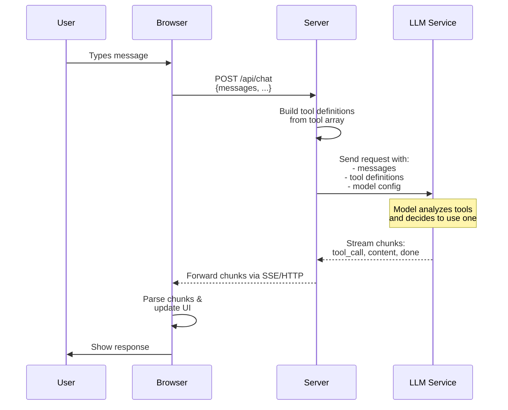
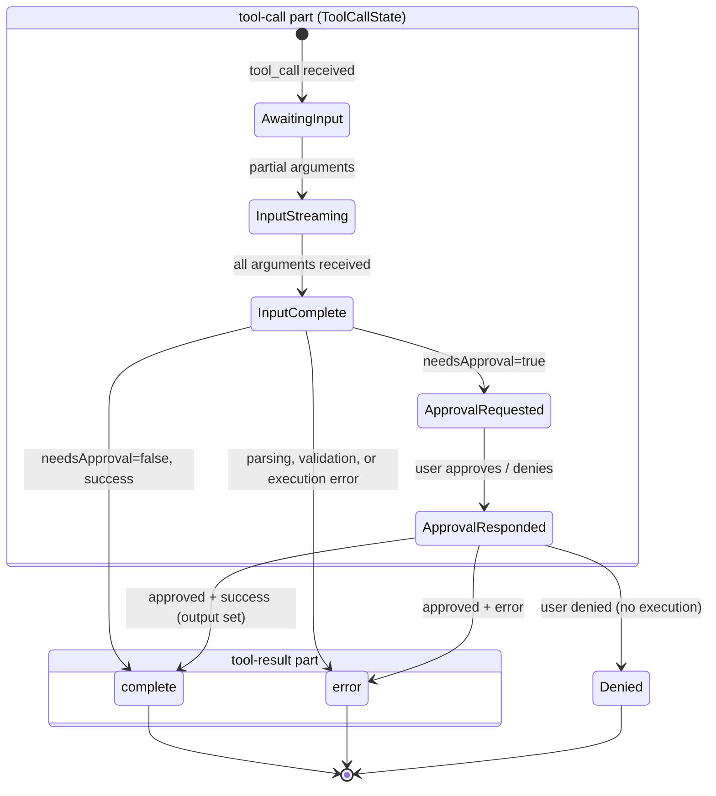
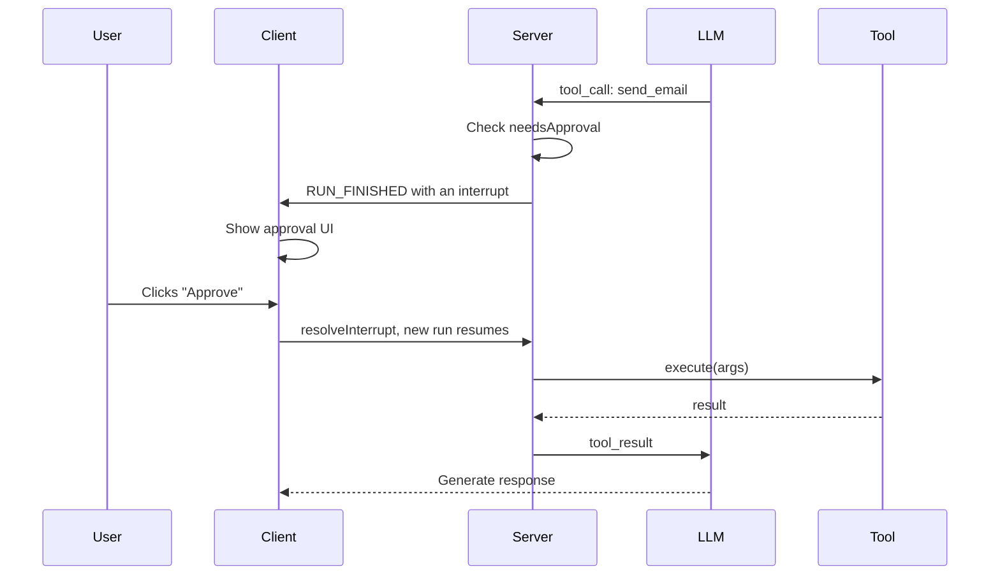
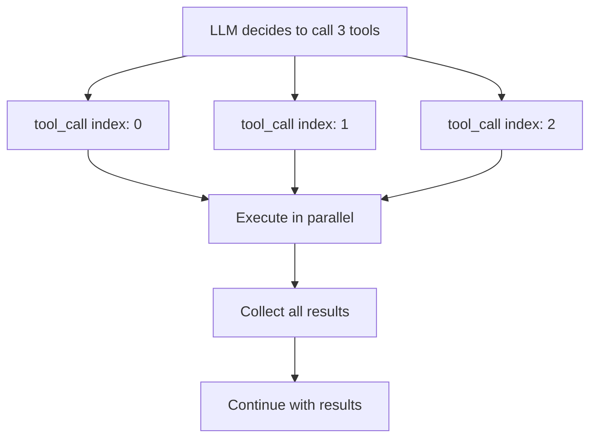

A tool call moves from the model, to your server or the browser, then back as a result. This page shows that path.

Each tool call is a `tool-call` part in the assistant message. It has a `state` that changes as the call moves forward. The result arrives as a sibling `tool-result` part.

## Show tool progress in your UI

Render the two part types next to your text parts:

```tsx
import type { MessagePart } from "@tanstack/ai-client";

export function ToolStatus({ part }: { part: MessagePart }) {
  if (part.type === "tool-call") {
    switch (part.state) {
      case "awaiting-input":
      case "input-streaming":
        return <p>Preparing {part.name}...</p>;
      case "approval-requested":
        return <p>{part.name} waits for your approval</p>;
      case "input-complete":
        return <p>Running {part.name}...</p>;
      default:
        // The tool-result part below shows the outcome.
        return null;
    }
  }

  if (part.type === "tool-result") {
    if (part.state === "error") {
      return <p>Tool failed: {part.error}</p>;
    }
    return <p>Tool done</p>;
  }

  return null;
}
```

Use it in your message list, for example `message.parts.map((part, index) => <ToolStatus key={index} part={part} />)`. While the model runs your tool, you now see "Running get_weather...", then "Tool done".

To get typed `part.name`, `part.input`, and `part.output`, pass your tools to the chat hook. See [Client Tools](./client-tools#show-the-tool-call-in-your-ui).

## How a tool call flows



1. The user types a message.
2. The browser sends a POST request to your route. It has the conversation history (`messages`) and optional extra data.
3. Your route calls `chat()`. `chat()` turns each tool into the format of the provider and sends the request to the model.
4. The model reads the conversation and the tools. It decides whether to call a tool, and with which arguments.
5. The model streams back chunks:
   - `tool_call` chunks with the tool name and arguments.
   - `content` chunks with text.
   - A `done` chunk at the end.
6. Where the tool runs depends on how you defined it:
   - A [server tool](./server-tools) runs inside `chat()`.
   - A [client tool](./client-tools) runs in the browser, and the result comes back in a new request.
   - A tool with `needsApproval: true` waits for the user first. See [Tool Approval Flow](./tool-approval).
7. `chat()` sends the result to the model, and the model continues. This loop is the [agentic cycle](../chat/agentic-cycle).
8. The browser updates the UI as each chunk arrives.

## Advanced

### Call states

The `state` of a `tool-call` part:

| State | Meaning | What to show |
|-------|---------|--------------|
| `awaiting-input` | The call started. No arguments yet. | A loading state |
| `input-streaming` | Partial arguments arrive. | Progress |
| `input-complete` | All arguments are in. | The tool is about to run |
| `approval-requested` | The call waits for the user. | The approval UI |
| `approval-responded` | The user approved or denied. | Running, or a denied note |
| `complete` | The result arrived. | The result |
| `error` | The call failed or was denied. | The error |

When the result arrives, the call part also gets `output`.

### Result states

The `state` of the sibling `tool-result` part:

| State | Meaning | What to show |
|-------|---------|--------------|
| `streaming` | Reserved for streamed results. Not used yet. | Progress |
| `complete` | The result is complete. | The result |
| `error` | An error occurred before or during the run. `part.error` has the message. | The error |

A denied or cancelled result is also `error`. Read `part.outcome` to tell it apart from a failure. See [Tool Approval Flow](./tool-approval#tell-a-denial-from-a-failure).

### The full lifecycle



### The approval flow



For the code, see [Tool Approval Flow](./tool-approval).

### Server and client tools in one task

The model can chain tools that run in different places. Here, a server tool reads preferences from the database, and a client tool applies them to the page:

```typescript
import { toolDefinition } from "@tanstack/ai";
import { z } from "zod";
import { db } from "./db";
import { i18n } from "./i18n";

// Server: read the preferences from the database
const fetchUserPrefsDef = toolDefinition({
  name: "fetch_user_preferences",
  description: "Get user preferences from server",
  inputSchema: z.object({
    userId: z.string(),
  }),
});

const fetchUserPreferences = fetchUserPrefsDef.server(async ({ userId }) => {
  const prefs = await db.userPreferences.findUnique({ where: { userId } });
  return prefs;
});

// Client: apply the preferences to the UI
const applyPrefsDef = toolDefinition({
  name: "apply_preferences",
  description: "Apply user preferences to the UI",
  inputSchema: z.object({
    theme: z.string(),
    language: z.string(),
  }),
});

const applyPreferences = applyPrefsDef.client(async ({ theme, language }) => {
  document.body.className = theme;
  i18n.changeLanguage(language);
  return { applied: true };
});

// The model can call fetch_user_preferences on the server,
// then apply_preferences in the browser with the result.
```

Pass `fetchUserPreferences` and `applyPrefsDef` to `chat()` on the server, and `applyPreferences` to the chat hook.

### Parallel tool calls

The model can call several tools in one turn:



For example, "Compare the weather in NYC, SF, and LA" can give three calls: `get_weather` for each city. All three run at the same time, then the model writes the comparison.

The server tools of one model turn start together. The model gets their results in the order of its calls. To run them one at a time, see [Run tools one at a time](./tools#run-tools-one-at-a-time).

### Design tips

Tool design:

- **One job per tool.** Small tools are easier for the model to pick.
- **Clear descriptions.** The model reads them to decide when to call the tool.
- **Schemas for input and output.** Zod schemas give you checks and types.
- **Errors as data.** Return a clear error message instead of throwing.
- **Safe repeats.** Make a tool safe to call more than once with the same input.

Security:

- **Sensitive work on the server.** Keys and private data stay in server tools.
- **Approval for destructive actions.** Use `needsApproval`.
- **Input checks.** Every call goes through `inputSchema`. Add your own business rules in the tool.
- **Rate limits.** Limit expensive tools.
- **Audit logs.** Log tool runs for debugging and security.

Performance:

- **Caching.** If the data allows it, cache tool results.
- **Parallel calls.** Let independent tools run together.
- **Progress events.** Stream progress for long tools. See [Server Tools: Advanced](./server-tools-advanced#stream-progress-while-a-tool-runs).
- **Timeouts.** Set timeouts on external API calls.
- **Lazy tools.** Make rarely used tools lazy. The model then gets them only on request. See [Lazy Tool Discovery](./lazy-tool-discovery).

The streaming protocol under all of this is AG-UI. See the [AG-UI docs](https://docs.ag-ui.com/introduction).
