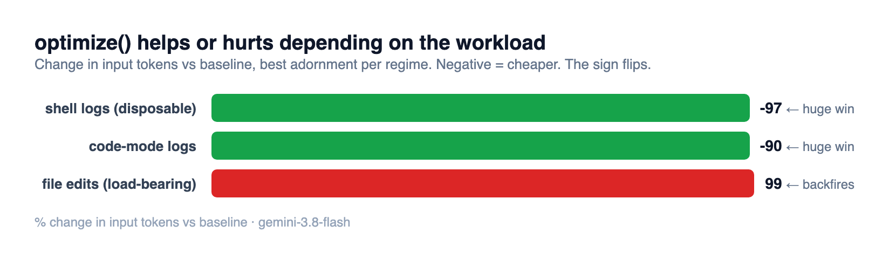
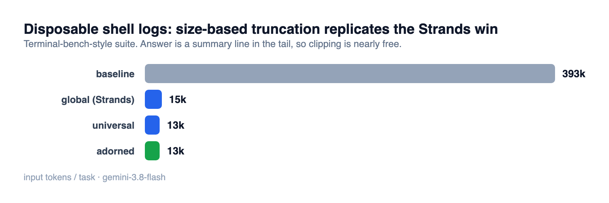
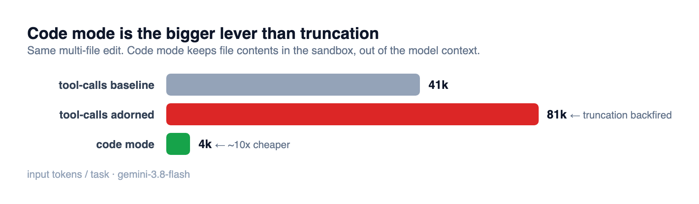

# Context-optimization eval results

Models: `gemini-3.8-flash` (sections 1-3) and `claude-sonnet-4-6` (section 4,
with wall-clock). Dates: 2026-11-12 / 2026-11-13. Raw per-trial JSONL in this
folder (`*.jsonl`; Sonnet runs are `sonnet-*.jsonl`). Token counts are estimates
(`~`); dollars derive from the rate card in `report.mjs`, labelled `(est)`.
Each trial also records `timing` (`duration_ms`, `first_token_ms`,
`ms_per_step`). Reported per model x arm, never pooled.

Rebuild: `node report.mjs results/*.jsonl` · Charts: `node chart.mjs`

**How to read the arms.** `baseline` runs with no optimization, it is the
reference for correct behavior. An optimize arm is only acceptable if it **holds
baseline's solved rate** (behavior) **and cuts cost** (tokens). That is the whole
method: prove the behavior unoptimized, lock it with evals, then add optimization
and keep it only where it pays without regressing. `terminal-bench/adorned` passes
(9/9, −96%); every `multi-write` tool-call arm fails the second half (solved, but
cost went up), so it gets rejected.

## The one-sentence finding

Deterministic tool-result truncation is not a free win or a free loss, **its
sign depends entirely on the workload** — a ~96% token cut when tool outputs are
disposable, a ~99% token _increase_ when they are load-bearing.

## 1. Disposable shell logs — replicating the Strands regime

Terminal-bench-style suite: the agent runs noisy build scripts whose stdout is
large but disposable, and the answer (`WARNINGS=<n>`) is a summary line at the
tail. This is the regime Strands' 77%/28% headline comes from.

| arm                      | mode           | $/task (est) | avg input | steps | retrievals |  solved |
| ------------------------ | -------------- | -----------: | --------: | ----: | ---------: | ------: |
| baseline                 | none           |      $0.3347 |  ~393,000 |   4.0 |          0 | **8/9** |
| global (Strands replica) | flatten        |      $0.0138 |   ~15,000 |   4.3 |          0 |     9/9 |
| universal                | leaves         |      $0.0124 |   ~13,200 |   4.0 |          0 |     9/9 |
| adorned                  | leaves + rules |      $0.0123 |   ~13,200 |   4.0 |          0 |     9/9 |

- **adorned cut input 96.6% and cost ~27x** vs baseline (~393K → ~13K). This
  reproduces, and on pure tokens exceeds, Strands' published 77%.
- **0 retrievals** — the clipped logs were never needed; the answer was in the tail.
- **baseline solved only 8/9**: the ~393K raw-log context tripped the agent once.
  Truncation here bought _reliability_, not just tokens.
- `global` / `universal` / `adorned` are within noise of each other, because when
  the whole field is disposable, blind and precise truncation do the same thing.

## 2. Code-mode debug logs

Code mode keeps file contents in the sandbox, so the model context is already
tiny. This suite adds a logging instruction (agents `console.log` to debug) to
isolate what optimize() adds on top of code mode: clipping those log dumps.

| arm         | $/task (est) | avg input | steps | retrievals | solved |
| ----------- | -----------: | --------: | ----: | ---------: | -----: |
| cm-baseline |      $0.0383 |   ~46,000 |   2.0 |          0 |    9/9 |
| cm-adorned  |      $0.0074 |    ~4,800 |   2.0 |          0 |    9/9 |
| cm-global   |      $0.0073 |    ~4,800 |   2.0 |          0 |    9/9 |

- **cm-adorned cut input 9.5x and cost 5.2x** (46K → 4.8K), 9/9 solved, 0 retrievals.
- Steps are constant at 2.0 — code mode has no step-count variance, so the
  measurement is clean.

## 3. Load-bearing file edits — where truncation backfires

Multi-write suite: read + edit + write several files in one tool-call session.
The file contents are load-bearing (the agent must see whole files to count
replacements), so truncating them forces the agent to work around the loss.

| arm         | mode       | $/task (est) | avg input | steps | retrievals | solved |
| ----------- | ---------- | -----------: | --------: | ----: | ---------: | -----: |
| cm-baseline | code-mode  |      $0.0077 |    ~3,800 |   2.2 |          0 |    6/6 |
| cm-adorned  | code-mode  |      $0.0084 |    ~4,700 |   2.5 |          0 |    6/6 |
| baseline    | tool-calls |      $0.0622 |   ~40,500 |   5.0 |          0 |    6/6 |
| universal   | tool-calls |      $0.0784 |   ~61,700 |   7.0 |         12 |    6/6 |
| global      | tool-calls |      $0.0915 |   ~69,000 |   7.2 |         12 |    6/6 |
| adorned     | tool-calls |      $0.0966 |   ~80,700 |   8.8 |          0 |    6/6 |

- **Every tool-call optimize arm cost MORE than baseline.** `universal`/`global`
  truncated the load-bearing reads, so the agent called `retrieve_context` to pull
  them back (12 retrievals) and spent extra steps. `adorned` dropped completed
  `write_file` contents mid-session; the agent re-verified work it could no longer
  see (8.8 steps vs 5.0). Cumulative input went UP in all three.
- **Code mode is the bigger lever**: ~8x cheaper than tool-call baseline
  ($0.0077 vs $0.0622), because file contents never enter the model context.
  optimize() adds nothing here (nothing large is disposable).

## 4. Second model: Sonnet (`claude-sonnet-4-6`), with wall-clock

Re-run on Sonnet to check the findings hold on a frontier model and to measure
latency. Runs were sequential (one matrix at a time) to avoid rate-limit
backoff. No prompt caching was active in this adapter path (`cache_read: 0`), so
dollars are clean input-token figures. All cells solved 100%.

**Multi-write (load-bearing edits, shell disabled), 2 tasks x 2 trials:**

| arm         | mode       |  input | output | $/task | wall-clock | steps | retrievals |
| ----------- | ---------- | -----: | -----: | -----: | ---------: | ----: | ---------: |
| baseline    | tool-calls | ~23.8K |  ~6.9K | $0.174 |      72.7s |   3.0 |          0 |
| adorned     | tool-calls | ~70.3K | ~13.1K | $0.407 |     140.3s |   5.8 |        3.3 |
| cm-baseline | code-mode  |  ~8.1K |  ~0.6K | $0.034 |   **9.9s** |   2.8 |          0 |
| cm-adorned  | code-mode  | ~23.8K |  ~2.3K | $0.106 |      29.0s |   4.5 |        0.3 |

- **Code mode is ~7x faster (9.9s vs 72.7s), ~5x cheaper, 3x less input.** The
  speed win is bigger than token count alone implies because tool-call mode makes
  the model regenerate the whole file as `write_file` **output** (~6.9K output
  tokens, slow to generate); code mode writes in the sandbox and emits a ~0.6K
  program.
- **optimize backfires harder on Sonnet** for load-bearing edits: `adorned`
  costs 2.3x baseline at 2x the wall-clock, with ~3.3 retrievals/task. Sonnet
  actually calls `retrieve_context`, so it loops pulling clipped reads back
  (Gemini mostly did not, so it was less bad there).

**Disposable-read (read a ~30K-token log via read_file, answer in the tail,
shell disabled), 2 tasks x 2 trials:**

| arm         |  input | $/task | wall-clock | steps | retrievals |
| ----------- | -----: | -----: | ---------: | ----: | ---------: |
| baseline    | ~54.6K | $0.165 |       3.4s |   2.0 |          0 |
| universal   |  ~3.4K | $0.012 |       3.9s |   2.0 |          0 |
| global      |  ~2.7K | $0.010 |       3.5s |   2.0 |          0 |
| cm-baseline |  ~3.1K | $0.013 |       4.1s |   2.0 |          0 |

- **Truncating the disposable read cuts input ~94% and cost ~14x, 4/4 solved, 0
  retrievals** — the tail-preserving preview keeps the summary line. This is the
  optimize-wins case, forced through `read_file`.
- **Wall-clock is flat (~3.5s all arms).** The task is 2 steps, so the 54K
  context never rides across many turns; the compression saves tokens and dollars
  but not time. The speed win appears only when big context is carried turn after
  turn (the multi-write baseline's 72s), not on a read-once task.

**Why not terminal-bench on Sonnet?** The shell-based terminal-bench suite is
_invalid_ on a capable model: Sonnet pipes its own shell output (`| tail`,
`| grep`), so the big logs never enter context (baseline ~5.9K input, `proj=0`).
When it did run full commands, truncation fired but still left more context than
its own piping. The lesson is its own finding: the smarter the model, the less a
blind-truncation scenario even arises — capable agents minimize their own
context, so a naive truncation layer has less to do and can add overhead. That
is the disposable-read suite's reason for existing (shell disabled).

**Cross-model.** Code mode wins on both models and by _more_ on Sonnet (~7x vs
~5x wall-clock). optimize's sign still flips with the workload on both. Sonnet's
time-to-first-token is much lower (~0.7-1.2s vs Gemini's ~3.6s).

## On the Strands 77% claim

The claim is from the Strands harness blog (Terminal-Bench 2.1, Fable 5, vs
Claude Code). It is real in its regime, and we reproduce it. But the headline is
cherry-picked in three nameable ways:

1. **Single-benchmark.** 77% is their best benchmark; their own average is **28%
   across six**.
2. **Cost, not tokens.** It bundles prompt caching with truncation.
3. **Cross-product baseline.** It is 77% less than _Claude Code_, not than Strands
   with truncation off, so it never isolates the feature's contribution.

Our params match their auto preset exactly (1500-token threshold, 750-token
preview, 60/40 head/tail, 85% summarization). Two differences in our favor:

- **Strands truncates tool RESULTS only.** Its `OffloadTarget` enum has no entry
  for tool arguments. Our argument dropping (`drop_with_ref` on completed-call
  args) is a capability its context manager does not have.
- A single headline percentage cannot describe an effect that ranges from −96% to
  +99%. The honest artifact is the recommendation below, not a hero number.

## Recommendations: what to adorn, and what not to

| Field / tool                                              | Nature                      | Adornment                                     | Expected effect | Risk                            |
| --------------------------------------------------------- | --------------------------- | --------------------------------------------- | --------------- | ------------------------------- |
| shell `stdout` (build/test logs)                          | disposable, answer in tail  | `result` head_tail (keep tail)                | huge token cut  | low                             |
| code-mode `logs`                                          | disposable debug dumps      | `result` head_tail                            | huge token cut  | low                             |
| `write_file.content`, **terminal** write                  | redundant on disk           | `args` drop_with_ref                          | saves           | low                             |
| `register_snippet.code`                                   | lives in snippet store      | `args` drop_with_ref                          | saves           | low                             |
| web page / `fetch` body read once                         | usually disposable          | `result` head_tail                            | big cut         | medium (needle may be mid-page) |
| `write_file.content`, **mid-session** (more edits follow) | agent re-checks it          | **leave whole** (or drop only the last write) | —               | **high — backfires**            |
| `read_file.content` while editing                         | load-bearing                | **keep whole** (pin high `aboveTokens`)       | —               | truncating → retrievals         |
| MCP id / status / short fields                            | load-bearing, already small | leaves mode passes them through               | —               | low                             |

Rules of thumb:

- **Truncate logs, keep data.** If the field is something the agent reads once and
  the answer sits in the head or tail, clip it. If later steps compute over the
  whole field, keep it.
- **Drop arguments only when terminal.** A completed write is safe to drop only if
  nothing downstream revisits it.
- **Reach for code mode first** on file-heavy work; then clip the logs it prints.
- **Watch `retrievals`.** If a field is retrieved on most turns, you truncated the
  wrong thing — that is the tuning signal, via `onEvent` or the `tanstack.optimize`
  record.
